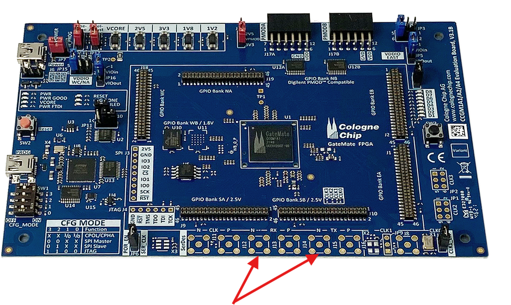

# SerDes Loopback tests

Mujo Sejdic and @KemalLikic workspace. [`PRBS-Loopback-Test-for-GateMate-EVK`](PRBS-Loopback-Test-for-GateMate-EVK) is a PRBS-7 loopback test of the GateMate SerDes on the evaluation board; [`build.sh`](build.sh) builds its bitstream.

  

    
**Status:** tested on EVK board, using 10cm SMA RF loopback cable. It runs fine.

**SerDes and PLL bring-up: an FSM, not defaults.** `CC_SERDES` gets only `SERDES_ENABLE = 1` and `SERDES_AUTO_INIT = 0`. After SW3, an FSM on the 10 MHz clock makes three regfile writes, 32 cycles apart (DS1001 register map):

| Register | Value | What it sets |
|---|---|---|
| `0x51` | `0x16FA` | PLL dividers (table below). Only `PLL_OUT_DIVSEL` differs from the defaults: 1 instead of 0 |
| `0x5C` | `0x0001` | SerDes Enable; the parameter sets it too |
| `0x50` | `0x0C03` | `PLL_EN_ADPLL_CTRL` = 1, `PLL_CONFIG_SEL` = 1, `PLL_REF_SEL` = 1 (LVDS reference), `PLL_REF_RTERM` = 1. Also clears `PLL_LOCK_WINDOW` and `PLL_FAST_LOCK` (defaults 1) |

**PLL settings** (DS1001 eq. 2.1–2.3, Tables 2.15 and 2.17), from the EVB's 100 MHz SerDes reference:

| | Loopback test `serdes_top.sv` |
|---|---|
| How it is set | register write `0x51` = `0x16FA` |
| `PLL_MAIN_DIVSEL` | 27 → N1 = 1, N2 = 5, N3 = 5 |
| `PLL_OUT_DIVSEL` | 1 → M3 = 2 |
| f_BRC → line rate | 100 · 25 / 2 = 1.25 GHz → **2.5 Gb/s** |
| `PLL_FCNTRL` | `0x3A` = 58 → M1 = 20 |
| M4 (`TX_DATAPATH_SEL[1]`) | 2 (64-bit) |
| `PLL_CLK_O` | 1250 / 40 = **31.25 MHz** |
| Fabric clock | 31.25 MHz directly |

**Analog settings** (DS1001 Tables 2.36, 2.41, 2.43, eq. 2.9–2.13). The test sets none of them, so all are `CC_SERDES` defaults.

Transmitter: the driver is 63 parallel branches. Each branch is a main, pre-cursor or post-cursor tap. Moving branches from main to pre/post gives pre-emphasis or de-emphasis (FFE).

| Parameter | Value | What it does |
|---|---|---|
| `TX_AMP` | 15 | Drive current per branch: I_TX = (TAIL_CASCODE + 10) · (AMP + 1) · 9.375 µA. Sets the swing |
| `TX_TAIL_CASCODE` | 4 | Bias for the branch current. DS1001: keep default |
| `TX_BRANCH_EN_MAIN` | 63 | Active main branches: all of them |
| `TX_BRANCH_EN_PRE` / `_POST` | 0 / 0 | Branches available for the pre-/post-cursor taps |
| `TX_SEL_PRE` | 0 | Branches used as pre-cursor: **no pre-emphasis** |
| `TX_SEL_POST` | 0 | Branches used as post-cursor: **no de-emphasis** |
| `TX_DC_ENABLE` | 63 | Branches used for common-mode adjustment |
| `TX_DC_OFFSET` | 0 | Extra common-mode shift. DS1001 says set to 8 |
| `TX_CM_RAISE` | 0 | Common-mode contribution of the termination |
| `TX_CM_THRESHOLD_0` / `_1` | 14 / 16 | Common-mode regulation window: VDD · (14 + TH) / 60 |

Receiver:

| Parameter | Value | What it does |
|---|---|---|
| `RX_AFE_GAIN` | 8 | Front-end gain (0 = min, 15 = max) |
| `RX_AFE_PEAK` | 16 | Front-end peaking (CTLE), high-frequency boost (0 = max, 31 = min) |
| `RX_AFE_VCMSEL` | 4 | Common mode inside the front-end |
| `RX_RTERM_VCMSEL` | 4 | Line common mode through the termination: 0.80 V at VDD_SER = 1.05 V (Table 2.42) |
| `RX_RTERM_PD` | 0 | 1 ties the termination to ground |
| `RX_EN_EQA` | 0 | DFE adaptation **off** |
| `RX_TAPW` | 8 | DFE tap weight, when not adapted |
| `RX_AFE_OFFSET` | 8 | Front-end offset, when not adapted |
| `RX_EI_BIAS` / `RX_EI_BW_SEL` | 4 / 4 | Electrical-idle detector bias and bandwidth |

PCIe asks for Tx de-emphasis (spec 4.3.3); this test runs without it. For comparison, see the [ULX5M-M2 Ver1 settings](https://github.com/chili-chips-ba/openCologne-PCIE/tree/main/1.pcb#ver1) used for SerDes PRBS speed tests.

---
### References:
- [CC SerDes LB](https://github.com/pu-cc/gm_serdes_lb) -- Includes **serdestool.py** tool for register map helpers
- [Intergalaktik 2-chip SerDes test](https://github.com/chili-chips-ba/openCologne-PCIE/tree/main/1.pcb#ver1)
- [openCologne ICLINK SerDes](https://github.com/chili-chips-ba/openCologne/tree/main/7.SerDes)
  
--------------------
#### End of Document
