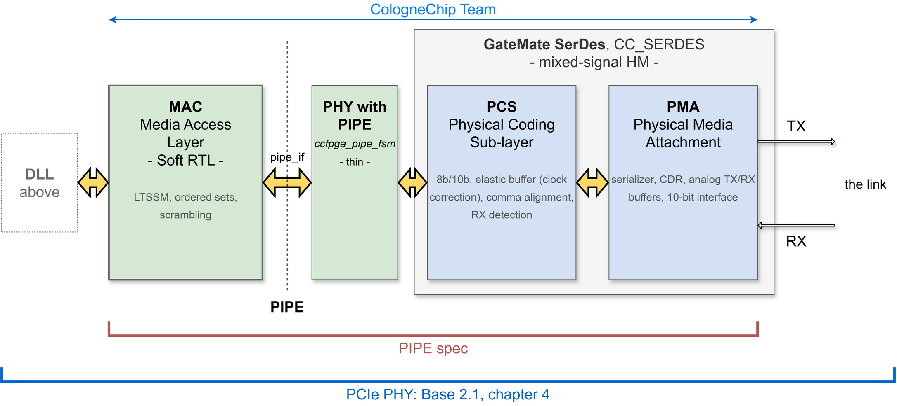

# PIPE PHY

Work area for the Cologne Chip PHY PIPE developers.

#### References:
- [GateMate PIPE repo](https://github.com/colognechip/gatemate-pipe) with DLL testbench
- [GateMate datasheet](https://colognechip.com/docs/ds1001-gatemate1-datasheet-latest.pdf)
- [CologneChip PHY/PIPE Overview](0.doc/PIPE_overview.pdf)
- [Unified PIPE Spec, Sept.2025, v7.1](0.doc/Intel.643108_PIPE_Arch_Spec_Rev_7_1.pdf)
- [Optimizing PCIE PIPE Power Management](https://www.synopsys.com/blogs/chip-design/optimizing-pcie-pipe-power-management.html)
- [TUSB1310A USB SuperSpeed PHY with PIPE](https://www.ti.com/product/TUSB1310A)
- [Mithro on SerDes](https://docs.google.com/presentation/d/e/2PACX-1vSgIGVCZtNt8RdifZXOLOJDDCj7g05zxr9WS2NjmQtM_E0GfZKCBYhASCto4eURL-86uNwJaXfo1qMC/pub?start=false&loop=false&delayms=3000#slide=id.g151286a907e_0_230)
- [Yumewatari (whitequark) PHY segments with rudimentary LTSSM](https://github.com/whitequark/Yumewatari/tree/master/yumewatari/gateware)

  

  

## Implementation Details
See [block diagram](0.doc/Physical_layer_block_diagram.pdf).

### SerDes

  

  

**Hai:**
> _"... our PIPE interface does not contain any functionality of the so called "MAC layer" which handles the training sequences, OSs and LTSSM..."_

**Simon:**
> For first functionality, the LTSSM just needs the linear power-up sequence from Detect.Quiet to L0 (Link UP), as per the table on page 14 of the PCIe Primer. Not part of pcievhost proper, but the model comes with demonstration code implementing the LTSSM to this spec, so we can test this first implementation.

**Async RefClock?**
> Does GateMate PHY support `Async RefClock`? That is, a 100MHz reference clock from a different oscillator than the Root Complex's: both nominally 100MHz, but still different.

#### DLL TestBench

Hai: Simon provided the x1 PIPE model. I modified the C++ model of the RC for different feature tests and set up my MAC layer design as the EP:
https://github.com/colognechip/gatemate-pipe/tree/dll_test/sim

--------------------
## Open-source SerDes simulation model

`2.serdes-model/` holds a copy of the open-source **SerDes BFM**, a behavioural model of the GateMate SerDes at the level of Cologne Chip's sim model `ccfpga_serdes`, not the `CC_SERDES` primitive. Its sibling `ccfpga_serdes.SYNTH.sv` puts `CC_SERDES` behind the same ports for the chip: `phy_top` has one SerDes instance, the file list picks the file. So the PIPE, MAC and DLL simulate with open tools. Master copy, documentation, tests and 8b/10b proofs: [openCologne `7.SerDes/1.sim-model`](https://github.com/chili-chips-ba/openCologne/blob/main/7.SerDes/1.sim-model/README.md).

| flow | result |
|---|---|
| PIPE test, 64-bit (`3.sim/run-phy.sh pipe64`) | PASSED |
| DLL, MAC, PIPE and SerDes, two link partners (`4.dll/sim/run-dll-phy.sh`) | PASSED; with `--inject=stp` or `end` FAILED: [#24](https://github.com/chili-chips-ba/openCologne-PCIE/issues/24) |

PHY flows: [3.sim/README.md](3.sim/README.md). DLL over this PHY: [4.dll/sim/README.md](../4.dll/sim/README.md); its test-bench PHY (SerDes model + PIPE + bring-up FSM) is [`phy_model.sv`](../4.dll/sim/phy_model.sv).

--------------------
#### End of Document
