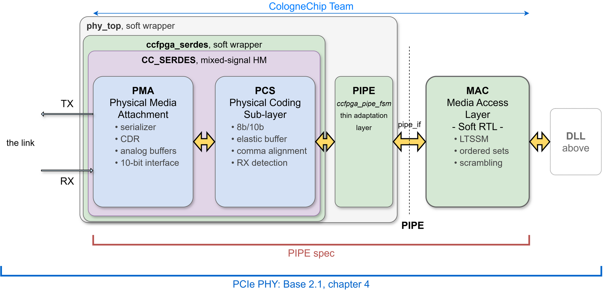
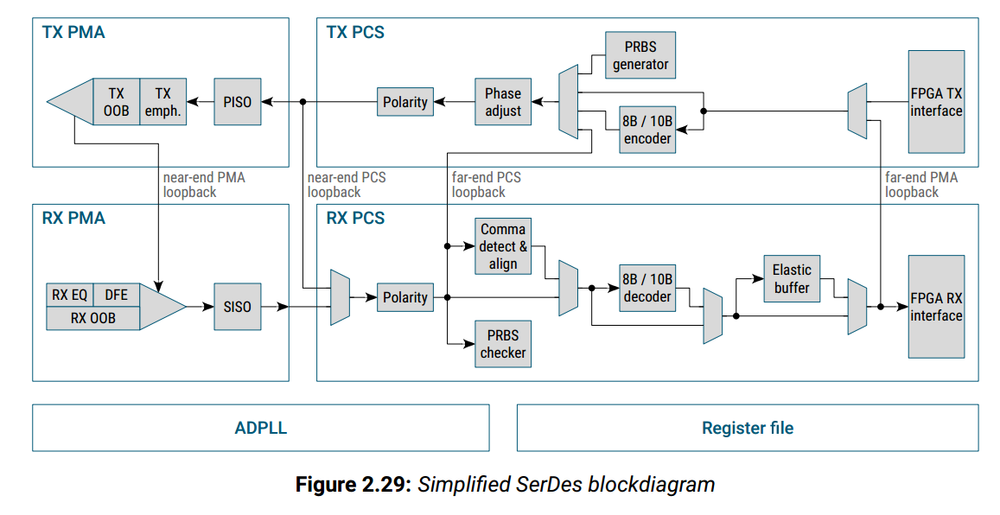

# PHY

Everything below the PIPE interface: [`phy_top.sv`](phy_top.sv), Cologne Chip's soft PIPE adaptation layer ([2.pipe](../2.pipe/README.md)) over one GateMate SerDes.

| Here | What |
|---|---|
| [`phy_top.sv`](phy_top.sv) | the PHY: `ccfpga_pipe_top` + one `ccfpga_serdes` |
| [`1.serdes-test.STANDALONE`](1.serdes-test.STANDALONE/README.md) | SerDes PRBS loopback on the GateMate EVB, tested on the board |
| [`2.serdes-model`](2.serdes-model) | the SerDes BFM (simulation) and `ccfpga_serdes.SYNTH.sv` (chip) |
| [`3.sim`](3.sim/README.md) | PHY tests |

#### References:
- gatemate-pipe: [Cologne Chip's](https://github.com/colognechip/gatemate-pipe) (`dll_test`), and [our fork](https://github.com/chili-chips-ba/gatemate-pipe/tree/ocp-integration) (`ocp-integration`), which carries our changes to it
- [GateMate datasheet, DS1001](https://colognechip.com/docs/ds1001-gatemate1-datasheet-latest.pdf) (copy: [September 2026](../../0.doc/2.rtl/ds1001-GateMate-datasheet.Sep2026.pdf))
- Cologne Chip: [PHY/PIPE overview](0.doc/PIPE_overview.pdf), [PHY block diagram](0.doc/Physical_layer_block_diagram.pdf), [MAC overview](0.doc/MAC_Overview.pdf)
- [Unified PIPE Spec, Sept.2025, v7.1](0.doc/Intel.643108_PIPE_Arch_Spec_Rev_7_1.pdf)
- [Optimizing PCIE PIPE Power Management](https://www.synopsys.com/blogs/chip-design/optimizing-pcie-pipe-power-management.html)
- [TUSB1310A USB SuperSpeed PHY with PIPE](https://www.ti.com/product/TUSB1310A)
- [Mithro on SerDes](https://docs.google.com/presentation/d/e/2PACX-1vSgIGVCZtNt8RdifZXOLOJDDCj7g05zxr9WS2NjmQtM_E0GfZKCBYhASCto4eURL-86uNwJaXfo1qMC/pub?start=false&loop=false&delayms=3000#slide=id.g151286a907e_0_230)
- [Yumewatari (whitequark) PHY segments with rudimentary LTSSM](https://github.com/whitequark/Yumewatari/tree/master/yumewatari/gateware)

  

  

## phy_top

- **PCLK** is the SerDes PLL clock, `PLL_CLK_O`: 31.25 MHz at 2.5 Gb/s with the 64-bit PIPE ([gatemate-pipe#19](https://github.com/colognechip/gatemate-pipe/pull/19)). It is also the SerDes TX and RX core clock.
- **Set up by parameters**, as on the chip; no register-file writes (`clk_reg_i` tied to 0): the SerDes and PLL on from reset (`SERDES_ENABLE`, `PLL_EN_ADPLL_CTRL`, `PLL_CONFIG_SEL`), the PLL for 2.5 Gb/s (`PLL_FCNTRL` 0x3A), a 64-bit datapath, the comma aligned on a 32-bit word, the RX electrical-idle detector on (`RX_EI_BIAS` 4).
- **`ccfpga_pipe_top`** runs the SerDes resets and comma alignment, receiver detection, the power states (P1 in Detect, P0 otherwise), PhyStatus and RxStatus ([2.pipe](../2.pipe/README.md)).
- **`phy_rdy`** is the SerDes `TX_RESET_DONE_O`.

  

### Where it departs from PCIe 2.1

| What | Spec | Note |
|---|---|---|
| No TX de-emphasis: full swing | 4.3.3 (-3.5 dB at 2.5 GT/s) | TODO in `phy_top`: `TX_SEL_POST`, `TX_BRANCH_EN_POST`; validate on the board |
| No clock tolerance compensation: `phy_top` leaves `RX_CLKCOR_USE` at 0 (as Cologne Chip's wrapper), so the RX buffer adds or removes no SKP | 4.2.7 | fine with a common REFCLK, which most PCIe systems use: the slot's 100 MHz goes to both ends. Only two separate oscillators (up to 600 ppm apart) would over- or underflow the RX buffer |
| RxStatus only 000, 011 (receiver detected), 100 (decode error), 111 (disparity error); no SKP added/removed, no buffer error | PIPE | the RX buffer error is not connected |
| Power states P0 and P1 only | 4.2.6 | no L0s, L1, L2 |
| 2.5 GT/s, x1 | 4.2.6.4.2 | no speed change |
| Reference clock input (`PLL_REF_SEL`) | | to validate when the board schematics are out |

--------------------
## Lane polarity: the P and N swaps

A lane is a differential pair, P and N. Keeping P on P from pin to pin often means crossing the pair on the board: two vias and their stubs on a 2.5 or 5 Gb/s line. On the openPCIE backplane we did not take the chance and routed every P to P, at the cost of crossings like 1 to 5 below ([openPCIE 1.pcb](https://github.com/chili-chips/openPCIE/tree/main/1.pcb#the-p-and-n-swaps)).

  

The GateMate SerDes makes these crossings unnecessary:

- **RX:** every PCIe receiver must take a swapped pair (Base 2.1, 4.2.4.4). Our MAC finds inverted TS1/TS2 in Polling and drives PIPE `RxPolarity`; `phy_top` passes it to `rx_polarity_i`, and the SerDes inverts the incoming bits (DS1001 Table 2.49). No fabric logic, no board change.
- **TX:** PCIe never inverts on transmit, but a pair swapped on the board can be undone with `tx_polarity_i` (DS1001 Table 2.35), one static setting per board. `ccfpga_pipe_top.sv` ties it to 0 today.

So a GateMate board can route each pair the short way: no crossing vias, no stubs.

--------------------
## Open-source SerDes simulation model

`2.serdes-model/` holds a copy of the open-source **SerDes BFM**, a behavioural model of the GateMate SerDes at the level of Cologne Chip's sim model `ccfpga_serdes`, not the `CC_SERDES` primitive. Its sibling `ccfpga_serdes.SYNTH.sv` puts `CC_SERDES` behind the same ports for the chip: `phy_top` has one SerDes instance, the file list picks the file. So the PIPE, MAC and DLL simulate with open tools. Master copy, documentation, tests and 8b/10b proofs: [openCologne `7.SerDes/1.sim-model`](https://github.com/chili-chips/openCologne/blob/main/7.SerDes/1.sim-model/README.md).

| flow | result |
|---|---|
| PIPE test, 64-bit (`3.sim/run-phy.sh pipe64`) | PASSED |
| DLL, MAC, PIPE and SerDes, two link partners (`4.dll/sim/run-dll-phy.sh`) | PASSED; with `--inject=stp` or `end` FAILED: [#24](https://github.com/chili-chips-ba/openCologne-PCIE/issues/24) |

PHY flows: [3.sim/README.md](3.sim/README.md). DLL over this PHY: [4.dll/sim/README.md](../4.dll/sim/README.md); its test-bench PHY (SerDes model + PIPE + bring-up FSM) is [`phy_model.sv`](../4.dll/sim/phy_model.sv).

--------------------
## ccfpga_serdes I/O

The GateMate SerDes by function. DS1001, the GateMate datasheet (section 2.5), documents the hard macro, `CC_SERDES`: 61 pins. Cologne Chip's simulation model and our BFM (`2.serdes-model/ccfpga_serdes.BFM.sv`) are the `ccfpga_serdes` wrapper around it: the same 84 ports, its own logic on 23 of them. For the chip, `ccfpga_serdes.SYNTH.sv` is the wrapper, with no logic: it connects the 61 pins.

- 🟪 **HM**: a `CC_SERDES` pin (**Pin**), through the wrapper. All 61 are.
- 🟥 **wrapper only**: the vendor model's own logic (config port, scan, test, core resets, serial pins, reference clock). On the chip unused, or the constant in brackets.

**Clocks** (DS1001 Tables 2.14, 2.26, 2.37)

| Ports | Dir | Pin | What |
|---|---|---|---|
| 🟥 `clk_ref_i` | in | – | ADPLL reference clock (the chip has dedicated SerDes reference pins) |
| 🟥 `refclk_sel_o`, `refclk_rterm_o` | out | – (`PLL_REF_SEL`, `PLL_REF_RTERM`) | reference clock type, 0 single-ended or 1 LVDS, and its termination |
| 🟪 `pll_reset_i` | in | `PLL_RESET_I` | asynchronous ADPLL reset; holds both data paths in reset until the ADPLL locks again |
| 🟪 `clk_core_pll_o` | out | `PLL_CLK_O` | data-path clock from the ADPLL; the fabric routes it back to `TX_CLK_I` and `RX_CLK_I` |
| 🟪 `clk_core_tx_i`, `clk_core_rx_i` | in | `TX_CLK_I`, `RX_CLK_I` | TX and RX data-path clocks; RX may also take the recovered clock |
| 🟪 `clk_core_rx_o` | out | `RX_CLK_O` | RX clock recovered by the CDR |

**Resets** (DS1001 Table 2.22)

| Ports | Dir | Pin | What |
|---|---|---|---|
| 🟪 `tx_reset_i`, `tx_pma_reset_i`, `tx_pcs_reset_i` | in | `TX_RESET_I`, `TX_PMA_RESET_I`, `TX_PCS_RESET_I` | asynchronous TX resets: the whole path, PMA, PCS. A path reset also resets its parts |
| 🟪 `rx_reset_i`, `rx_pma_reset_i`, `rx_eqa_reset_i`, `rx_cdr_reset_i`, `rx_pcs_reset_i`, `rx_buf_reset_i` | in | `RX_RESET_I`, `RX_PMA_RESET_I`, `RX_EQA_RESET_I`, `RX_CDR_RESET_I`, `RX_PCS_RESET_I`, `RX_BUF_RESET_I` | asynchronous RX resets: the whole path, PMA, equaliser (DFE), CDR, PCS, elastic buffer |
| 🟪 `tx_resetdone_o`, `rx_resetdone_o` | out | `TX_RESET_DONE_O`, `RX_RESET_DONE_O` | TX and RX reset sequences done |
| 🟥 `reset_n_i`, `reset_reg_n_i` | in | – | asynchronous reset; register-file reset |
| 🟥 `reset_core_tx_n_i`, `reset_core_rx_n_i` | in | – | TX and RX core resets |
| 🟥 `reset_core_pll_n_o` | out | – (1) | high once the ADPLL has locked |

**Power, electrical idle, receiver detection** (DS1001 2.5.5, 2.5.6, Table 2.43)

| Ports | Dir | Pin | What |
|---|---|---|---|
| 🟪 `tx_powerdown_n_i`, `rx_powerdown_n_i` | in | `TX_POWER_DOWN_N_I`, `RX_POWER_DOWN_N_I` | 0: TX or RX powered down |
| 🟪 `tx_elec_idle_i` | in | `TX_ELEC_IDLE_I` | TX electrical idle: the driver runs on its `*_EI` settings |
| 🟪 `tx_detect_rx_i` | in | `TX_DETECT_RX_I` | detect a far-end receiver: the driver moves its common mode and watches the line |
| 🟪 `rx_detect_done_o`, `rx_present_o` | out | `TX_DETECT_RX_DONE_O`, `TX_DETECT_RX_PRESENT_O` | detection done; a receiver is there |
| 🟪 `rx_en_ei_detector_i` | in | `RX_EN_EI_DETECTOR_I` | RX electrical-idle detector on |
| 🟪 `rx_ei_en_o` | out | `RX_EI_EN_O` | RX line electrically idle |

**TX data path** (DS1001 Tables 2.26, 2.29 to 2.32, 2.35)

| Ports | Dir | Pin | What |
|---|---|---|---|
| 🟪 `tx_data_i[63:0]`, `tx_char_is_k_i[7:0]` | in | `TX_DATA_I`, `TX_CHAR_IS_K_I` | TX word, 16, 32 or 64 bits (`TX_DATAPATH_SEL`); per byte, a K character |
| 🟪 `tx_8b10b_en_i`, `tx_8b10b_bypass_i[7:0]` | in | `TX_8B10B_EN_I`, `TX_8B10B_BYPASS_I` | 8b/10b encoder on; per byte, bypassed |
| 🟪 `tx_char_dispmode_i[7:0]`, `tx_char_dispval_i[7:0]` | in | `TX_CHAR_DISPMODE_I`, `TX_CHAR_DISPVAL_I` | per byte disparity: 00 computed, 01 inverted, 10 forced negative, 11 forced positive. Without 8b/10b, bits 9 and 8 of the 10-bit symbol |
| 🟪 `tx_polarity_i` | in | `TX_POLARITY_I` | invert the outgoing data |
| 🟪 `tx_buf_err_o` | out | `TX_BUF_ERR_O` | TX buffer (the PCS-to-PMA phase FIFO) over- or underflow; cleared by a TX reset |

**RX data path** (DS1001 Tables 2.37, 2.49, 2.55, 2.56)

| Ports | Dir | Pin | What |
|---|---|---|---|
| 🟪 `rx_data_o[63:0]` | out | `RX_DATA_O` | RX word, 16, 32 or 64 bits (`RX_DATAPATH_SEL`) |
| 🟪 `rx_8b10b_en_i`, `rx_8b10b_bypass_i[7:0]` | in | `RX_8B10B_EN_I`, `RX_8B10B_BYPASS_I` | 8b/10b decoder on; per byte, bypassed (less latency) |
| 🟪 `rx_char_is_k_o[7:0]`, `rx_char_is_comma_o[7:0]` | out | `RX_CHAR_IS_K_O`, `RX_CHAR_IS_COMMA_O` | per byte: a K character, a comma |
| 🟪 `rx_not_in_table_o[7:0]`, `rx_disp_err_o[7:0]` | out | `RX_NOT_IN_TABLE_O`, `RX_DISP_ERR_O` | per byte: not an 8b/10b code, a disparity error. Without 8b/10b, `rx_char_is_k_o` and `rx_disp_err_o` extend the data to 10 bits a byte |
| 🟪 `rx_polarity_i` | in | `RX_POLARITY_I` | invert the incoming data |
| 🟪 `rx_buf_err_o` | out | `RX_BUF_ERR_O` | elastic buffer over- or underflow; cleared by its reset |

**Comma alignment** (DS1001 Table 2.50)

| Ports | Dir | Pin | What |
|---|---|---|---|
| 🟪 `rx_comma_detect_en_i` | in | `RX_COMMA_DETECT_EN_I` | comma detection and alignment on; low bypasses them |
| 🟪 `rx_mcomma_align_i`, `rx_pcomma_align_i` | in | `RX_MCOMMA_ALIGN_I`, `RX_PCOMMA_ALIGN_I` | align on minus, on plus commas |
| 🟪 `rx_slide_i` | in | `RX_SLIDE_I` | manual alignment: a one-cycle strobe slides the stream (`RX_SLIDE_MODE`); synchronous to `RX_CLK_O`, 11 cycles apart |
| 🟪 `rx_byte_is_aligned_o`, `rx_byte_realign_o` | out | `RX_BYTE_IS_ALIGNED_O`, `RX_BYTE_REALIGN_O` | commas aligned to the byte boundary; a comma off it, realigned |

**Test** (DS1001 Tables 2.24, 2.34, 2.52)

| Ports | Dir | Pin | What |
|---|---|---|---|
| 🟪 `loopback_i[2:0]` | in | `LOOPBACK_I` | 000 normal, 001 near-end PCS, 010 near-end PMA, 100 far-end PMA, 110 far-end PCS; the rest reserved |
| 🟪 `tx_prbs_sel_i[2:0]`, `tx_prbs_force_err_i` | in | `TX_PRBS_SEL_I`, `TX_PRBS_FORCE_ERR_I` | pattern generator: 000 off, 001 PRBS-7, 010 PRBS-15, 110 2-UI and 111 20/40/80-UI square wave, the rest reserved; inject errors |
| 🟪 `rx_prbs_sel_i[2:0]`, `rx_prbs_cnt_reset_i` | in | `RX_PRBS_SEL_I`, `RX_PRBS_CNT_RESET_I` | pattern checker: 000 off, 001 PRBS-7, 010 PRBS-15, the rest reserved; clear its error counter |
| 🟪 `rx_prbs_err_o` | out | `RX_PRBS_ERR_O` | pattern checker: an error |
| 🟥 `testmode_i` | in | – | test mode, where the register file's `*_OVR` fields override the ports |
| 🟥 `scan_enable_i`, `scan_in_i[6:0]`, `scan_out_o[6:0]` | in, out | – (0) | scan chain |
| 🟥 `TERM_SERIO_O` | out | – (unconnected) | termination calibration output; the BFM does not model it |

**Register file** (DS1001 Table 2.58, 2.5.7)

| Ports | Dir | Pin | What |
|---|---|---|---|
| 🟪 `clk_reg_i` | in | `REGFILE_CLK_I` | register-file clock |
| 🟪 `regfile_en_i`, `regfile_we_i` | in | `REGFILE_EN_I`, `REGFILE_WE_I` | access; write |
| 🟪 `regfile_addr_i[7:0]`, `regfile_di_i[15:0]`, `regfile_mask_i[15:0]` | in | `REGFILE_ADDR_I`, `REGFILE_DI_I`, `REGFILE_MASK_I` | address, write data, write mask (1 writes the bit) |
| 🟪 `regfile_do_o[15:0]`, `regfile_rdy_o` | out | `REGFILE_DO_O`, `REGFILE_RDY_O` | read data; ready. At least 16 clocks between accesses; JTAG wins a collision |
| 🟥 `cfg_en_i`, `reset_cfg_i` | in | – | config port on (it takes over the register file); synchronous register reset |
| 🟥 `clk_cfg_i`, `cfgfile_valid_i`, `cfgfile_addr_i[7:0]`, `cfgfile_di_i[15:0]` | in | – | config clock, write strobe, address, data |

**Serial pins**

| Ports | Dir | Pin | What |
|---|---|---|---|
| 🟥 `TX_SERIO_P_B`, `TX_SERIO_N_B` | out | – (unconnected) | serial TX pair: the BFM's serializer drives it; the chip drives its own pads |
| 🟥 `RX_SERIO_P_B`, `RX_SERIO_N_B` | in | – | serial RX pair |

--------------------
## ccfpga_serdes parameters

The vendor model's 115, plus `SERDES_ENABLE` and `SERDES_AUTO_INIT` of `CC_SERDES`: 117. All but 🟥 are `CC_SERDES` parameters, each the reset value of the register-file field of its name (`ALIGN_*` is `RX_ALIGN_*`, `RX_RESETDONE_GATE` is `RX_RESET_DONE_GATE`). **Default**: DS1001's register map (Table 2.59); six differ elsewhere ([four-way compare](#four-way-compare-ds1001-vendor-model-bfm-synth)). **BFM**: M modelled, R read back only, – accepted, not modelled (analog or calibration).

- 🟥 **wrapper only**: `TX_BUFFER_ADDR_WIDTH`; the four `RX_*_OVR`, which the wrapper packs into `RX_EN_EQA_EXT_VALUE` of `CC_SERDES`.

**ADPLL** (DS1001 Tables 2.15 to 2.21)

| Parameters | Default | BFM | What |
|---|---|---|---|
| `PLL_MAIN_DIVSEL` | 27 | M | feedback dividers N1, N2, N3 |
| `PLL_OUT_DIVSEL` | 0 | M | output divider M3: 1, 2 or 4 |
| `PLL_FCNTRL` | 58 | M | data-path clock divider M1 (Table 2.17) |
| `PLL_EN_ADPLL_CTRL` | 0 | M | 1: ADPLL on |
| `PLL_CONFIG_SEL` | 0 | M | 1: the ADPLL takes its settings from the register file, 0: internal values |
| `PLL_REF_BYPASS` | 0 | M | the reference clock bypasses the ADPLL to its clock output |
| `PLL_REF_SEL`, `PLL_REF_RTERM` | 0, 1 | M | reference clock: 0 single-ended, 1 LVDS; its termination |
| `PLL_SET_OP_LOCK`, `PLL_ENFORCE_LOCK`, `PLL_DISABLE_LOCK` | 0, 0, 0 | R | force the locked bit: to 1 in OP mode, overwrite it, to 0 |
| `PLL_LOCK_WINDOW`, `PLL_FAST_LOCK`, `PLL_SYNC_BYPASS`, `PLL_PFD_SELECT` | 1, 1, 0, 0 | R | lock window (1 short), fast lock-in by binary search, no lock-in phase sync, PFD synchroniser |
| `PLL_CI`, `PLL_CP`, `PLL_FILTER_SHIFT` | 3, 80, 2 | – | loop filter: integral and proportional coefficients; their left shift while unlocked |
| `PLL_SAR_LIMIT`, `PLL_OPEN_LOOP`, `PLL_FT` | 2, 0, 512 | – | fast lock-in limit; open-loop mode and its fine tune |
| `PLL_AO`, `PLL_SCAP`, `PLL_SCAP_AUTO_CAL` | 0, 0, 1 | – | coarse tune: PMOS and capacitor switches, capacitor auto tune |
| `PLL_BISC_MODE` | 4 | – | built-in self calibration of CP: bit 0 on; mode A or B (B preferred) |
| `PLL_BISC_TIMER_MAX`, `PLL_BISC_CP_MIN`, `PLL_BISC_CP_MAX`, `PLL_BISC_CP_START` | 15, 4, 18, 12 | – | BISC timer; CP range and start |
| `PLL_BISC_COR_DLY` | 1 | – | BISC mode B delay |
| `PLL_BISC_DLY_PFD_MON_REF`, `PLL_BISC_DLY_PFD_MON_DIV`, `PLL_BISC_DLY_DIR`, `PLL_BISC_PFD_SEL`, `PLL_BISC_OPT_DET_IND`, `PLL_BISC_CAL_SIGN`, `PLL_BISC_CAL_AUTO` | 0, 2, 0, 0, 0, 0, 1 | – | BISC mode A: monitor PFD delays and options |
| `SERDES_ENABLE`, `SERDES_AUTO_INIT` | 0, 0 | M, R | register `0x5C`: bit 0 SerDes on, bit 1 (not in the vendor model) |

**Data path widths, buffers, loopback** (DS1001 Tables 2.25, 2.27, 2.38, 2.57)

| Parameters | Default | BFM | What |
|---|---|---|---|
| `TX_DATAPATH_SEL`, `RX_DATAPATH_SEL` | 3, 3 | M | word: 0 16, 1 32, 2 or 3 64 bits (20, 40, 80 without 8b/10b) |
| 🟥 `TX_BUFFER_ADDR_WIDTH` | 5 | M | TX buffer depth, 2^N words (must stay 5) |
| `TX_PMA_LOOPBACK` | 0 | M | TX PMA loopback mode (bit 1 must be 0) |
| `RX_BUF_BYPASS` | 0 | M | 1: no elastic buffer (less latency) |
| `RX_CLKCOR_USE` | 0 | M | elastic buffer: 0 phase alignment, 1 clock correction |
| `RX_CLKCOR_MIN_LAT`, `RX_CLKCOR_MAX_LAT` | 32, 39 | M | buffer latency limits: below MIN it repeats a clock-correction sequence, above MAX it removes one |
| `RX_CLKCOR_SEQ_1_0` to `RX_CLKCOR_SEQ_1_3` | `10'h1F7` each | M | the clock-correction sequence, bytes 0 to 3 |

**Resets** (DS1001 Tables 2.27, 2.38, 2.40, 2.44, 2.48, 2.57)

| Parameters | Default | BFM | What |
|---|---|---|---|
| `TX_PMA_RESET_TIME`, `TX_PCS_RESET_TIME` | 3, 3 | M | TX internal resets: clocks active |
| `RX_PMA_RESET_TIME`, `RX_EQA_RESET_TIME`, `RX_CDR_RESET_TIME`, `RX_PCS_RESET_TIME`, `RX_BUF_RESET_TIME` | 3 each | M | RX internal resets: prescaled clocks active |
| `RX_RESET_TIMER_PRESC` | 0 | M | their prescaler |
| `RX_WAIT_CDR_LOCK` | 1 | M | the RX reset sequence waits for the CDR lock |
| `RX_RESETDONE_GATE` | 0 | M | 1: `RX_RESET_DONE_O` stays low (debug) |

**CDR, comma alignment, electrical idle** (DS1001 Tables 2.43, 2.48, 2.51)

| Parameters | Default | BFM | What |
|---|---|---|---|
| `RX_CDR_FORCE_LOCK` | 0 | M | force the CDR lock |
| `RX_CDR_CKP`, `RX_CDR_CKI` | `8'hF8`, 0 | – | CDR loop: proportional and integral coefficients |
| `RX_CDR_LOCK_CFG` | `8'hD5` | – | CDR lock configuration |
| `RX_CDR_SET_ACC_CONFIG`, `RX_CDR_FREQ_ACC`, `RX_CDR_PHASE_ACC` | 0, 0, 0 | – | preset the CDR frequency (bit 1) and phase (bit 0) accumulators, with these values |
| `ALIGN_MCOMMA_VALUE`, `ALIGN_PCOMMA_VALUE` | `10'h283`, `10'h17C` | M | minus and plus comma (K28.5) |
| `ALIGN_COMMA_ENABLE` | `10'h3FF` | M | mask: the comma bits compared |
| `ALIGN_COMMA_WORD` | 0 | M | alignment boundary: 0 8-bit, 1 16-bit, 2 or 3 32-bit |
| `RX_SLIDE_MODE` | 0 | M | `RX_SLIDE_I`: bit 0 slides a bit, bit 1 a byte |
| `RX_EI_BIAS`, `RX_EI_BW_SEL` | 4, 4 | M | RX electrical-idle detector: bias, bandwidth |

**RX front end and equaliser** (DS1001 Tables 2.41, 2.44, 2.46)

| Parameters | Default | BFM | What |
|---|---|---|---|
| `RX_AFE_PEAK`, `RX_AFE_GAIN`, `RX_AFE_VCMSEL`, `RX_AFE_OFFSET` | 16, 8, 4, 8 | – | front end: peaking (0 max), gain (15 max), common mode, offset |
| `RX_RTERM_VCMSEL`, `RX_RTERM_PD` | 4, 0 | – | termination: common mode, to ground |
| `RX_CALIB_OVR`, `RX_CALIB_VAL` | 0, 0 | – | termination calibration: override, its value |
| `RX_EN_EQA`, `RX_EQA_LOCK_CFG`, `RX_EQA_CONFIG` | 0, 0, `16'h01C0` | – | DFE adaptation: on, lock configuration, configuration |
| `RX_EQA_CKP_LF`, `RX_EQA_CKP_HF`, `RX_EQA_CKP_OFFSET` | `8'hA3`, `8'hA3`, `8'h01` | – | DFE loops: low- and high-frequency amplitude, offset |
| `RX_TH_MON1`, `RX_TH_MON2`, `RX_TAPW` | 8, 8, 8 | – | monitor thresholds; DFE tap weight |
| 🟥 `RX_TH_MON1_OVR`, `RX_TH_MON2_OVR`, `RX_TAPW_OVR`, `RX_AFE_OFFSET_OVR` | 0 each | – | use the values above, not adapted ones (bits 0 to 3 of `RX_EN_EQA_EXT_VALUE`) |
| `RX_MON_PH_OFFSET`, `RX_EYE_MEAS_CFG` | 0, 0 | – | monitor 2 phase offset; eye measurement window count |
| `RX_DBG_MODE`, `RX_DBG_SEL`, `RX_DBG_SRAM_DELAY` | 0, 0, `6'h05` | – | RX debug |

**TX driver** (DS1001 2.5.5.6, Table 2.36)

| Parameters | Default | BFM | What |
|---|---|---|---|
| `TX_AMP` | 15 | – | unit current: the swing |
| `TX_BRANCH_EN_PRE`, `TX_BRANCH_EN_MAIN`, `TX_BRANCH_EN_POST` | 0, `6'h3F`, 0 | – | active pre-cursor, main, post-cursor branches |
| `TX_SEL_PRE`, `TX_SEL_POST` | 0, 0 | – | pre- and post-cursor branches used: the de-emphasis |
| `TX_TAIL_CASCODE` | 4 | – | unit-current control voltage (keep the default) |
| `TX_DC_ENABLE`, `TX_DC_OFFSET`, `TX_CM_RAISE` | 63, 0, 0 | – | common mode: branches, scaling, raise |
| `TX_CM_THRESHOLD_0`, `TX_CM_THRESHOLD_1` | 14, 16 | – | common-mode regulation setpoints |
| `TX_CM_REG_EN`, `TX_CM_REG_KI` | 1, `8'h80` | – | common-mode regulator: on, its gain |
| `TX_CALIB_OVR`, `TX_CALIB_VAL` | 0, 0 | – | termination calibration: override, its value |

### Four-way compare: DS1001, vendor model, BFM, SYNTH

DS1001 documents the HM; the other three are the `ccfpga_serdes` wrapper around it: the vendor model and the BFM in simulation, `ccfpga_serdes.SYNTH.sv` on the chip.

| | DS1001: the HM, `CC_SERDES` | vendor model | BFM (simulation) | SYNTH (chip) |
|---|---|---|---|---|
| Ports | 61 pins | 84: the 61, and 23 of its own | the same 84 | the same 84; the 23 unused or constant |
| Parameters | 208 (Yosys); defaults in the register map, Table 2.59 | 115: 110 of the HM's, 5 of its own | 117: + `SERDES_ENABLE`, `SERDES_AUTO_INIT` | the same 117, passed to `CC_SERDES` with its (Yosys) defaults |

HM only, not set through the wrapper: 95 of the 208 parameters. The TX driver sets for electrical idle (`*_EI`) and receiver detection (`*_RXDET`), 12 each; test mode's port overrides (`*_OVR`, 26) and their values (e.g. `RX_RESET`, `TX_POLARITY`); debug, calibration and eye-measurement controls; `RX_CDR_TRANS_TH`, `SERDES_TESTMODE`.

**1. Defaults that differ** (all others agree, wherever they exist; asked in [#43](https://github.com/chili-chips-ba/openCologne-PCIE/issues/43), [#44](https://github.com/chili-chips-ba/openCologne-PCIE/issues/44))

| Parameter | DS1001 | `CC_SERDES` (Yosys) | vendor model | BFM | SYNTH | the BFM models it |
|---|---|---|---|---|---|---|
| `RX_EI_BIAS` | 4 | 0 | 4 | **4** | **0** | yes: 0 is the detector off (as the vendor model) |
| `PLL_SET_OP_LOCK` | 0 | 0 | 1 | 1 | 0 | read back only |
| `RX_CDR_LOCK_CFG` | `8'hD5` | `8'hD5` | `15'h08D5` | `15'h08D5` | `8'hD5` | no |
| `PLL_CI` | 3 | 3 | 1 | 1 | 3 | no |
| `PLL_CP` | 80 | 80 | 60 | 60 | 80 | no |
| `RX_CDR_CKP` | `8'hF8` | `8'hF8` | `8'hAF` | `8'hAF` | `8'hF8` | no |

**`RX_EI_BIAS`: set it.** Left unset, the BFM's RX electrical-idle detector runs (4, as DS1001) while SYNTH gives the chip the Yosys default, 0. `rx_ei_en_o` is the PIPE's `RxElecIdle` (`ccfpga_pipe_top.sv`), so `phy_top` sets 4, as Cologne Chip's `ccfpga_pipe_wrapper.sv` does. It also sets `PLL_SET_OP_LOCK` (0); the other four are not modelled.

**2. Where the BFM differs from the vendor model** (ports: none)

| | vendor model | BFM | why |
|---|---|---|---|
| `SERDES_ENABLE`, `SERDES_AUTO_INIT` | – | 0, 0 | `CC_SERDES` parameters: the BFM starts like the chip |
| SerDes enable | `0x5C` on the config port | also `SERDES_ENABLE`, and `0x5C` on the register file | as the chip |
| `RX_EI_EN_O` | idle only with X or Z on both pins; with `RX_EI_BW_SEL` 1 to 15 never high (its filter takes the output, not the samples) | idle when P = N, after `RX_EI_BW_SEL` reference clocks, as DS1001 Table 2.43 | our line has no X or Z ([#43](https://github.com/chili-chips-ba/openCologne-PCIE/issues/43)) |

**3. Where the wrapper (all three) differs from `CC_SERDES`**

| | wrapper | `CC_SERDES` |
|---|---|---|
| `RX_CDR_LOCK_CFG` width | 15 bits | 8 bits |
| Ports | 84, lower case, some renamed (`tx_powerdown_n_i`, `tx_resetdone_o`, `rx_detect_done_o`, `clk_core_pll_o` ...) | 61, upper case (`TX_POWER_DOWN_N_I`, `TX_RESET_DONE_O`, `TX_DETECT_RX_DONE_O`, `PLL_CLK_O` ...) |
| Wrapper-only ports | 23: config port, scan, test, core resets, serial pins, reference clock | – |
| Parameter names | `ALIGN_*`, `RX_RESETDONE_GATE` | `RX_ALIGN_*`, `RX_RESET_DONE_GATE` ([#29](https://github.com/chili-chips-ba/openCologne-PCIE/issues/29)) |
| Wrapper-only parameters | `TX_BUFFER_ADDR_WIDTH`; four `RX_*_OVR` | one field, `RX_EN_EQA_EXT_VALUE` |
| HM-only parameters | – | 95: `*_EI`, `*_RXDET`, `*_OVR`, debug (above) |

**Open questions to Cologne Chip**

| Issue | On |
|---|---|
| [#18](https://github.com/chili-chips-ba/openCologne-PCIE/issues/18) | the 16-bit PIPE clock; a `ccfpga_serdes` wrapper for `CC_SERDES`, which we now provide (`ccfpga_serdes.SYNTH.sv`) |
| [#28](https://github.com/chili-chips-ba/openCologne-PCIE/issues/28) | DS1001 Table 2.51: `RX_ALIGN_COMMA_WORD` width and default |
| [#29](https://github.com/chili-chips-ba/openCologne-PCIE/issues/29) | `RX_RESET_DONE_GATE` (`CC_SERDES`) vs `RX_RESETDONE_GATE` (vendor model) |
| [#30](https://github.com/chili-chips-ba/openCologne-PCIE/issues/30) | DS1001: the RX clock-correction behaviour |
| [#43](https://github.com/chili-chips-ba/openCologne-PCIE/issues/43) | `RX_EI_EN_O`: the idle line, the `RX_EI_BW_SEL` filter, the `RX_EI_BIAS` default |
| [#44](https://github.com/chili-chips-ba/openCologne-PCIE/issues/44) | five defaults of the vendor model vs DS1001: `PLL_CI`, `PLL_CP`, `RX_CDR_CKP`, `PLL_SET_OP_LOCK`, `RX_CDR_LOCK_CFG` (and its width) |
| [#45](https://github.com/chili-chips-ba/openCologne-PCIE/issues/45) | DS1001: seven ADPLL defaults, Tables 2.18/2.19 vs the register map |
| [#49](https://github.com/chili-chips-ba/openCologne-PCIE/issues/49) | the SerDes pins (`SER_TX_*`, `SER_RX_*`, `SER_CLK*`) cannot be top-level ports: `CC_SERDES` has no port for them |

**Notes**

- DS1001 contradicts itself on 7 ADPLL defaults ([#45](https://github.com/chili-chips-ba/openCologne-PCIE/issues/45)): Tables 2.18 and 2.19 give `PLL_CP` 12, `PLL_AO` 10, `PLL_SAR_LIMIT` 0, `PLL_SET_OP_LOCK` 1, `PLL_REF_RTERM` 0, `PLL_CONFIG_SEL` 1, `PLL_BISC_MODE` 0; its register map (Table 2.59) and `CC_SERDES` give 80, 0, 2, 0, 1, 0, 4.
- DS1001 names some ports differently from `CC_SERDES`: `CLK_CORE_O`, `CLK_CORE_TX_I`, `CLK_CORE_RX_I`, `CLK_REG_I` (for `PLL_CLK_O`, `TX_CLK_I`, `RX_CLK_I`, `REGFILE_CLK_I`), `RX_PRBS_CNT_RESET_N_I`, and `RESET_CORE_TX_N_I`, a vendor-model port with no `CC_SERDES` pin.
- PRBS codes 011 and 100: reserved in DS1001; the vendor model and the BFM give PRBS-23 and PRBS-31 there, TX and RX.

--------------------
#### End of Document
