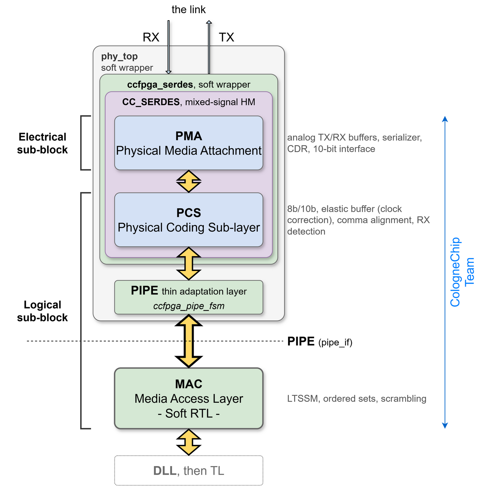
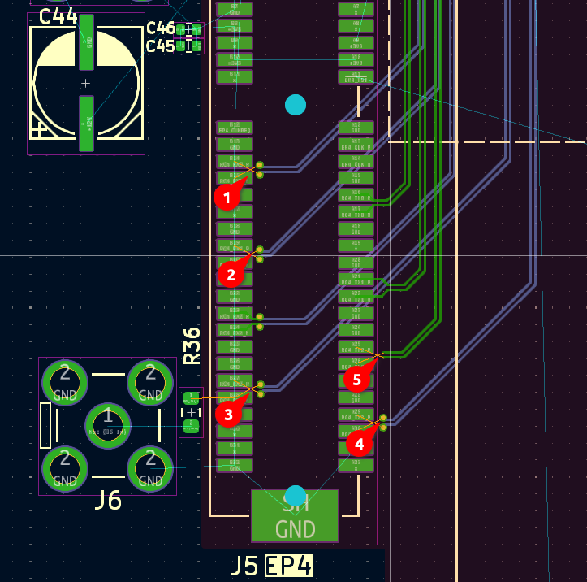

# PHY

Everything below the PIPE interface: [`phy_top.sv`](phy_top.sv), Cologne Chip's soft PIPE adaptation layer ([2.pipe](../2.pipe/README.md)) over one GateMate SerDes.

| Here | What |
|---|---|
| [`phy_top.sv`](phy_top.sv) | the PHY: `ccfpga_pipe_top` + one `ccfpga_serdes` |
| [`1.serdes-test.STANDALONE`](1.serdes-test.STANDALONE/README.md) | SerDes PRBS loopback on the GateMate EVB, tested on the board |
| `2.openSERDES_BFM` | git submodule: [openSERDES_BFM](https://github.com/chili-chips/openSERDES_BFM), the SerDes BFM (simulation) and `ccfpga_serdes.SYNTH.sv` (chip), in `1.gatemate/1.model` |
| [`3.sim`](3.sim/README.md) | PHY tests |

#### References:
- [gatemate-pipe](https://github.com/colognechip/gatemate-pipe) by Cologne Chip (`dll_test`): where the PIPE, MAC and DLL sources started. We forked them and maintain them here
- [GateMate datasheet, DS1001](https://colognechip.com/docs/ds1001-gatemate1-datasheet-latest.pdf) (copy: [September 2026](../../0.doc/2.rtl/ds1001-GateMate-datasheet.Sep2026.pdf))
- Cologne Chip: [PHY/PIPE overview](0.doc/PIPE_overview.pdf), [PHY block diagram](0.doc/Physical_layer_block_diagram.pdf), [MAC overview](0.doc/MAC_Overview.pdf)
- [Unified PIPE Spec, Sept.2025, v7.1](0.doc/Intel.643108_PIPE_Arch_Spec_Rev_7_1.pdf)
- [Optimizing PCIE PIPE Power Management](https://www.synopsys.com/blogs/chip-design/optimizing-pcie-pipe-power-management.html)
- [TUSB1310A USB SuperSpeed PHY with PIPE](https://www.ti.com/product/TUSB1310A)
- [Mithro on SerDes](https://docs.google.com/presentation/d/e/2PACX-1vSgIGVCZtNt8RdifZXOLOJDDCj7g05zxr9WS2NjmQtM_E0GfZKCBYhASCto4eURL-86uNwJaXfo1qMC/pub?start=false&loop=false&delayms=3000#slide=id.g151286a907e_0_230)
- [Yumewatari (whitequark) PHY segments with rudimentary LTSSM](https://github.com/whitequark/Yumewatari/tree/master/yumewatari/gateware)

  

  

## phy_top

- **PCLK** is the SerDes PLL clock, `PLL_CLK_O`: 31.25 MHz at 2.5 Gb/s with the 64-bit PIPE. It is also the SerDes TX and RX core clock.
- **Set up by parameters**, as on the chip; no register-file writes (`clk_reg_i` tied to 0): the SerDes and PLL on from reset (`SERDES_ENABLE`, `PLL_EN_ADPLL_CTRL`, `PLL_CONFIG_SEL`), the PLL for 2.5 Gb/s (`PLL_FCNTRL` 0x3A), a 64-bit datapath, the comma aligned on a 32-bit word, the RX electrical-idle detector on (`RX_EI_BIAS` 4).
- **`ccfpga_pipe_top`** runs the SerDes resets and comma alignment, receiver detection, the power states (P1 in Detect, P0 otherwise), PhyStatus and RxStatus ([2.pipe](../2.pipe/README.md)).
- **`phy_rdy`** is the SerDes `TX_RESET_DONE_O`.

  

### Where it departs from PCIe 2.1

| What | Spec | Note |
|---|---|---|
| No TX de-emphasis: full swing | 4.3.3 (-3.5 dB at 2.5 GT/s) | TODO in `phy_top`: `TX_SEL_POST`, `TX_BRANCH_EN_POST`; validate on the board |
| No clock tolerance compensation: `phy_top` leaves `RX_CLKCOR_USE` at 0 (as Cologne Chip's wrapper), so the RX buffer adds or removes no SKP | 4.2.7 | fine with a common REFCLK, which most PCIe systems use: the slot's 100 MHz goes to both ends. Only two separate oscillators (up to 600 ppm apart) would over- or underflow the RX buffer |
| RxStatus only 000, 011 (receiver detected), 100 (decode error), 111 (disparity error); no SKP added/removed, no buffer error | PIPE | the RX buffer error is not connected |
| Power states P0 and P1 only | 4.2.6 | no L0s, L1, L2 |
| 2.5 GT/s, x1 | 4.2.6.4.2 | no speed change |
| Reference clock input (`PLL_REF_SEL`) | | to validate when the board schematics are out |

--------------------
## Lane polarity: the P and N swaps

A lane is a differential pair, P and N. Keeping P on P from pin to pin often means crossing the pair on the board: two vias and their stubs on a 2.5 or 5 Gb/s line. On the openPCIE backplane we did not take the chance and routed every P to P, at the cost of crossings like 1 to 5 below ([openPCIE 1.pcb](https://github.com/chili-chips/openPCIE/tree/main/1.pcb#the-p-and-n-swaps)).

  

The GateMate SerDes makes these crossings unnecessary:

- **RX:** every PCIe receiver must take a swapped pair (Base 2.1, 4.2.4.4). Our MAC finds inverted TS1/TS2 in Polling and drives PIPE `RxPolarity`; `phy_top` passes it to `rx_polarity_i`, and the SerDes inverts the incoming bits (DS1001 Table 2.49). No fabric logic, no board change.
- **TX:** PCIe never inverts on transmit, but a pair swapped on the board can be undone with `tx_polarity_i` (DS1001 Table 2.35), one static setting per board. `ccfpga_pipe_top.sv` ties it to 0 today.

So a GateMate board can route each pair the short way: no crossing vias, no stubs.

--------------------
## Open-source SerDes simulation model

The submodule `2.openSERDES_BFM` is the open-source **SerDes BFM**, at the level of Cologne Chip's `ccfpga_serdes`, with `ccfpga_serdes.SYNTH.sv` for the chip: `phy_top` has one SerDes instance, the file list picks the file. What it models, its settings and its tests: [openSERDES_BFM, Target 1: GateMate](https://github.com/chili-chips/openSERDES_BFM/blob/main/1.gatemate/README.md).

| flow | result |
|---|---|
| PIPE test, 64-bit (`3.sim/run-phy.sh pipe64`) | PASSED |
| DLL, MAC, PIPE and SerDes, two link partners (`4.dll/sim/run-dll-phy.sh`) | PASSED; with `--inject=stp` or `end` FAILED: [#3](https://github.com/chili-chips/openCologne-PCIE/issues/3) |

PHY flows: [3.sim/README.md](3.sim/README.md). DLL over this PHY: [4.dll/sim/README.md](../4.dll/sim/README.md); its test-bench PHY (SerDes model + PIPE + bring-up FSM) is [`phy_model.sv`](../4.dll/sim/phy_model.sv).

--------------------
## ccfpga_serdes I/O

All 84 ports of `ccfpga_serdes`, by function, with their `CC_SERDES` pins: [openSERDES_BFM, ports](https://github.com/chili-chips/openSERDES_BFM/blob/main/1.gatemate/1.model/README.md#ports).

## ccfpga_serdes parameters

All 117 parameters, their defaults and what the BFM models: [openSERDES_BFM, parameters](https://github.com/chili-chips/openSERDES_BFM/blob/main/1.gatemate/1.model/README.md#parameters).

### DS1001, vendor model, BFM and SYNTH wrapper

Where the datasheet, the vendor simulation model, our BFM and the SYNTH wrapper differ (ports, parameters, defaults) is listed with the model, in [openSERDES_BFM](https://github.com/chili-chips/openSERDES_BFM/blob/main/1.gatemate/README.md#ds1001-vendor-model-bfm-and-synth-where-they-differ).

What matters here: `phy_top` sets `RX_EI_BIAS = 4` and `PLL_SET_OP_LOCK = 0`. Left unset, simulation and chip would differ: the BFM's RX electrical-idle detector runs (4, as DS1001), the chip gets the Yosys default (0, detector off), and `rx_ei_en_o` is the PIPE's `RxElecIdle` (`ccfpga_pipe_top.sv`).

--------------------
#### End of Document
