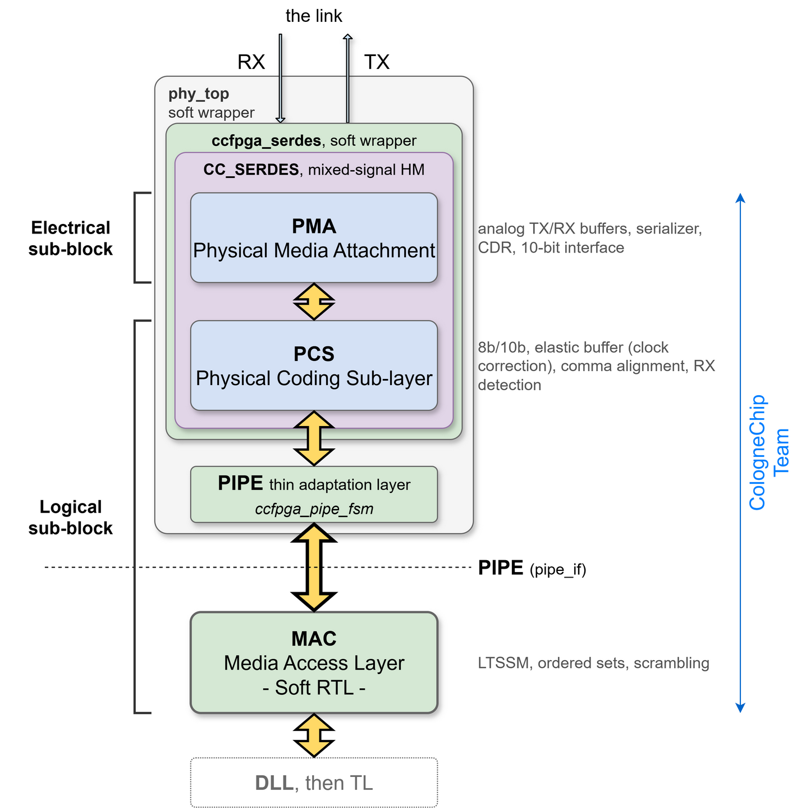
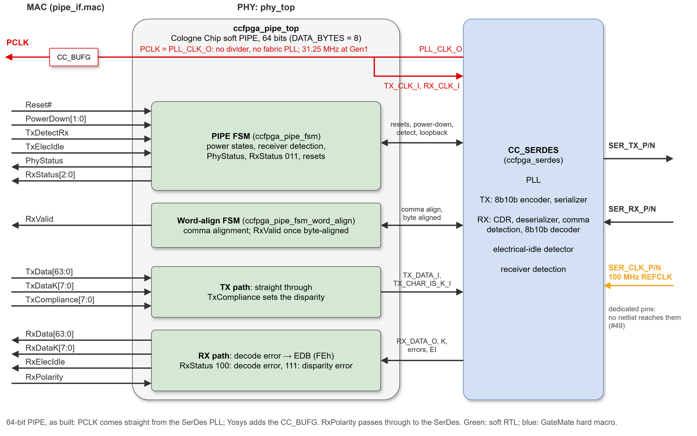

# gatemate-pipe

## Sources
The sources here, [`3.mac`](../3.mac) and [`4.dll`](../4.dll) come from [Cologne Chip's gatemate-pipe](https://github.com/colognechip/gatemate-pipe) (`dll_test`), plus our changes. [Our fork](https://github.com/chili-chips-ba/gatemate-pipe/tree/ocp-integration) carries the same changes on branch `ocp-integration`, and we offer each change to Cologne Chip as a pull request: [#17](https://github.com/colognechip/gatemate-pipe/pull/17) (InitFC credits), [#19](https://github.com/colognechip/gatemate-pipe/pull/19) (64-bit PCLK straight from `PLL_CLK_O`), [#20](https://github.com/colognechip/gatemate-pipe/pull/20) (the DLL retry buffer in block RAM), [#21](https://github.com/colognechip/gatemate-pipe/pull/21) (no latch in the scrambler, lint).

## Description
The **PHY Interface for the PCI Express Architecture (PIPE)** is part of the physical layer, between the Media Access Control (MAC) Layer and the Physical Coding Sublayer (PCS). It separates the soft-core RTL from the FPGA-specific SerDes, which reduces effort and eases porting to other FPGA vendors and platforms.

  

## The Interface
The schematic shows the **64-Bit datapath**, where `pipe.pclk` runs at the **SERDES TX_clock** frequency. Narrower datapaths run `pipe.pclk` at a multiple of **TX_clock**, by the datapath ratio, to keep MAC and PHY synchronized: a **32-Bit datapath** (half the **64-Bit SERDES datapath**) runs `pipe.pclk` at twice **TX_clock**.

The width is `DATA_BYTES` in `pipe_pkg`: the PIPE takes 8-, 16-, 32- or 64-Bit datapaths (1, 2, 4, 8). 64-Bit works, 16-Bit fails ([BA#18](https://github.com/chili-chips-ba/openCologne-PCIE/issues/18)), 32-Bit is untested.

`ccfpga_pipe_top` takes these as the members of `pipe_if.phy pipe`; `clk_core_pll` is a plain port.

- `clk_core_pll`: Reference clock generated by ADPLL of the SerDes.
- `pclk`: Parallel Interface clock to synchronize MAC and PHY layer.
- `tx.data[63:0]`, `tx.kcode[7:0]` (`pipe_sym_t`, PIPE TxData/TxDataK): transmitted symbols and, per symbol, whether it is a control (K) symbol.
- `rx.data[63:0]`, `rx.kcode[7:0]` (`pipe_sym_t`, PIPE RxData/RxDataK): received symbols and their K flags.
- Command:
    - `reset_n`: PIPE Reset#, asynchronous, for the SerDes.
    - `power_down[1:0]`: Power states. **00 = P0, 01 = P0s, 10 = P1, 11 = P2**.
    - `tx_elec_idle`: Set the SerDes in Electrical Idle state.
    - `tx_detect_rx`: Trigger the Receiver Detection operation of the SerDes (P1) or Enable Loopback (P0).
    - `tx_compliance[7:0]`: Compliance pattern flags. Each bit represents whether the symbol at that position is a compliance pattern and disparity needs to be set to negative.
    - `rx_polarity`: Invert the polarity of the received data if set.
- Status:
    - `phy_status`: Indicate successful Power State change or finished Receiver Detection.
    - `rx_elec_idle`: Detection of Electrical Idle on receiving lines.
    - `rx_valid`: Indicates symbol lock and the received data is valid.
    - `rx_status[2:0]`: Status of the receiver (Description in Table below).

| RxStatus        | Description           |
| --------------- |:---------------------|
| 000             | Received Data OK (P0),  Receiver not detected (P1)         |
| 001             | SKP added              |
| 010             | SKP removed              |
| 011             | Receiver detected (P1)              |
| 100             | 8b/10b Error and optionally  Disparity Error              |
| 101             | Elastic Buffer Overflow              |
| 110             | Elastic Buffer Underflow              |
| 111             | Disparity Error. Unused if  reported together with  8b/10b Error (100)              |

This PHY (64-bit) reports only 000, 011, 100 and 111. SerDes clock correction is off (`RX_CLKCOR_USE` left at 0 in `phy_top.sv`, as in Cologne Chip's wrapper): the RX elastic buffer only aligns phase, never adds or removes SKP, so 001 and 010 never occur; its overflow/underflow flag (`o_rx_buf_err`) is not connected in `phy_top`, so neither do 101 and 110.

## Power states in PIPE Interface and their relation to power states in LTSSM
Only two power states are supported: **P0**, normal operation on the line, and **P1**, the PHY powered off. Their relation to the LTSSM states:

P1 in Detect, P0 in every other state. The full LTSSM, with all four PIPE power states, against ours: [LTSSM](../3.mac/README.md#ltssm).

## Where it departs from PCIe 2.1

| What | Base 2.1 | Issue |
|---|---|---|
| No clock tolerance compensation: no SKP added or removed on RX, so the ±300 ppm of separate reference clocks is not absorbed; both ends need the common REFCLK of the slot | 4.2.7 | |
| P0 and P1 only: no P0s or P2 (so no L0s or L2); the MAC has no L1 either | 4.2.6 | |
| One lane, 2.5 GT/s | 4.2.6.3, 4.2.6.4 | |

The MAC's own list: [3.mac](../3.mac/README.md#where-it-departs-from-pcie-21).

<!--## Prerequisites 
The simulation can be run using the [Gatemate open source toolchain](https://colognechip.com/programmable-logic/gatemate/toolchain/).

`source oss-cad-suite/environment` to activate the virtual environment.

## Run Testbench
Run `make testcase` to run the testbench (Note that the testbench currently only works for **64-Bit datapath**).

The testbench also requires the simulation model of the SERDES, which currently can not be disclosed to the public.

## Testbench description
The testbench begins by performing several key state transitions within the PIPE finite state machine (FSM). After initialization, it triggers the word alignment process and proceeds to transmit data. The transmission lines are modeled in the testbench using four registers `RX_SERIO_N`, `RX_SERIO_P`, `TX_SERIO_N`, and `TX_SERIO_P`, which also allow for manual fault injection to simulate various error detection processes.-->

## References
- [PIPE Specs, Sept. 2025, v7.1](https://cdrdv2-public.intel.com/643108/643108_PIPE_Arch_Spec_Rev_7_1.pdf)
- [Philipp Ledüc's Masterthesis](https://opus.bsz-bw.de/fhdo/frontdoor/index/index/year/2021/docId/3076)
- [Optimizing PCIe PIPE Interface Power Management](https://www.synopsys.com/blogs/chip-design/optimizing-pcie-pipe-power-management.html)

--------------------
#### End of Document
