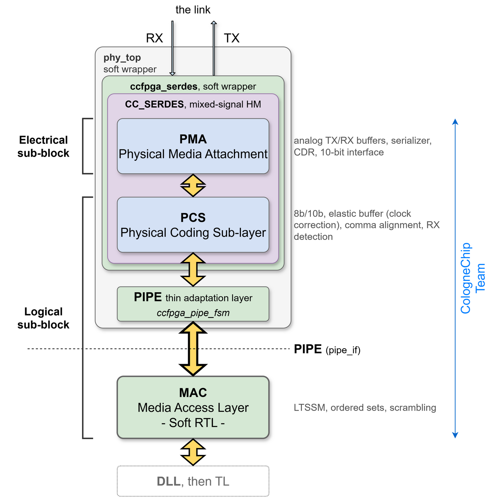
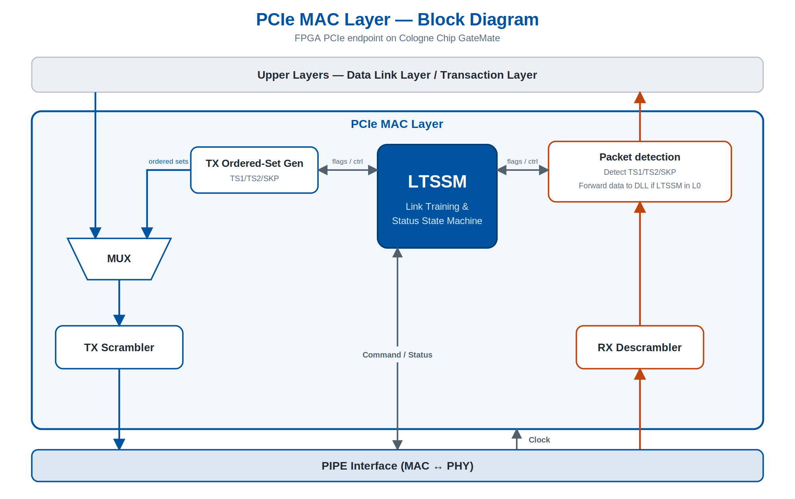
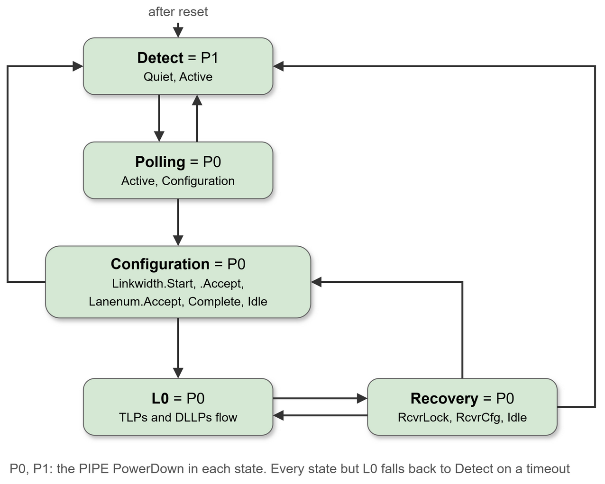
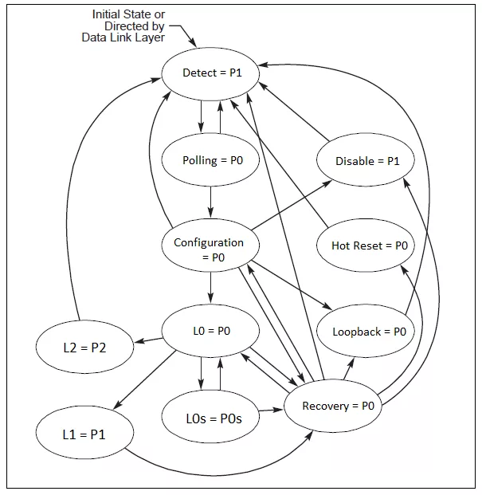

# PCIe MAC Layer

The sources are Cologne Chip's, from [gatemate-pipe](https://github.com/colognechip/gatemate-pipe): this folder (`ccfpga_*`).

## Description
The **Media Access Control (MAC)** is the logical sub-block of the PCIe **Physical Layer**, between the **Data Link Layer (DLL)** above and the **PIPE interface / SerDes PHY** below.

- **TX:** turns the DLL's byte stream into a scrambled symbol stream for the PHY; **RX** does the reverse.
- **Link:** owns bring-up and maintenance through the **Link Training and Status State Machine (LTSSM)**.
- **Soft RTL** in the FPGA fabric. **8b/10b** encode/decode, the **elastic buffer** and **word alignment** are done by the GateMate SerDes, behind [PIPE](../2.pipe/README.md).

  

## Architecture
A transmit datapath, a receive datapath, and the control plane binding them.

- **TX datapath**: receive framed packets from DLL → scrambling → `TxData`/`TxDataK` to the PIPE interface.
- **RX datapath**: `RxData`/`RxDataK` from the PIPE interface → descrambling → packet detection → packet stream to the DLL.
- **LTSSM**: drives the PIPE command signals (`pipe.power_down`, `pipe.tx_detect_rx`, `pipe.tx_elec_idle`, `pipe.rx_polarity`, `pipe.tx_compliance`) and consumes the PIPE status signals (`pipe.phy_status`, `pipe.rx_valid`, `pipe.rx_elec_idle`, `pipe.rx_status`) to sequence the link through Detect → Polling → Configuration → L0, and Recovery.
- **Ordered-set generator/detector**: builds and recognises TS1/TS2, SKP used during link training.
- **Scrambler/descrambler**: LFSR applied to data symbols only; reset by COM and bypassed for training sequences and control symbols (RX in L0: see [Scrambling](#scrambling)).

## The Interface
**Upstream** to the Data Link Layer, **downstream** to the PIPE / PHY. `ccfpga_mac_top` takes two interfaces, `mac_if.mac mac` (DLL side) and `pipe_if.mac pipe`; its reset `i_reset_n` stays a plain port.

### Upstream — Data Link Layer
| Signal            | Dir | Description |
| ----------------- |:---:|:----------- |
| `mac.tx.data`     | in  | Byte stream of the packet to transmit. |
| `mac.tx.kcode`    | in  | Control flags of the byte stream to transmit. |
| `mac.rx.data`     | out | Descrambled byte stream from PHY, in L0 only: whole words, from the one holding STP or SDP to the one holding END; zero otherwise. |
| `mac.rx.kcode`    | out | Control flags of the received byte stream. |
| `mac.link_up`     | out | LTSSM in L0 or Recovery. `pcie_core` raises the DLL's link up in L0 and holds it through Recovery, until `mac.link_up` drops. |
| `mac.ltssm_state` | out | LTSSM state (`ccfpga_LTSSM_fsm` encoding); `pcie_core` raises the DLL's link up when it reaches L0. |

### Downstream — PIPE / PHY
`pipe_if.mac pipe`: `pclk`, `tx`/`rx` (`pipe_sym_t`: `data[63:0]`, `kcode[7:0]`), the command signals (`reset_n`, driven by `pcie_core`, `power_down[1:0]`, `tx_elec_idle`, `tx_detect_rx`, `tx_compliance[7:0]`, `rx_polarity`) and the status signals (`phy_status`, `rx_elec_idle`, `rx_valid`, `rx_status[2:0]`). Descriptions, 32-/64-bit datapath handling and `RxStatus` encoding: [PIPE](../2.pipe/README.md).

## LTSSM
The heart of the MAC control plane. Top-level states for endpoint bring-up:

| State           | Description |
| --------------- |:----------- |
| Detect          | Detect the presence of a receiver on the link via the PHY's receiver-detection sequence (`pipe.tx_detect_rx` → `pipe.phy_status` / `pipe.rx_status` `RX_DETECTED`). |
| Polling         | Establish bit lock, symbol lock and lane polarity; exchange TS1/TS2 ordered sets. |
| Configuration   | Assign link and lane numbers and configure link width; TS1/TS2 carry the assigned numbers. |
| L0              | Fully active operational state; TLPs and DLLPs flow. |
| Recovery        | Retrain the link from L0: RcvrLock, RcvrCfg, Idle. |

  

**Against the full LTSSM** (Base 2.1, 4.2.5), with the PIPE power state of each state:

  

| | Full LTSSM | Ours |
|---|---|---|
| States | 11: Detect, Polling, Configuration, L0, L0s, L1, L2, Recovery, Disabled, Loopback, Hot Reset | 5: Detect, Polling, Configuration, L0, Recovery |
| PIPE power states | P0, P0s, P1, P2 | P1 in Detect, P0 elsewhere |
| Low power | L0s, L1, L2 | none |
| Link control | Disabled, Loopback, Hot Reset | none |
| Speed change | Recovery.Speed | none: Gen1 only |

## Symbols and Ordered Sets
The MAC uses the PHY's control-symbol flags (`TxDataK`/`RxDataK`); 8b/10b lives in the SerDes. The control symbols (K-codes), by who handles them:

**Ordered-set symbols**: the MAC builds them (`ccfpga_send_OS.sv`) and detects COM, TS1/TS2 and PAD (`ccfpga_OS_process.sv`); SKP it only sends.

| Symbol | Code   | Name          | Use |
| ------ |:------ |:------------- |:--- |
| COM    | K28.5  | Comma         | Starts every ordered set; symbol alignment |
| PAD    | K23.7  | Pad           | Link and Lane numbers not yet set, in TS1/TS2 during Configuration |
| SKP    | K28.0  | Skip          | The SKP ordered set, for clock-tolerance compensation |

**Framing symbols**: the DLL inserts and checks them (`retry_buffer.sv`, `send_dllp.sv`, `packet_handler.sv`); the MAC only watches them for where a packet starts and ends (`ccfpga_send_data.sv`, `ccfpga_rx_MAC_data.sv`). Base 2.1 puts framing in the Physical Layer (4.2.2); our design puts it in the DLL.

| Symbol | Code   | Name          | Use |
| ------ |:------ |:------------- |:--- |
| STP    | K27.7  | Start TLP     | Starts a TLP |
| SDP    | K28.2  | Start DLLP    | Starts a DLLP |
| END    | K29.7  | End           | Ends a TLP or DLLP |
| EDB    | K30.7  | EnD Bad       | TX: a packet end to the MAC. RX: ignored by MAC and DLL; the PHY puts it in place of a symbol with an 8b/10b error. Nullified TLPs are not supported |

Ordered sets generated/detected by the MAC: **TS1/TS2** (Polling, Configuration, Recovery), **SKP** (sent only; RX does not detect it, and the SerDes passes it on unchanged). The SerDes does no clock compensation: clock correction is off (`RX_CLKCOR_USE` left at 0 in `phy_top.sv`, as in Cologne Chip's wrapper), so its elastic buffer neither adds nor removes SKP symbols, and `RxStatus` never reports it. Both link partners must run from the same REFCLK.

## Scrambling
Data (D) symbols are scrambled with the standard PCIe LFSR, **G(x) = x¹⁶ + x⁵ + x⁴ + x³ + 1**, seeded FFFFh by COM and advanced once per symbol but SKP (Base 2.1, 4.2.3). Not scrambled: K symbols, and on TX the TS1/TS2 data symbols. RX descrambles with the identical LFSR.

- **Disable Scrambling:** Training Control bit 3 turns both off. In Configuration.Complete the MAC copies the Training Control of the TS received in each PCLK, and 0 in a PCLK without one; the value of the last PCLK there stays. Detect and a new Configuration clear it. The EP's own TS echo the received Training Control.
- **RX, TS1/TS2:** the RX mask is per LTSSM state, not per symbol: in L0, Configuration.Idle and PRE_L0 (the cycle before L0) it descrambles every data symbol, a received TS1/TS2 too (the spec leaves those unscrambled), so the EP never follows the partner into Recovery ([#9](https://github.com/chili-chips/openCologne-PCIE/issues/9)).

## Where it departs from PCIe 2.1

| What | Base 2.1 | Issue |
|---|---|---|
| Framing (STP, SDP, END, EDB) is done in the DLL, not the Physical Layer | 4.2.2 | |
| RX descrambles a TS1/TS2 received in L0 | 4.2.3 | [#9](https://github.com/chili-chips/openCologne-PCIE/issues/9) |
| Disable Scrambling taken from the last PCLK of Configuration.Complete | 4.2.6.3.5 | [#10](https://github.com/chili-chips/openCologne-PCIE/issues/10) |
| A TS1 is cut short at every SKP in Polling.Active, a TS2 on the step to Configuration | 4.2.7.1 | [#7](https://github.com/chili-chips/openCologne-PCIE/issues/7) |
| COM and SKP of a received SKP ordered set reach the DLL as data | 4.2.7.2 | [#8](https://github.com/chili-chips/openCologne-PCIE/issues/8) |
| No clock tolerance compensation: SerDes clock correction off; common REFCLK only | 4.2.7 | |
| No Receiver Error to the DLL: 8b/10b and disparity errors are not acted on | 4.2.4.6 | [#3](https://github.com/chili-chips/openCologne-PCIE/issues/3) |
| L0 goes to Recovery only on two received TS1; a TS2 or electrical idle does not take it there | 4.2.6.5 | |
| Configuration.Idle and Recovery.Idle count any PCLK without a COM as Idle data; the symbols are not checked | 4.2.6.3.6 | |
| No L0s (required of every component), L1, L2, Disabled, Loopback, Hot Reset or Polling.Compliance | 4.2.6, 5.4.1 | [#11](https://github.com/chili-chips/openCologne-PCIE/issues/11) |
| Gen1 only: TS advertise 2.5 GT/s, no Recovery.Speed | 4.2.6.4 | |
| x1 only: Configuration.Lanenum.Wait is never entered | 4.2.6.3 | |
| Polling.Active and Recovery.RcvrLock time out straight to Detect | 4.2.6.2.1, 4.2.6.4.1 | |

<!--## Prerequisites
The simulation can be run using the pcieVHost ... TODO

## Run Testbench
make -f makefile.ica run

## Testbench description
The testbench drives the MAC from both sides. On the downstream side it models the PIPE/SerDes responses (`pipe.phy_status`, `pipe.rx_valid`, `pipe.rx_status`, `pipe.rx`) so the LTSSM can be walked through Detect → Polling → Configuration → L0, including receiver detection and TS1/TS2 exchange. On the upstream side it injects TLP/DLLP packets to exercise framing, scrambling and the return path. Fault injection on the modelled receive symbols (bad 8b/10b, disparity, EDB) is used to check the error-handling and Recovery transitions.-->

## References
- [PIPE Specs, Sept. 2025, v7.1](https://cdrdv2-public.intel.com/643108/643108_PIPE_Arch_Spec_Rev_7_1.pdf)
- [Simon Southwell's Primer](https://www.linkedin.com/pulse/pci-express-primer-1-overview-physical-layer-simon-southwell/)
- [MAC Overview](./0.doc/MAC_Overview.pdf)

--------------------
#### End of Document
