# PCIe Data Link Layer (DLL)

## Description
The **Data Link Layer (DLL)** sits between the **Transaction Layer (TL)** above and the **Physical Layer (MAC + PIPE + PCS)** below. It makes the link *reliable*:

- wraps every outgoing TLP with a sequence number and a 32-bit LCRC;
- holds transmitted TLPs in a retry buffer (currently size one) until acknowledged;
- drives the ACK/NAK protocol, so corrupted or lost packets are replayed;
- generates and consumes DLLPs: ACK/NAK and flow-control;
- runs the **flow-control initialization** handshake before the link carries traffic.

Soft-core RTL in the FPGA fabric. Below it, the MAC and the GateMate SerDes handle the LTSSM, 8b/10b and the serial link, reached through the PHY interface. `DATA_WIDTH` is **64 bits** (`DATA_BYTES = 8`, PCLK 31.25 MHz at Gen1), the only width built and tested. `retry_buffer.sv` also has an experimental 32-bit path, kept solely as a nextpnr timing closure stress test. It would need PCLK 62.5 MHz even at Gen1 (2.5 Gbps), and the 64-bit datapath already misses 31.25 MHz by a wide margin ([#15](https://github.com/chili-chips/openCologne-PCIE/issues/15)), so we do not plan to validate or bring it up.

<div align="center">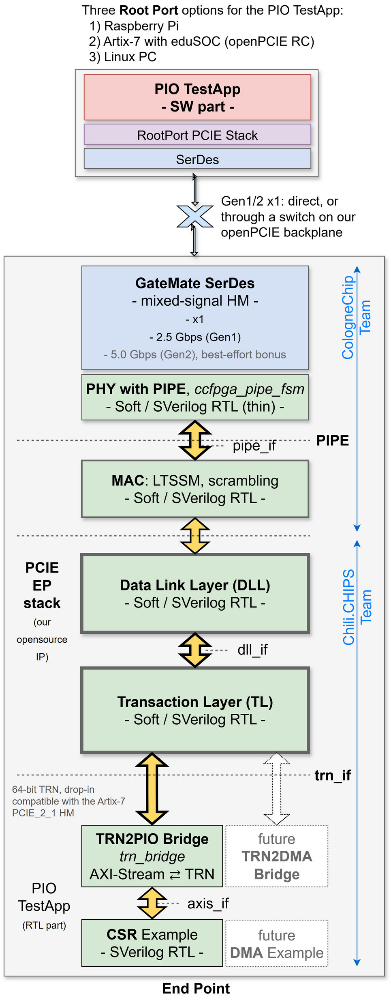</div>

## Architecture
A transmit datapath, a receive datapath, and the control logic binding them.

- **TX datapath**: takes TLP payload / DLLP fields from the TL, frames them (STP/SDP … END), appends the LCRC (TLP) or 16-bit CRC (DLLP), stores TLPs in the retry buffer, and streams the result to the MAC on `mac.tx` (`pipe_sym_t`: `data`, `kcode`).

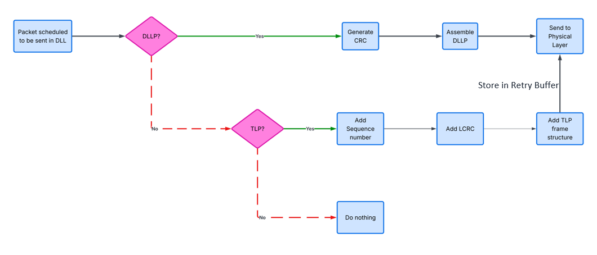

- **RX datapath**: shifts `mac.rx` into registers, detects STP/SDP, checks the CRC/LCRC, strips the framing, and forwards TLP payload / extracted DLLP fields to the TL.

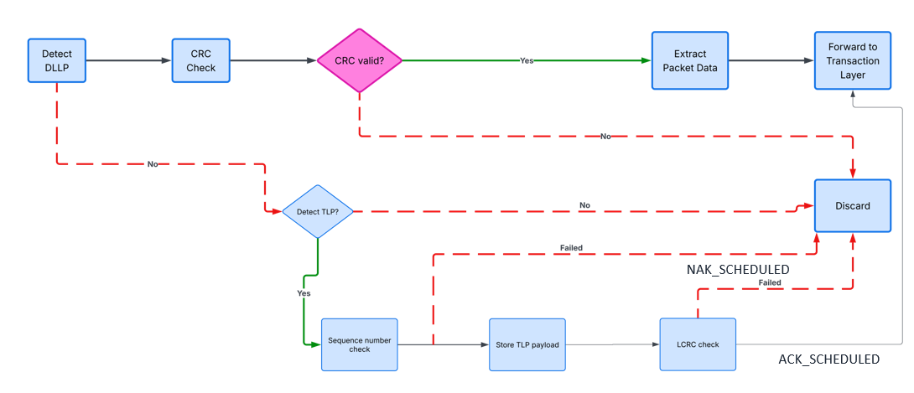

- **TLP handler**: sequence-number assignment and checking, LCRC generation/validation, and the ACK/NAK scheduling logic (`NEXT_RCV_SEQ`).
- **DLLP handler**: builds and parses ACK/NAK and flow-control DLLPs; on ACK it retires TLPs from the retry buffer, on NAK it triggers a replay.
- **Retry buffer**: holds unacknowledged TLPs (currently has size of one) for replay. Replay on NAK only; no replay timer or replay number yet ([#3](https://github.com/chili-chips/openCologne-PCIE/issues/3)).
- **DLL Init FSM**: gates the link through `DL_Inactive → DL_Init → DL_Active`, including flow-control initialization.

## The Interface
**Upstream** to the Transaction Layer, **downstream** to the Physical Layer. `dll_top` takes two interfaces, `dll_if.dll tl` (TL side) and `mac_if.dll mac` (MAC side); clock, reset and link up stay plain ports.

### Upstream — Transaction Layer (TL)
| Direction | Signal              | Description                                  | Width      |
| --------- |:------------------- |:-------------------------------------------- |:---------- |
| in        | `tl.tx_tlp`         | TLP word from TL (`tlp_beat_t`: valid, first, last, half = the last word holds one DW, data) | 68 bits |
| out       | `tl.tx_tlp_ready`   | Retry buffer can take a TLP                  | 1 bit      |
| in        | `tl.tx_dllp`        | Flow-control DLLP to send (`fc_dllp_t`: valid, packet and update type, credits) | 25 bits |
| out       | `tl.rx_tlp`         | TLP word to TL (`tlp_beat_t`; half is 0)     | 68 bits    |
| out       | `tl.rx_dllp`        | Flow-control DLLP received (`fc_dllp_t`)     | 25 bits    |
| out       | `tl.dl_state`        | DL state of VC0 (debug)                      | 3 bits     |

### Downstream — Physical Layer
| Direction | Signal          | Description                                             | Width        |
| --------- |:--------------- |:------------------------------------------------------ |:------------ |
| in        | `phy_clk`       | PHY-domain clock                                       | 1 bit        |
| in        | `phy_reset`     | Async reset from the physical layer                    | 1 bit        |
| in        | `phy_linkup`    | Link-up indication: set in **L0**, held through Recovery (`pcie_core`) | 1 bit        |
| in        | `mac.rx.data`   | Receive data stream from the physical layer            | DATA_WIDTH   |
| in        | `mac.rx.kcode`  | K-character (control) markers for `mac.rx.data`        | DATA_WIDTH/8 |
| out       | `mac.tx.data`   | Transmit data stream to the physical layer             | DATA_WIDTH   |
| out       | `mac.tx.kcode`  | K-character (control) markers for `mac.tx.data`        | DATA_WIDTH/8 |

> `mac_if` connects the DLL to the MAC: the DLL drives `mac.tx` and reads `mac.rx`, each a `pipe_sym_t` (`data`, `kcode`). `phy_linkup` is not the MAC's `mac.link_up`: `pcie_core` raises it in L0 and holds it through Recovery.
>
> The DLL frames its own packets: STP ... END around a TLP, SDP ... END around a DLLP, and checks them on RX ([framing symbols](../3.mac/README.md#symbols-and-ordered-sets)).

## DLL Init FSM
Tracks whether the link is usable: `DL_Inactive` out of reset, `DL_Active` only once flow-control is initialized.

<div align="center">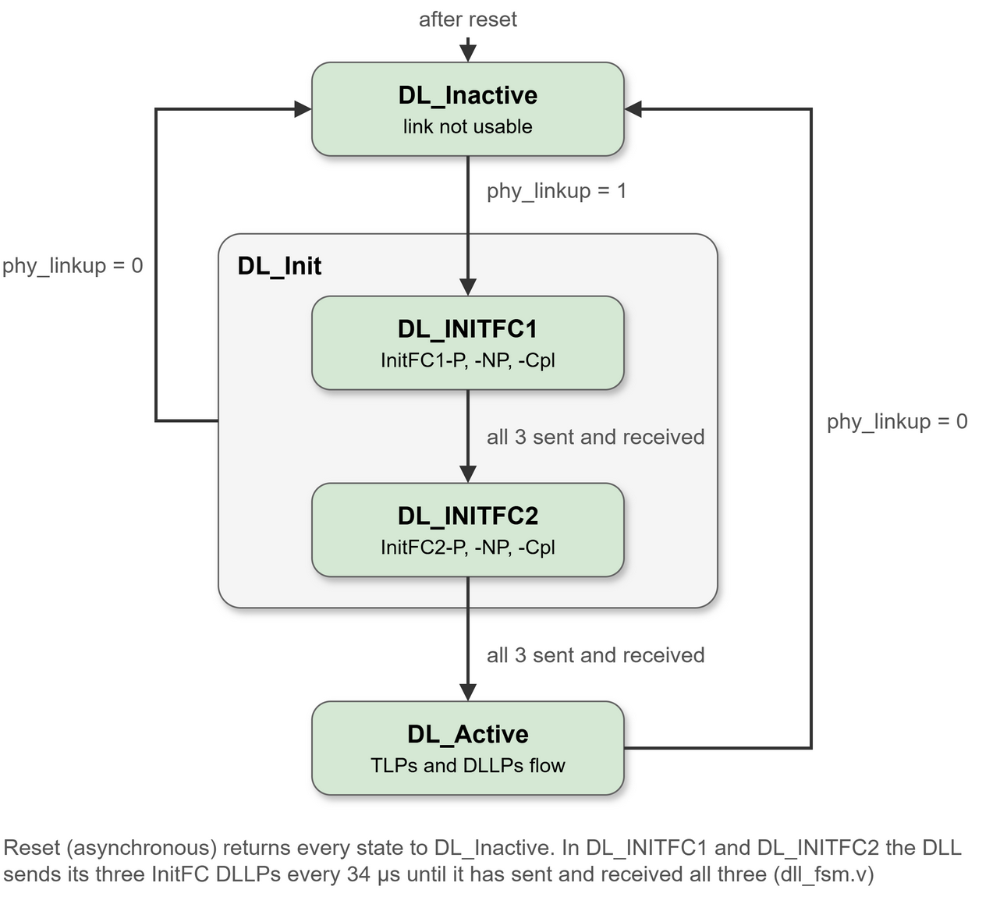</div>

| State         | Meaning / transition |
| ------------- |:-------------------- |
| `DL_Inactive` | Reset state; the DLL is idle. Move to `DL_Init` when `phy_linkup = 1`. |
| `DL_Init`     | Runs flow-control initialization. Contains two sub-states, `DL_INITFC1 → DL_INITFC2`. Move to `DL_Active` when flow-control initialization succeeds. |
| `DL_Active`   | Normal operation; TLPs and DLLPs flow. |

Any state returns to `DL_Inactive` on `phy_linkup = 0` or reset.

## Flow-control initialization
While in `DL_Init`, **all TLPs are blocked**. `DL_Init` has two sub-states:

- **`DL_INITFC1`**
  - Transmit and receive three InitFC1 DLLPs: `InitFC1-P`, `InitFC1-NP`, `InitFC1-Cpl`.
  - Repeat the transmission every **34 µs** while the exit conditions are not met.
  - Record the FC unit values, then move on to `DL_INITFC2`.
- **`DL_INITFC2`**
  - Transmit and receive three InitFC2 DLLPs: `InitFC2-P`, `InitFC2-NP`, `InitFC2-Cpl`.
  - Repeat the transmission every **34 µs** while the exit conditions are not met.
  - Ignore the FC unit values, then move on to `DL_Active`.

## Packet Structures

### TLP

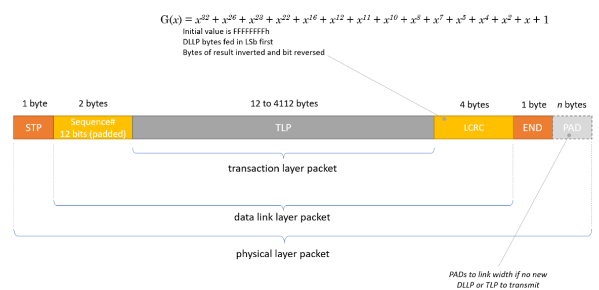

- Framing tokens: `STP = 1111_1011`, `END = 1111_1101`, `EDB = 1111_1110`.
- **LCRC**: `G(x) = x³² + x²⁶ + x²³ + x²² + x¹⁶ + x¹² + x¹¹ + x¹⁰ + x⁸ + x⁷ + x⁵ + x⁴ + x² + x + 1`, initial value `FFFF_FFFFh`, bytes fed in LSb first, result inverted and bit-reversed.

### DLLP

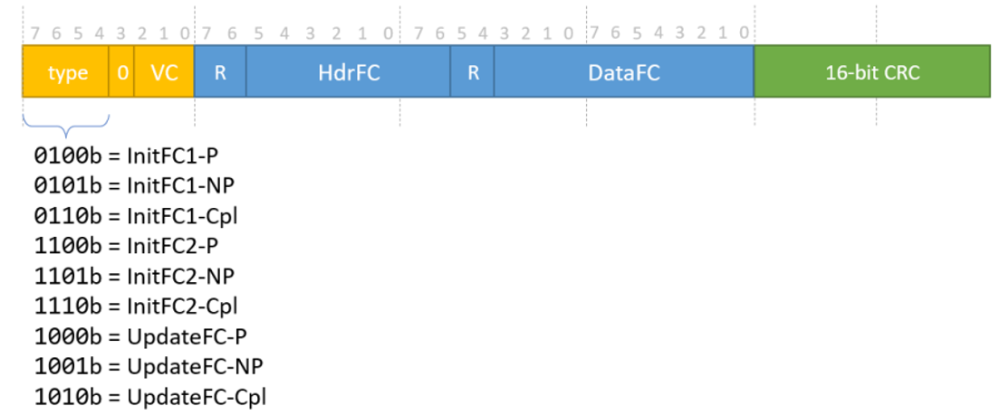

`DLLP Type = {packet_type[1:0], update_type[1:0], 1'b0, VC[2:0]}`. `HdrFC` and `DataFC` go to the TL in `dll_if.rx_dllp` (`fc_dllp_t`: `hdr`, `data`); the `R` (reserved) bytes are not considered.

| Code (`byte 1`) | DLLP Type |
| --------------- |:--------- |
| `0000_0000`     | ACK |
| `0001_0000`     | NAK |
| `0010_0000`     | PM_Enter_L1 (currently not supported) |
| `0010_0001`     | PM_Enter_L23 (currently not supported) |
| `0010_0011`     | PM_Active_State_Request_L1 (currently not supported) |
| `0010_0100`     | PM_Request_Ack (currently not supported) |
| `0011_0000`     | Vendor specific (currently not supported) |
| `0100_0xxx`     | InitFC1-P  (`xxx` = virtual channel #) |
| `0101_0xxx`     | InitFC1-NP |
| `0110_0xxx`     | InitFC1-Cpl |
| `1100_0xxx`     | InitFC2-P |
| `1101_0xxx`     | InitFC2-NP |
| `1110_0xxx`     | InitFC2-Cpl |
| `1000_0xxx`     | UpdateFC-P |
| `1001_0xxx`     | UpdateFC-NP |
| `1010_0xxx`     | UpdateFC-Cpl |

- Framing tokens: `SDP = 0101_1100`, `END = 1111_1101`, `PAD = 1111_0111`.
- **CRC**: `G(x) = x¹⁶ + x¹² + x³ + x + 1`, initial value `FFFFh`, bytes fed in LSb first, result inverted and bit-reversed.
- PM and Vendor DLLPs are **not** supported in this first version of the DLL. Padding is not needed for the 32-bit and 64-bit datapaths.

### ACK/NAK
Field layout: `type | Reserved | AckNak_Seq_Num | 16-bit CRC`.

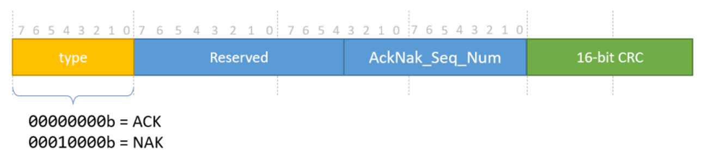

| `type`       | Meaning |
| ------------ |:------- |
| `0000_0000b` | ACK |
| `0001_0000b` | NAK |

## TLP Handler

### TX
- The TL indicates the start and end of the TLP payload.
- The DLL stores the TLP payload in a buffer.
- Each TLP is assigned a **12-bit sequence number**.
- The TLP is protected by a **32-bit LCRC** (polynomial above); the result is complemented and the bits of each byte are stored in reversed order.
- **Transmission priority**: TLP/DLLP already in progress → NAK → ACK → UpdateFC DLLP → other DLLPs → TLP (new or replayed).

### RX
- `NEXT_RCV_SEQ` holds the expected sequence number of the next TLP. The sequence number is checked at STP, before the LCRC:
  - `(NEXT_RCV_SEQ − TLP_Seq_Num) mod 4096 ≤ 2048` → the TLP is a duplicate → discarded, an ACK is scheduled.
  - Otherwise, if not the expected value → out of sequence → discarded, a NAK is scheduled.
- A TLP with the expected sequence number is stored in a buffer, awaiting the LCRC check:
  - LCRC mismatch, or a new STP before END → discarded, a NAK is scheduled.
  - LCRC match → the control data is removed and the TLP is forwarded to the TL: the DLL marks the start and end of the TLP, `NEXT_RCV_SEQ` is incremented, and an ACK is scheduled.
- A NAK is scheduled for every bad TLP: there is no `NAK_SCHEDULED` flag holding back a second one.
- An ACK is sent as soon as it is scheduled; there is no `AckNak_LATENCY_TIMER` yet.
- The RX buffer is a ring: an STP is taken in the clock after the END before it, while the TLPs before it are forwarded; a TLP with a bad LCRC is rewound ([#4](https://github.com/chili-chips/openCologne-PCIE/issues/4), fixed). A nullified TLP (EDB) is Naked, not dropped ([#29](https://github.com/chili-chips/openCologne-PCIE/issues/29)).
- Nullification of a TLP with `EDB` is **not** supported in this first version.

## DLLP Handler

### RX
- Received data shifts into registers large enough to hold a DLLP.
- On `SDP` detection, the DLLP is extracted with alignment and its CRC checked.
  - CRC fail → discard the packet.
  - CRC pass → forward the data to the TL with `tl.rx_dllp.valid` set.
- For ACK / NAK:
  - **ACK** → release all unacknowledged TLPs in the retry buffer (one today; up to two once the ping-pong buffer lands) at and below the sequence number in the ACK, and update `ACKD_SEQ` to `Ack_Seq_Num`.
  - **NAK** → retransmit all unacknowledged TLPs.

### TX
- `tl.tx_dllp.valid` from the TL starts a DLLP transmission; the DLLP data comes from the TL, the CRC is appended.
- Received TLP LCRC fails: send a **NAK** with the sequence number of the last TLP received intact; passes: an **ACK** with the error-free packet's sequence number.

## Retry Buffer
- The retry buffer replays on NAK only. There is no replay timer and no replay number yet ([#3](https://github.com/chili-chips/openCologne-PCIE/issues/3)).
- The first version offers a retry buffer of **size one**, in block RAM; a later version may move to **size two**, implemented as a ping-pong scheme.

## Where it departs from PCIe 2.1

| What | Base 2.1 | Issue |
|---|---|---|
| The DLL frames its packets (STP, SDP, END); the spec puts framing in the Physical Layer | 4.2.2 | |
| No `REPLAY_TIMER`, no `REPLAY_NUM`: a TLP lost on the line is never replayed | 3.5.2.1 | [#3](https://github.com/chili-chips/openCologne-PCIE/issues/3) |
| No Receiver Error input from the Physical Layer, so no Nak on that ground | 3.5.3.1 | [#3](https://github.com/chili-chips/openCologne-PCIE/issues/3) |
| A nullified TLP (EDB) is Naked, not dropped | 3.5.3.1 | [#29](https://github.com/chili-chips/openCologne-PCIE/issues/29) |
| Sequence number checked before the LCRC: a duplicate with a bad LCRC is answered with an Ack, not a Nak | 3.5.3.1 | |
| No `NAK_SCHEDULED`: a Nak for every bad TLP, not one until a good TLP arrives | 3.5.3.1 | |
| No `AckNak_LATENCY_TIMER`: one Ack per TLP, sent at once | 3.5.3.1 | |
| Nullified TLPs (EDB) not recognised | 3.5.3.1 | |
| InitFC1/InitFC2 repeated only every 34 µs, not back to back when idle | 3.3.1 | [#5](https://github.com/chili-chips/openCologne-PCIE/issues/5) |
| FC_INIT2 waits for all three InitFC2 (or an UpdateFC or a TLP), not any one InitFC2 | 3.3.1 | |
| Bad TLP and Bad DLLP not reported as Correctable errors | 6.2.5 | [#13](https://github.com/chili-chips/openCologne-PCIE/issues/13) |
| No PM DLLPs: D3hot does not take the link to L1 | 3.4, 5.3.2.1 | |

<!--## Prerequisites
The simulation can be run using the pcieVHost model … *TODO*

## Run Testbench
`make -f makefile.ica run`

## Testbench description
The testbench drives the DLL from both sides. On the **upstream** side it plays the Transaction Layer: it injects TLP payload (`tl_tx_*`) and requests DLLP transmissions (`tl_tx_dllp_valid`) to exercise framing, sequence-number assignment, LCRC generation and the transmission-priority logic. On the **downstream** side it models the PHY, feeding framed TLPs/DLLPs on `phy_rx_data`/`phy_rx_data_k` and driving `phy_linkup` so the DLL Init FSM walks through `DL_Inactive → DL_Init → DL_Active`, including flow-control initialization. Fault injection on the received stream (bad CRC/LCRC, out-of-sequence and duplicate sequence numbers) is used to check the ACK/NAK scheduling, the retry buffer and the replay/latency timers.-->

## Sources and testbench
The DLL sources are in this folder. Cologne Chip's block testbench, `sim/tb_dll_logic.sv` in [gatemate-pipe](https://github.com/colognechip/gatemate-pipe), loops the DLL's `phy_tx_data` back into `phy_rx_data`:

| Step | Exercises |
|---|---|
| 1 | DLL Init FSM `DL_Inactive → DL_Init → DL_Active`, flow-control initialization |
| 2 | three TLPs from the TL, every received word checked |
| 3 | one TLP with its LCRC corrupted on the loopback: NAK and replay |
| 4 | an UpdateFC-P DLLP, its received fields checked |

It does not inject out-of-sequence or duplicate TLPs and checks no timers.

Our own DLL simulation, [`sim/run-dll-phy.sh`](#simulation-over-mac-pipe-and-serdes), runs similar steps between two DLLs, with the MAC, PIPE and SerDes BFM below each.

## Viewing the DLL in WaveCrux

Ferrite's [PCIe PIPE and Data Link Layer decoders](https://github.com/Ferrite-Engineering/wavecrux-decoders) (`wcx-pcie` 0.1.0 or later) in [WaveCrux](https://wavecrux.app) decode the DLL's PHY-side stream. Source: `sim/tb_dll_wavecrux.sv`, a fork of gatemate-pipe's `tb_dll_logic.sv` with the same test steps, whose TLPs carry real headers (MWr32, MWr64, CplD) so the decoders can name them.

To reproduce, from `2.rtl/4.dll`:

```
verilator --binary --timing --trace-fst --trace-structs -O0 -Wno-fatal --top-module tb_dll_wavecrux ../2.pipe/pipe_pkg.sv ../3.mac/mac_pkg.sv dll_pkg.sv ../3.mac/mac_if.sv $(ls *.sv | grep -v _pkg.sv) sim/tb_dll_wavecrux.sv sim/dll_wavecrux_view.sv
./obj_dir/Vtb_dll_wavecrux          # writes sim/dll_wavecrux.fst
```

Then, once per machine, add the unzipped `wcx-pcie` release under **Settings -> Extensions -> Decoder Plugins** in WaveCrux (1.0.1 or later), and open [`sim/tb.DLL-PIPE.wavecrux`](sim/tb.DLL-PIPE.wavecrux). It loads `dll_wavecrux.fst` from the same directory with all four decoders bound.

- [`sim/dll_wavecrux_view.sv`](sim/dll_wavecrux_view.sv) is `bind`-attached to the testbench and presents the stream under the names the decoders auto-bind to: **Tx** (orange) is DLL -> PHY, **Rx** (blue) is PHY -> DLL.
- The testbench loops Tx back into Rx through one register, so Rx runs one clock behind; `RxDataK` is `TxDataK` through the same register, as fed to the DLL's `phy_rx_data_k`.
- `-O0` matters: without it Verilator traces these copies as aliases of the original signals, and WaveCrux's signal pickers hide them.
- Decoder rows, top to bottom: Data Link Layer Tx, Data Link Layer Rx, PIPE Tx, PIPE Rx.

**The whole run.** Flow-control initialization, three TLPs each followed by an Ack, the TLP whose LCRC is corrupted on the way back (red), its Nak and replay, and a final UpdateFC:

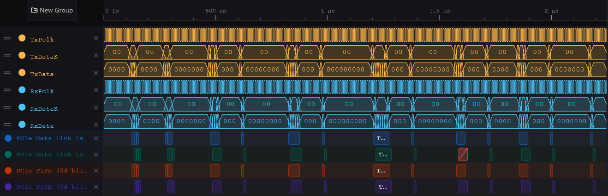

**Flow-control initialization.** One DLLP per clock, each framed by SDP on lane 0 and END on lane 7 (`TxDataK` = `81`). The DLL advertises its receive credits for Posted, Non-Posted and Completion traffic: `InitFC1-P H=32 D=1008`, `InitFC1-NP H=32 D=1`, `InitFC1-Cpl H=0 D=0` (0 means infinite). The PIPE decoder counts the 6 symbols between SDP and END:

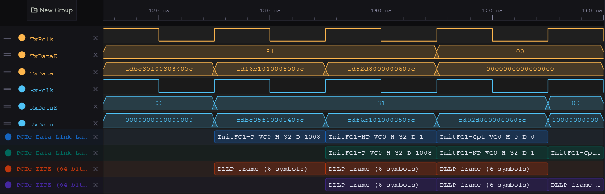

**A TLP.** `MWr32` with sequence number 0 and a 3-DW payload: STP on lane 0 (`TxDataK` = `01`), the sequence number, the 3-DW header, the payload, the LCRC and END on lane 7 (`80`). The 30 symbols are the 2 sequence bytes, 24 TLP bytes and 4 LCRC bytes:

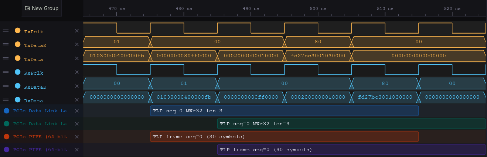

**A corrupted LCRC.** The testbench flips bit 40 of the last word on the way back (`fd2eb881...` sent, `fd2eb981...` received). The Rx Data Link Layer decoder reports `LCRC mismatch`, and so does the DLL: it answers `Nak seq=2`, naming the last TLP it received intact (at 1.72 us in the overview):

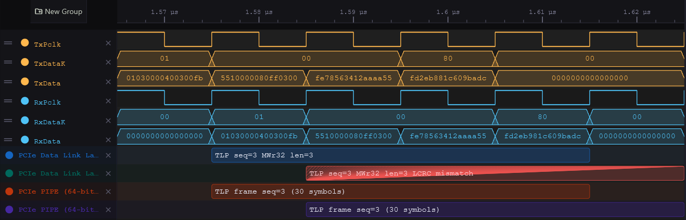

**The replay.** The retry buffer resends the TLP with the same sequence number; the Tx decoder marks it `(replay)`. Rx receives it intact and answers `Ack seq=3` (at 2.0 us). The Rx row does not say `(replay)`, as the first copy never arrived intact:

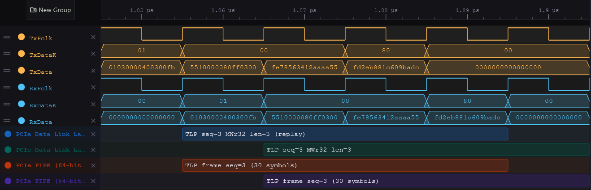

## Simulation with pcieVHost

> **pcieVHost is a Root Complex model written in C.** Its **PIPE interface** connects directly to our **MAC layer**, so traffic passes through our MAC (LTSSM, ordered sets, packet framing) and the DLL: this tests **both the MAC and the DLL** against an independent link partner.

Pictures from Cologne Chip's test in the [`dll_test` branch of gatemate-pipe](https://github.com/colognechip/gatemate-pipe/tree/dll_test) (`sim/pcievhost_test`), scrambling disabled on both sides, decoded with the WaveCrux PCIe decoders above. Our own runs against pcieVHost are in [`5.sim`](../../5.sim). Signals:
- `LinkDownData`/`LinkDownDataK`: pcieVHost (Root Complex) -> our MAC.
- `LinkUpData`/`LinkUpDataK`: our MAC -> pcieVHost.

**Link number detection.** In Configuration, pcieVHost, as the downstream port, proposes a link number by sending TS1 with `link=0 lane=PAD`. Our MAC first sends TS1 with `link=PAD lane=PAD`, then echoes `link=0` back:

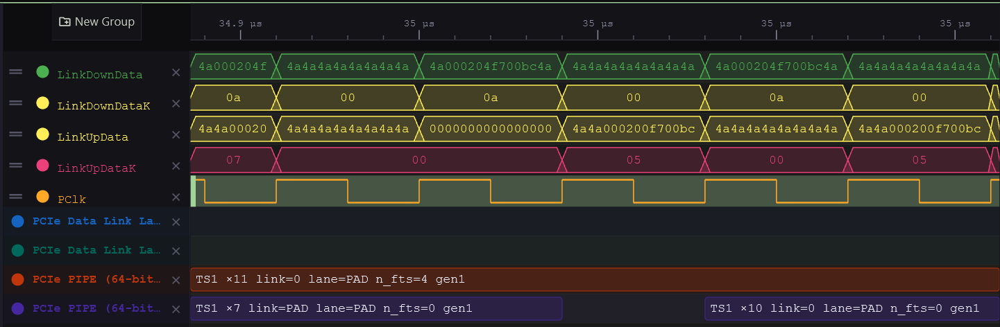

**Lane number detection.** pcieVHost then assigns the lane number by sending TS1 with `link=0 lane=0`, while our MAC is still sending `link=0 lane=PAD`. Once the lane number is accepted, both sides complete Configuration and the LTSSM enters L0:

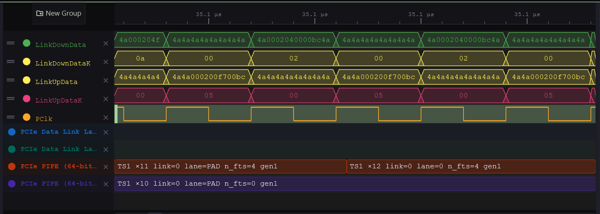

**InitFC1.** With the link up, the DLL enters `DL_INITFC1` and sends `InitFC1-P`, `InitFC1-NP` and `InitFC1-Cpl`, one DLLP per clock with SDP on lane 0 and END on lane 7 (`LinkUpDataK` = `81`). pcieVHost answers with its own InitFC1 set, not aligned to a lane boundary: its first SDP sits on lane 6 (`LinkDownDataK` = `40`), so each DLLP spans two words. This confirms the DLL detects DLLPs at any SDP position:

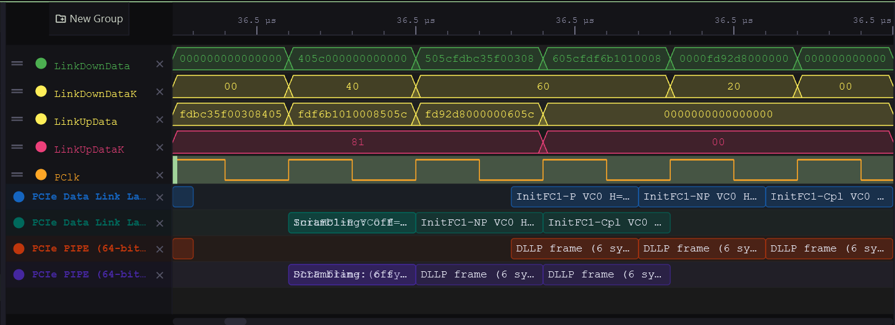

**InitFC2.** Both sides move on to `DL_INITFC2` and exchange `InitFC2-P`, `InitFC2-NP` and `InitFC2-Cpl`, after which the DLL is in `DL_Active`:

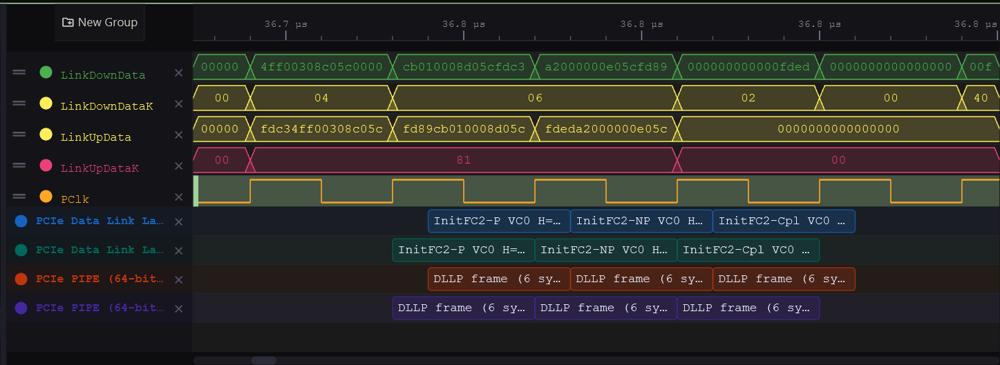

**TLP received.** pcieVHost sends its first TLP, a `CfgWr0` with sequence number 0 and a 1-DW payload (22 symbols from STP to END). STP is on lane 6 (`LinkDownDataK` = `40`) and END on lane 5 of the last word (`20`):

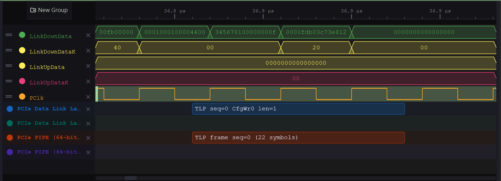

**Returned ACK.** The DLL checks the LCRC and the sequence number, forwards the TLP to the TL and returns `Ack seq=0` to pcieVHost:

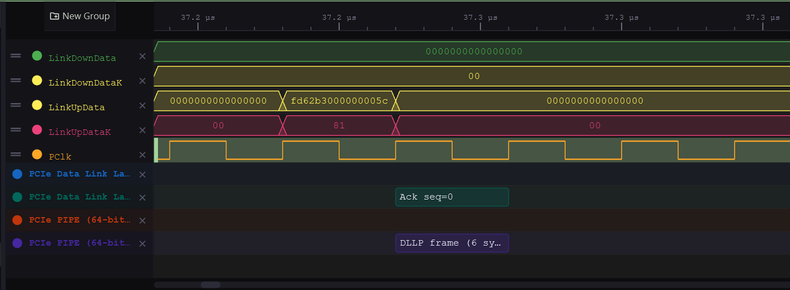

## Simulation over MAC, PIPE and SerDes

`sim/run-dll-phy.sh` runs this DLL over the MAC/LTSSM, the PIPE logic and the opensource SerDes BFM, two link partners on a bit-level serial link: LTSSM training to L0, InitFC, TLPs both ways, NAK and replay of a TLP corrupted on the wire, and an UpdateFC DLLP. See [sim/README.md](sim/README.md).

```sh
bash 2.rtl/4.dll/sim/run-dll-phy.sh
```

## References
- [PIPE Specs, Sept. 2025, v7.1](https://cdrdv2-public.intel.com/643108/643108_PIPE_Arch_Spec_Rev_7_1.pdf)
- [Simon Southwell's Primer](https://www.linkedin.com/pulse/pci-express-primer-1-overview-physical-layer-simon-southwell/)
- [DLL Overview](0.doc/DLL_draft_v2.pdf)
- [openPCIE Controller White Paper](0.doc/opensource-PCIE-Controller.applsci-16-03409.pdf)
- [openPCIE Controller repo](https://github.com/isomoye-msu/pcie_datalink_layer)

--------------------
#### End of Document
