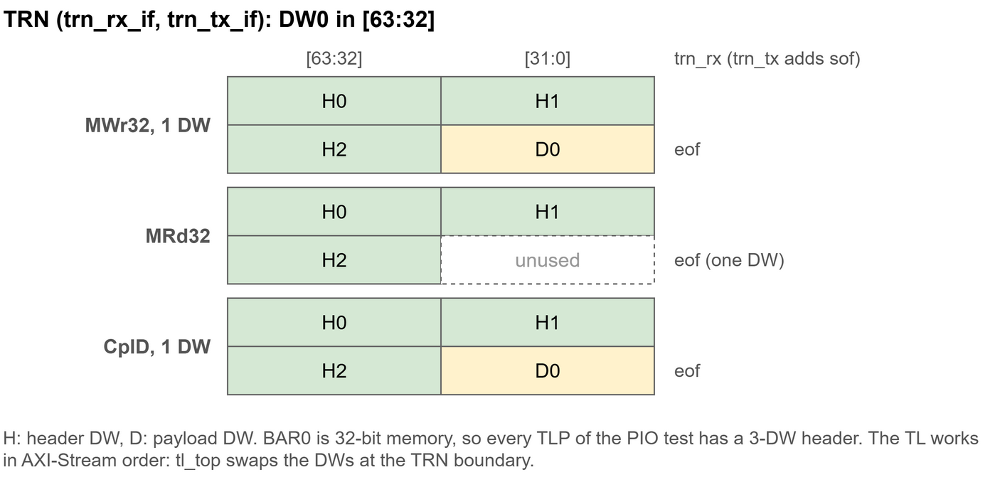
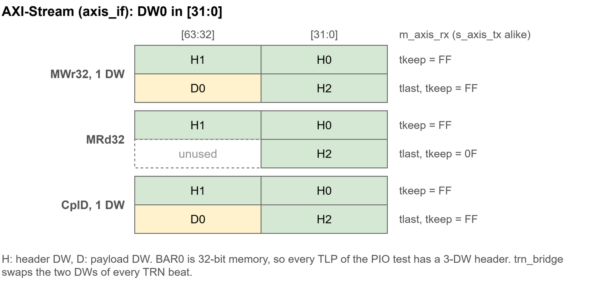

# TRN Bridge

`trn_bridge` turns the TL's TLP interfaces (`trn_tx_if`, `trn_rx_if`, derived from TRN) into the SOC's two 64-bit AXI-Stream streams (`axis_if`), as the AXI wrapper of AMD's `PCIE_2_1` does. From [openPCIE](https://github.com/chili-chips/openPCIE), where it sits on `PCIE_2_1`, cut to what this core uses:
- the clock port is `clk`, our PCLK (`clk62m5` there);
- `m_axis_rx` carries `tdata`, `tvalid` and `tlast`. `tkeep` is all ones, also on a last beat holding one DW, and `tuser` is 0: the SOC reads neither, it takes the length from the header. A departure from AXI-Stream and UG477;
- on `trn_tx_if` / `trn_rx_if` instead of TRN: no `rsof`, `rem`, BAR hit, error forward or `link_up`, and the throttle works on `free_words` (beats) instead of `tbuf_av` (TLPs);
- no padding of a TLP that DL_Down cuts short and no drop of the SOC's TLP on DL_Down: `pcie_core` resets the bridge and the SOC with the link;
- the throttle has no ECRC gap and no PM L1 pause (no ECRC, no power management), and drives `s_axis_tx.tready` itself.

| File | What it is |
|---|---|
| [`trn_bridge.sv`](trn_bridge.sv) | the top: `trn_rx`, `trn_tx` and `trn_tx_throttle` |
| [`trn_rx.sv`](trn_rx.sv) | TRN RX to `m_axis_rx`: DW order; `tkeep` all ones, `tuser` 0 |
| [`trn_tx.sv`](trn_tx.sv) | `s_axis_tx` to TRN TX |
| [`trn_tx_throttle.sv`](trn_tx_throttle.sv) | holds the SOC back between TLPs while the TL's TX buffer is short of room for a largest TLP (`free_words`) |
| [`axis_if.sv`](axis_if.sv) | the AXI-Stream interface to the SOC |

`trn_tx_if`, `trn_rx_if` and `cfg_if` are in [5.tlp](../5.tlp), the TL's user side. Byte and DW order: [5.tlp](../5.tlp/README.md#byte-order).

The same TLPs on both sides of `trn_bridge`:

Validated within the TL unit test-bench: [`5.tlp/sim/run-tl.sh`](../5.tlp/sim/run-tl.sh) ([Simulation](../5.tlp/README.md#simulation)).

--------------------
#### End of Document
