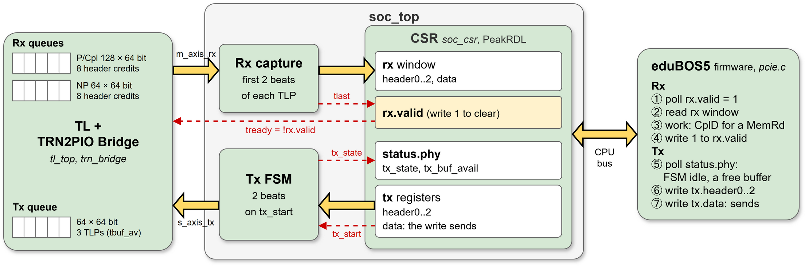
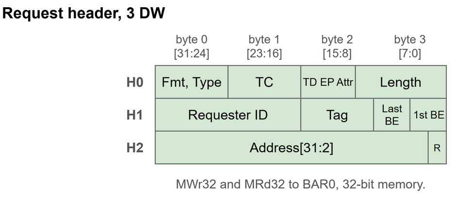
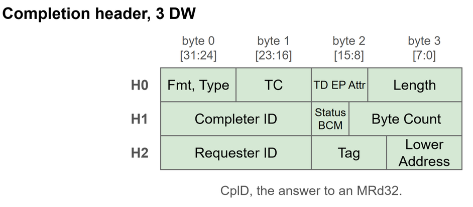

# SOC: eduBOS5 + PCIE CSR window

`soc_top` is the user side of our EP: a small RISC-V SOC that talks to the PCIE core over the same AXI-Stream / TRN interface an AMD Artix-7 EP gives its user logic. Twin of the openPCIE SOC; only the CSR window and firmware change, as the roles swap: the RC sends requests and waits for Completions, the EP waits for requests and sends Completions.

| File | What it is |
|---|---|
| [`soc_top.sv`](soc_top.sv) | CPU, 8 KB RAM, address decode, Tx FSM and Rx capture around the CSR block |
| [`soc_csr.sv`](soc_csr.sv) | bridges the CPU bus to the PeakRDL-generated register block |
| [`mem_if.sv`](mem_if.sv) | the CPU memory bus: valid / addr / wdata / wstrb, ready / rdata |
| [`4.build/csr_build/csr.rdl`](../../4.build/csr_build/csr.rdl) | the register map, the single source of the CSR RTL, C headers and docs |
| [`../5.tlp/`](../5.tlp), [`../6.trn_bridge/`](../6.trn_bridge) | `tl_pkg`, `cfg_if`; `axis_if`: the interfaces to the PCIE core |

### CPU

- **eduBOS5** (default): Chili.CHIPS' RV32I core, copied here in [`CPU.eduBOS5`](CPU.eduBOS5). The master is on [openPCIE](https://github.com/chili-chips/openPCIE/tree/main/2.rtl/0.common.opensource/src/CPU.eduBOS5): before major work here, update the copy from it ([how](CPU.eduBOS5/README.md)). It builds the 3-stage core, with its register file in block RAM; `` `define SOC_EDUBOS5_2STG `` selects the 2-stage one.
- **VProc** (`` `define SOC_CPU_VPROC ``, co-simulation only): the same bus driven by native C/C++ or by the rv32 ISS, see [5.sim](../../5.sim).

### Address map

| Address | What |
|---|---|
| 0x0000_0000 | 8 KB RAM: code, data and the PIO buffer, loaded from `firmware.hex` |
| 0x3000_0000 | PCIE CSR window, see below |

### CSR window

| Offset | Register | Use |
|---|---|---|
| 0x0C | `tx.send` | writing it sends the TLP in `tx_payload` |
| 0x10 – 0x1C | – | free |
| 0x20 | `rx.valid` | a TLP is waiting; write 1 to clear |
| 0x28 | `status.phy` | `tx_busy`: the Tx FSM is sending |
| 0x2C | `status.result` | firmware result marker, write-only; 0x0000_FACE lights `fw_pass` |
| 0x30 | `status.cfg_id` | our own Bus/Device/Function |
| 0x100 – 0x1FC | `rx_payload` | the last TLP received, as it came, header first, 64 DWORDs: entry i is DW i |
| 0x200 – 0x2FC | `tx_payload` | the TLP to send, header first, 64 DWORDs: entry i is DW i |

Things worth knowing:

- **The Rx window takes any TLP as-is.** The RC version decoded only Completions; an EP must see Memory requests. Every incoming TLP lands in `rx_payload`, header first, up to a MemWr of Max_Payload_Size (128 bytes) behind a 4-DW header, and the firmware decodes it. So the window is generic: the same RTL could serve the RC too.
- **The payload windows are RAMs.** `rx_payload` and `tx_payload` are PeakRDL external memories, each two banks of 32 DWORDs, odd and even entries, so that a 64-bit beat writes (Rx) or reads (Tx) both its DWORDs in one clock. Their read is registered, so they fit block RAM.
- **`rx.valid` is the flow control.** Set at the end of a TLP, it holds `m_axis_rx.tready` low until the firmware clears it: a slow CPU never loses a request; the PCIE core waits.
- **Configuration requests never get here.** The TL answers them itself, as the AMD hard macro does. `status.cfg_id` is the Bus/Device/Function the host gave us, captured from its Type 0 Configuration Writes (UG477 `cfg_bus_number`, `cfg_device_number`, `cfg_function_number`); every Completion carries it as the Completer ID.
- **`tx.send` is a trigger.** PeakRDL's `swmod` strobe on that field starts the Tx FSM, so the firmware writes the whole TLP into `tx_payload` first and `tx.send` last. The Tx FSM sends as many DWORDs as the header's Fmt and Length say. The payload must not exceed Max_Payload_Size (32 DWORDs): the hardware does not check it, the simulation assertion `a_tx_max_payload` does. A longer TLP would reach the host as a Malformed TLP.

### What the firmware needs to know

**The handshake:** one TLP at a time each way; the firmware polls `rx.valid` and `status.phy`.

**The headers**, in entries 0 to 2 (3 for a 4-DW header) of `rx_payload` and `tx_payload`, one DW each: H0 first, byte 0 of every DW in bits [31:24], payload included. The firmware decodes requests and builds completions:

<table align="center">
  <tr><th>Request: MWr32, MRd32 (decoded)</th><th>Completion: CplD (built)</th></tr>
  <tr>
    <td></td>
    <td></td>
  </tr>
</table>

Payload DWORD i is `rx_payload` entry 3+i. A 4-DW request (64-bit address) has the upper address half in H2 and the lower in H3 (entry 3), so its payload starts one entry later, at entry 4. The firmware handles both ([3.sw](../../3.sw/README.md#ep-firmware)).

Lint: [`4.build/hw_build/run-lint.sh`](../../4.build/hw_build/run-lint.sh) checks the SOC as part of `top`.

### Where it departs from PCIe 2.1

The SOC adds none: it is the user side, which the spec does not cover. The departures it sees come from below: [TL](../5.tlp/README.md#where-it-departs-from-pcie-21), [DLL](../4.dll/README.md#where-it-departs-from-pcie-21), [MAC](../3.mac/README.md#where-it-departs-from-pcie-21), [PIPE](../2.pipe/README.md#where-it-departs-from-pcie-21), [PHY](../1.phy/README.md#where-it-departs-from-pcie-21).

### Watching the CPU in WaveCrux

[`sim/run-soc.sh`](sim/run-soc.sh) runs the SOC alone (`tb_soc`, Verilator, 20 µs): eduBOS5 starts the firmware, which then waits for the host. Open [`sim/tb_soc.RISCV-ISA.wavecrux`](sim/tb_soc.RISCV-ISA.wavecrux) in WaveCrux: the disassembly and the RVFI Commit Inspector come bound to `tb_soc.cpu_view` ([`soc_cpu_view.sv`](CPU.eduBOS5/wavecrux/soc_cpu_view.sv), from openPCIE).

`bash sim/run-soc.sh tx` tests the Tx path instead: the [`soc_tx`](../../3.sw/tests/soc_tx/main.c) firmware sends 3-DW and 4-DW MWr and MRd, and `tb_soc` checks every `s_axis_tx` beat (data, `tkeep`, `tlast`).

- `soc_top` carries the CPU's retired instructions on [`rvfi_if`](rvfi_if.sv) (`// KEEPME`): the standard [RVFI](https://github.com/YosysHQ/riscv-formal) signals, one `rvfi_valid` per instruction.
- No RTL reads them; they are for WaveCrux and formal checks.
- eduBOS5 drives them when built with `RISCV_FORMAL` (simulation only); under VProc they read 0, as a native program has no instructions.

**The disassembly**, from the EP co-simulation ([5.sim](../../5.sim/README.md)): the firmware clearing `pio_mem`, one turn of the loop. RVFI on top, the RISC-V decoder's table below:

  

**The RVFI Commit Inspector** (View -> Toggle Stage Panel), the same core and view in openPCIE: each retired instruction with its effect, a register written or a store:

  

--------------------
#### End of Document
