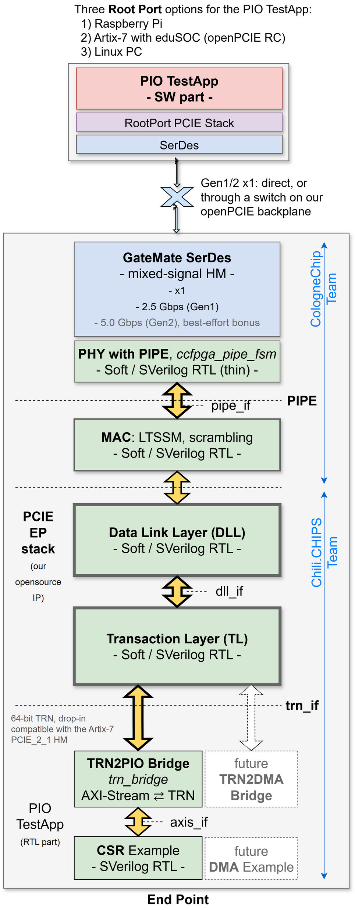
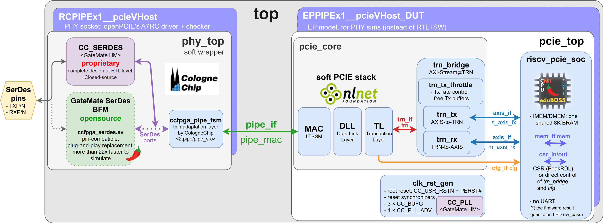
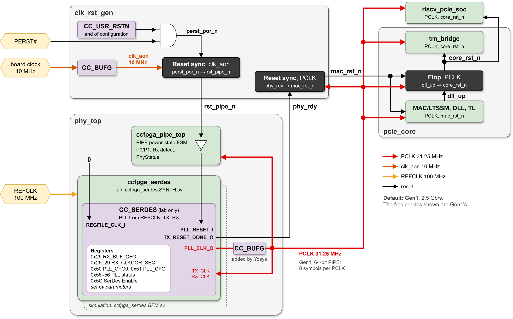
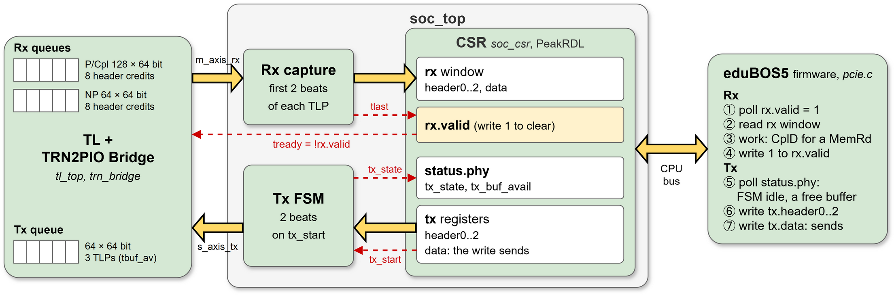

# RTL Architecture

  

### Block Diagram: Coding-ready partitioning

  

### Clock and Reset

Two clocks. `clk_aon` (always on: the 10 MHz board clock, no PLL) runs the reset sequencing. The SerDes regfile clock is tied to 0: parameters set the registers, and start the SerDes and its PLL, on the chip and in simulation. PCLK (31.25 MHz at Gen1) is the SerDes PLL clock itself (`PLL_FCNTRL = 6'h3A`), and runs everything from the MAC up to the SOC. SerDes clock correction is off: no SKP is added or removed on RX, so the EP needs the common REFCLK of the slot.

Each reset is asserted asynchronously and released on its own clock, in a chain ([`clk_rst_gen.sv`](clk_rst_gen.sv)):
- `rst_pipe_n`: end of configuration (`CC_USR_RSTN`) and PERST#. PIPE Reset# and the SerDes PLL reset, the same in simulation and on the chip
- `mac_rst_n` (MAC, DLL): once the SerDes TX is out of reset
- `core_rst_n` (TL, `trn_bridge`, SOC): while the data link is up (`dll_up`); made in [`pcie_core.sv`](pcie_core.sv)

  

The rate is fixed at reset: no dynamic rate change ([Future Development](#future-development)). The default is Gen1, and the diagram shows its frequencies. A Gen2 build would run at:

| Clock | Gen1 (default) | Gen2 |
|---|---|---|
| Line rate | 2.5 Gb/s | 5 Gb/s |
| `PLL_OUT_DIVSEL` | 1 | 0 |
| PCLK = `PLL_CLK_O` (64-bit PIPE, 8 symbols per clock) | 31.25 MHz | 62.5 MHz |
| REFCLK | 100 MHz | 100 MHz |
| `clk_aon` | 10 MHz | 10 MHz |

### Compatibility goal: an Artix-7 EndPoint, in open source

To its user, our EP looks exactly like the AMD Artix-7 EP, the `PCIE_2_1` hard macro in the 64-bit EndPoint mode.

- **`trn_if` is plug-and-play, drop-in compatible with the TRN interface of `PCIE_2_1`**: same signals, widths and handshakes. Logic written for the HM connects unchanged; the TRN / AXI-Stream user interface is kept as-is.
- The soft TL answers configuration requests itself, as the hard macro does.
- When in doubt about behaviour, [UG477](../0.doc/2.rtl/ug477_7Series_IntBlock_PCIe.pdf) is the reference.

### Porting plan: openPCIE → openCologne-PCIE

[openPCIE](https://github.com/chili-chips-ba/openPCIE) (Root Complex, Artix-7) and openCologne-PCIE (EndPoint, GateMate) are twins. We keep the openPCIE structure and replace only what is vendor-specific:

| openPCIE (Artix-7 RC) | openCologne-PCIE (GateMate EP) |
|---|---|
| `PCIE_2_1` hard macro: TL, DLL, LTSSM, MAC | soft RTL: MAC/LTSSM ([3.mac](3.mac)) by Cologne Chip, DLL ([4.dll](4.dll)) and TL ([5.tlp](5.tlp)) by Chili.CHIPS; MAC and DLL sources in the gatemate-pipe submodule |
| `phy_top`: `mac2phy` + GTP wrapper + `GTPE2` hard macros | `phy_top`: Cologne Chip soft wrapper ([2.pipe](2.pipe)) + GateMate SerDes `CC_SERDES` ([1.phy](1.phy)), one `ccfpga_serdes` instance: `CC_SERDES` behind it for the chip, the open [SerDes BFM](1.phy/2.serdes-model) for simulation |
| `trn_bridge`, `trn_if`, `axis_if`, `cfg_if`, `pcie_pkg` | the same ([5.tlp](5.tlp)); `trn_bridge` unchanged, on the TRN bus of our TL instead of `PCIE_2_1` |
| SOC `riscv_pcie_soc` + PeakRDL CSR | the same ([6.soc](6.soc)), with the Rx window capturing any TLP, as an EP must see Memory requests |
| eduBOS5 RISC-V core | copied from openPCIE, unchanged ([`6.soc/CPU.eduBOS5`](6.soc/CPU.eduBOS5)); more on eduBOS5, such as the CPU comparison, formal proofs and WaveCrux views, is in [openPCIE](https://github.com/chili-chips-ba/openPCIE/blob/main/2.rtl/0.common.opensource/src/CPU.eduBOS5/README.md) |
| co-sim VIP: VProc, pcieVHost as the EP, rv32 ISS | the same in [5.sim](../5.sim), pcieVHost as the RC; upstream copies in [`5.sim/vip`](../5.sim/vip/README.md) |
| C firmware: the RC enumerates and tests the EP | C firmware: the EP answers the host's Memory requests |

Only the C firmware changes role. Everything is open source: no split between vendor and open RTL.

#### References:
- [PCIE Primer](../0.doc/pcie-primer.Simon-Southwell.pdf) by Simon Southwell ✔
- [PCIE Technology Rev3.0 (MindSharePress2012)](https://github.com/chili-chips-ba/openCologne-PCIE/blob/main/0.doc/PCIE-Technology3-0---MindSharePress2012.pdf)
- [PCIE Base Spec Rev2.1](https://github.com/chili-chips-ba/openCologne-PCIE/blob/main/0.doc/PCIE-base-spec.Rev2-1.pdf)
- [openPCIE Controller WhitePaper](https://www.mdpi.com/2076-3417/16/7/3409)
- [GateMate FPGA Datasheet, DS1001](../0.doc/2.rtl/ds1001-GateMate-datasheet.Sep2026.pdf) by Cologne Chip, September 2026
- [GateMate FPGA Primitives Library, UG1001](../0.doc/2.rtl/ug1001-GateMate-primitives-library.Mar2025.pdf) by Cologne Chip, March 2025: `CC_DFF`, `CC_BUFG`, `CC_USR_RSTN`, `CC_SERDES`
- [GateMate Integrated Logic Analyzer, UG1005](../0.doc/2.rtl/ug1005-GateMate-ILA.Aug2025.pdf) by Cologne Chip, August 2025: on-chip debug
- [Inside GateMate: Analysis and Benchmarking of a New FPGA Architecture](https://ieeexplore.ieee.org/document/11322434) by Tarik Ibrahimović and Nedim Osmić, ICM 2025
- [7 Series FPGAs Integrated Block for PCI Express, UG477](../0.doc/2.rtl/ug477_7Series_IntBlock_PCIe.pdf) by AMD/Xilinx: the user interface (TRN / AXI-Stream, configuration space) our EP reproduces; the reference whenever in doubt
- [USB 3 implementation on GateMate](https://videos.cern.ch/record/3025766), CERN FPGA Developers' Forum 2026: best-talk award, funded by NLnet

  
#### Examples:

Proprietary PCIE Core for Xilinx 7Series FPGA devices
  - [Xilinx UG477 7series PCIE HM - User Guide](https://docs.amd.com/v/u/en-US/ug477_7Series_IntBlock_PCIe) ✔
  - [Xilinx PG054 7series PCIE HM - Product Guide](https://www.xilinx.com/support/documents/ip_documentation/pcie_7x/v3_3/pg054-7series-pcie.pdf)
  - [Xilinx DS821 7series PCIE HM - Datasheet](https://docs.xilinx.com/v/u/en-US/ds821_7series_pcie)
> The Xilinx 7-series PCIE Hard Macro (HM) covers our goals and more (e.g. root complex mode, multi-lanes). It indicates the complexity a viable open-source alternative must meet.
>
> Below: open-source **applications** built around vendor PCIE HMs, such as this _pcie_7x_ core.
> - [regymm pcie_7x](https://github.com/regymm/pcie_7x)
> - [LiteFury pcie_7x](https://github.com/hdlguy/litefury_pcie)
> - [wavelet-lab pcie_7x wrappers, with DMA](https://github.com/wavelet-lab/usdr-fpga/tree/main/lib/pci)
> - [Wupper DMA for Xilinx PCIE HMs](https://gitlab.nikhef.nl/franss/wupper)
> - [Alex's wrappers for Xilinx and Altera PCIE HMs, with DMA](https://github.com/alexforencich/verilog-pcie)
> - [LitePCIE wrappers for vendor (Xilinx, Gowin, Lattice, ...) PCIE HMs](https://github.com/enjoy-digital/litepcie)
>
> A common misconception: these are not open-source PCIE cores, but examples of how to use proprietary ones. Ours is currently the only open-source work creating a PCIE EP core itself.

---
# PIO MemWr/Rd signalling flow: a walkthrough

How a PIO write and a PIO read cross today's stack, layer by layer. Details: [MAC](3.mac/README.md), [DLL](4.dll/README.md), [TL](5.tlp/README.md), [SOC](6.soc/README.md).

## (i) Reception of a `MemWr` Request

A `Posted` transaction: no response.

| Layer | RX: the MemWr comes in | TX: what goes back |
|---|---|---|
| SerDes + PHY | 8b/10b decode, elastic buffer, comma alignment; `ccfpga_pipe_fsm` hands the words to the MAC on `pipe_if` | |
| MAC | descrambles, strips the ordered sets, passes data and K flags to the DLL | scrambles the DLL's Ack and UpdateFC DLLPs; inserts SKP ordered sets |
| DLL | finds STP, checks LCRC and sequence number, strips the framing, hands the TLP to the TL on `dll_if` | schedules an Ack for it |
| TL | checks the TLP (Malformed, Receiver Overflow), queues it as posted, decodes the BAR0 hit | an UpdateFC-P once the TLP has left its queue |
| `trn_bridge` | TRN RX to `m_axis_rx`, `tuser.bar_hit` = BAR0 | |
| SOC | the firmware writes its PIO memory | |

## (ii) Reception of a `MemRd` Request and Completion

A `Non-posted` transaction: the requester waits for a `Completion`.

| Layer | RX: the MemRd comes in | TX: the CplD goes back |
|---|---|---|
| SerDes, PHY, MAC, DLL | as for the MemWr | MAC: scrambling, SKP; SerDes: 8b/10b, serializer |
| DLL | as for the MemWr | sequence number, LCRC, STP/END; holds the CplD in its retry buffer until Acked, replays it on a Nak |
| TL | queues it as non-posted; `tlp_order` releases it only after every posted TLP received before it | the TX buffer takes the CplD whole; `tlp_tx_arbiter` sends it when the link partner has the credits |
| `trn_bridge` | TRN RX to `m_axis_rx` | `s_axis_tx` to TRN TX, throttled by `tbuf_av` |
| SOC | the firmware reads its PIO memory | builds the CplD: Completer ID from `cfg`, Requester ID and Tag of the MemRd |

Configuration requests stop in the TL: `config_space` answers them and `cpl_gen` builds the completion. So do Unsupported Requests.

---
# Walkthrough Interface Layers

The layers in the order of the [stack diagram](../0.doc/2.rtl/pcie-ep-top-stack.png), from the PIPE up: each interface and the layer above it.

## 1) PIPE (pipe_if)
64-bit PIPE between the MAC and Cologne Chip's soft PHY. See [2.pipe](2.pipe/README.md) and [1.phy](1.phy/README.md).

## 2) MAC: Physical Layer to PIPE

#### Ordered sets

| Ordered set | RX | TX | Notes |
|---|---|---|---|
| TS1, TS2 | ✅ | ✅ | Link and Lane numbers as numbers or PAD |
| SKP | ✅ | partial | sent every 2360-2384 symbol times, not 1180-1538 ([#38](https://github.com/chili-chips-ba/openCologne-PCIE/issues/38)); cuts a TS1 short in Polling ([#31](https://github.com/chili-chips-ba/openCologne-PCIE/issues/31)); RX: not detected, may reach the DLL as data ([#32](https://github.com/chili-chips-ba/openCologne-PCIE/issues/32)) |
| Logical idle | ✅ | ✅ | in Configuration.Idle and Recovery.Idle; RX counts any word without COM as idle |
| Electrical Idle (EIOS) | ❌ | ❌ | no speed change, no low-power states |
| FTS | ❌ | ❌ | no L0s |
| Compliance pattern | ❌ | ❌ | |

#### Other

| Feature | Support | Notes |
|---|---|---|
| LTSSM | partial | Detect, Polling (Active, Configuration), Configuration (all but Lanenum.Wait, unused at x1), L0, Recovery (RcvrLock, RcvrCfg, Idle). No Polling.Compliance, L0s, L1, L2, Disabled, Loopback or Hot Reset |
| Speed | Gen1 | no Recovery.Speed |
| Scrambling | ✅ | data symbols only, reset by COM; Disable Scrambling (TS Training Control bit 3) taken in Configuration.Complete, both ways ([3.mac](3.mac/README.md#scrambling)). RX in L0 also descrambles a received TS1/TS2 ([#42](https://github.com/chili-chips-ba/openCologne-PCIE/issues/42)) |
| Lane polarity inversion | ✅ | detected in Polling, `RxPolarity` to the PHY |
| Lane reversal | — | x1 |
| Clock tolerance compensation | ❌ | SerDes clock correction off; common REFCLK only |

## 3) DLL (dll_if)

#### DLLP generation and reception

| DLLP | RX | TX | Notes |
|---|---|---|---|
| InitFC1, InitFC2 | ✅ | ✅ | P, NP, Cpl; credits from the TL's `INIT_*` ([gatemate-pipe#17](https://github.com/colognechip/gatemate-pipe/pull/17), [#22](https://github.com/chili-chips-ba/openCologne-PCIE/issues/22)); repeated every 34 µs ([#25](https://github.com/chili-chips-ba/openCologne-PCIE/issues/25)) |
| UpdateFC | ✅ | ✅ | on the TL's request, and every 30 µs |
| Ack, Nak | ✅ | ✅ | an Ack is sent as soon as it is scheduled: no AckNak latency timer yet; a Nak for every bad TLP (no `NAK_SCHEDULED`) |
| PM_Enter_L1, PM_Enter_L23, PM_Active_State_Request_L1, PM_Request_Ack | ❌ | ❌ | no power management |
| Vendor specific | ❌ | ❌ | |

#### Other

| Feature | Support | Notes |
|---|---|---|
| Framing: STP ... END (TLP), SDP ... END (DLLP) | ✅ | |
| LCRC (32-bit), DLLP CRC (16-bit) | ✅ | |
| Sequence numbers, duplicates | ✅ | a duplicate TLP is Acked and dropped |
| Retry buffer | ✅ | one TLP, in block RAM ([gatemate-pipe#20](https://github.com/colognechip/gatemate-pipe/pull/20)) |
| Back-to-back TLPs | ❌ | a TLP right behind another one is dropped without a Nak ([#26](https://github.com/chili-chips-ba/openCologne-PCIE/issues/26)) |
| Replay on Nak | ✅ | |
| Replay timer | ❌ | a lost TLP is never replayed ([#24](https://github.com/chili-chips-ba/openCologne-PCIE/issues/24)) |
| Nullified TLP (EDB) | ❌ | |
| DL Init FSM | ✅ | `DL_Inactive` → `DL_Init` (`DL_INITFC1`, `DL_INITFC2`) → `DL_Active` |

The TL starts a TLP only while `tx_tlp_ready` is high, and marks the last word of an odd-DW TLP with `tx_tlp_last_half` ([#21](https://github.com/chili-chips-ba/openCologne-PCIE/issues/21)).

## 4) TL (trn_if)
The user side of the TL: the 64-bit TRN bus, drop-in compatible with the Artix-7 `PCIE_2_1` hard macro's.

#### TLP generation and reception

| TLP | RX | TX | Notes |
|---|---|---|---|
| Memory Read, 32- and 64-bit address | ✅ to the SOC on a BAR0 hit | ✅ from the SOC | a BAR0 miss gets an Unsupported Request completion; SOC requests wait for Bus Master Enable |
| Memory Write, 32- and 64-bit address | ✅ to the SOC on a BAR0 hit | ✅ from the SOC | a BAR0 miss or poisoned MWr is discarded, Unsupported Request |
| Memory Read Locked | Unsupported Request | ❌ | as Cpl, not CplLk ([#39](https://github.com/chili-chips-ba/openCologne-PCIE/issues/39)) |
| I/O Read, I/O Write | Unsupported Request | ❌ | legacy |
| Configuration Type 0 | ✅ answered by the TL | — | function 0; another function gets Unsupported Request |
| Configuration Type 1 | Unsupported Request | — | RCs and switches only |
| AtomicOp | Unsupported Request | ❌ | |
| Messages | PME_Turn_Off, Set_Slot_Power_Limit; others discarded or Unsupported Request | PME_TO_Ack, ERR_NONFATAL, ERR_FATAL | no legacy interrupts |
| Cpl, CplD | ✅ to the SOC, `err_fwd` if poisoned | ✅ from the TL (configuration, Unsupported Request) and the SOC (its reads) | |

#### Other

| Feature | Support | Notes |
|---|---|---|
| TLP header decode and build | ✅ | 3 DW and 4 DW, through the `pcie_pkg` structs |
| Bus and Device Number capture | ✅ | on every Type 0 configuration write to function 0; Completer ID and Requester ID |
| Ordering | ✅ | posted TLPs pass a waiting non-posted one, never the reverse |
| Flow control | ✅ | transmit gating per 2.6.1.1; an UpdateFC on every credit release |
| ECRC | ❌ | a digest is accounted for in the length, not checked |
| Traffic Classes, Virtual Channels | ❌ | TC0, VC0 |
| Error handling | ✅ | without AER: Malformed TLP and Receiver Overflow are Fatal, Unsupported Request Non-Fatal; no correctable errors, and a poisoned TLP sets only Detected Parity Error ([#40](https://github.com/chili-chips-ba/openCologne-PCIE/issues/40)) |

## 5) Type 0 Configuration Space

In the TL _config_space_, as on the hard macro. Each register is one 32-bit word with a write mask, and an RW1C mask where needed.

| Capability | Implemented | Notes |
|---|---|---|
| Type 0 header | ✅ | BAR0 only: 32-bit, non-prefetchable, `2^BAR0_SIZE_BITS` bytes |
| PCI Power Management | ✅ | D0 and D3hot |
| PCI Express | ✅ | version 2, Endpoint; Max_Payload_Size 128 bytes; 2.5 GT/s, x1; advertises L0s, which the MAC lacks ([#47](https://github.com/chili-chips-ba/openCologne-PCIE/issues/47)); its 64 ns L0s Acceptable Latency keeps hosts that check it (e.g. Linux) from enabling it |
| MSI | ❌ | no interrupts |
| AER, other extended capabilities | ❌ | |

To the rest of the logic, through `cfg_if`: Bus and Device Number, Memory Space Enable, Bus Master Enable, Max_Payload_Size. Register list: [5.tlp](5.tlp/README.md#configuration-space).

## 6) axis_if and TRN2PIO Bridge
`trn_bridge` (`trn_rx`, `trn_tx`, `trn_tx_throttle`), unchanged from openPCIE, turns the TRN bus into the SOC's two 64-bit AXI-Stream streams (`axis_if`), as the AXI wrapper of `PCIE_2_1` does. Behind it, `riscv_pcie_soc` runs the PIO TestApp firmware on eduBOS5: it serves the MemWr and MemRd to BAR0 from its memory and builds the completions ([6.soc](6.soc/README.md), [3.sw](../3.sw/README.md)).

## 7) CSR, HAL and SW Interface
The CSR block (`soc_csr`, at 0x3000_0000 on the CPU bus) is where the firmware meets the PCIE side: the `tx` registers (0x00) for the TLP to send, the `rx` window (0x10) for the received one, and `status` (0x24).

**Handshake:** one TLP at a time each way, the firmware polls.

- **Rx:** the SOC captures the first two beats of a TLP into the `rx` window and sets `rx.valid` at its last beat. While `rx.valid` is set, `tready` is low and the next TLP waits in the TL's queues (posted/completion 128 × 64 bit, non-posted 64 × 64 bit, 8 header credits each), its credits held, so nothing is lost. The firmware reads the window, answers, and writes 1 to `rx.valid` to open it again.
- **Tx:** the firmware waits for the Tx FSM to be idle and the TL's Tx queue (64 × 64 bit, 3 TLPs) to have a free slot (`status.phy`), writes `tx.header0..2`, then `tx.data`. That last write starts the FSM, which sends the TLP in two beats.

> **Food for thought:** PIO bursts without the CPU, see [Future Development](#future-development).

The registers are written once, in SystemRDL ([`csr.rdl`](../4.build/csr_build/csr.rdl)). [PeakRDL](https://peakrdl.readthedocs.io) compiles that one file into the CSR RTL (`csr.sv`, `csr_pkg.sv`), the C header of the HAL (`csr.h`) and the register map docs ([`opencologne_pcie.md`](../4.build/csr_build/generated-files/opencologne_pcie.md)). RTL, firmware and docs cannot drift apart.

- **Generate:** [4.build](../4.build/README.md#build-environment), step 1 (`MakefileCSR`)
- **Firmware use:** [3.sw](../3.sw/README.md#ep-firmware)
- **Co-simulation:** [5.sim](../5.sim/README.md#hal): the same firmware compiled for the host, each CSR access a _VProc_ bus cycle

---
# Where it departs from PCIe 2.1

By design: Gen1 and x1 only; no L0s, L1, L2, Disabled, Loopback, Hot Reset or Compliance; no clock tolerance compensation (common REFCLK only); framing in the DLL. Open bugs and the full lists, with spec sections and issues, per layer: [PHY](1.phy/README.md#where-it-departs-from-pcie-21), [PIPE](2.pipe/README.md#where-it-departs-from-pcie-21), [MAC](3.mac/README.md#where-it-departs-from-pcie-21), [DLL](4.dll/README.md#where-it-departs-from-pcie-21), [TL](5.tlp/README.md#where-it-departs-from-pcie-21).

---
# Future Development

1. **Dynamic rate change (Gen1 ↔ Gen2).**
   - The LTSSM negotiates speed in Recovery.Speed and drives a PIPE `Rate`, which our `pipe_if` and CC's PIPE logic would also need.
   - A fabric FSM reprograms the SerDes through its regfile: PLL off, `PLL_CFG1` (`PLL_OUT_DIVSEL` 1 → 0), PLL on, wait for lock, then `PhyStatus`.
   - PCLK doubles to 62.5 MHz and stops during the relock, so everything above the PHY must close timing at Gen2.
2. **PIO bursts.**
   - An FSM, instead of the CPU, services the TL's queues: MemWr and MemRd to BAR0 go straight to and from the SOC memory, with multi-DW Completions.
   - The firmware only sets it up. We stay the Completer: no new TLP types, no tags.
3. **DMA.**
   - The EP becomes a Requester: a DMA engine issues MemWr and MemRd to host memory, once Bus Master Enable is set.
   - It needs tags and outstanding-request tracking, Completion reassembly and timeouts, and Tx arbitration with the PIO path.
   - Descriptor CSRs for the firmware, and a host driver to hand out buffers.

---
---
# Design Process and QA Methodology

### RTL coding guidelines

IEEE 1800-2009 SystemVerilog, the same rules as on [openPCIE](https://github.com/chili-chips-ba/openPCIE/blob/main/2.rtl/README.md#rtl-coding-rules), for our RTL and the models standing in for it. The gatemate-pipe submodule (`2.pipe/pipe_src`: the PIPE, MAC/LTSSM and DLL sources) keeps its own style. [`run-lint`](../4.build/hw_build/run-lint.sh), [`run-format`](../4.build/hw_build/run-format.sh) and [`run-leq`](../4.build/hw_build/run-leq.sh) are in `4.build/hw_build`.

- **One place for bit positions:** TLP header fields and sideband bits are packed structs in a `_pkg` (openPCIE: [`pcie_pkg.sv`](https://github.com/chili-chips-ba/openPCIE/blob/main/2.rtl/0.common.opensource/src/pcie/pcie_pkg.sv)). Use their members, never raw slices like `tdata[30:29]`. Reserved bits `rsvd0`, `rsvd1`, ... make each struct span its full width.
- **Declare and size once:** widths, constants and types live in a `_pkg` (e.g. `TRN_DATA_W` in openPCIE's `pcie_pkg.sv`); no module redeclares them.
- **Fewer, richer ports:** interfaces and struct-typed ports, not many scalars; same for internal signals.
- **Packages:** `import` right after the module name, no package prefix on every use.
- **Case:** signals and ports lower case; constants (parameters, localparams, enum values, macros) UPPER CASE. Only vendor hard-macro and primitive pins (`CC_SERDES`, `CC_BUFG`, `CC_USR_RSTN`, ...) keep vendor names.
- **Descriptor names:** a signal of a `pcie_pkg` header or sideband type is named `*_dw0` ... `*_dw3`, `*_hdr_*` or `*_tuser` (e.g. `rx_hdr_dw0`, `tx_cfg_dw2`). It reads only the fields it needs; `run-lint.sh` waives the unread fields by that name.
- **Procedural blocks:** `always_ff` for flip-flops, `always_comb` for combinational logic, never plain `always`. `unique case` for parallel muxes covering every value, `unique0 case` where no item may match, `priority case` for priority encoders; never plain `case`. A `unique case` has no `default`.

  | Keyword | Several items match | No item matches | Synthesis meaning |
  |---|---|---|---|
  | `unique` | violation | violation, unless there is a `default` | `parallel_case` + `full_case` |
  | `unique0` | violation | allowed, nothing happens | `parallel_case` only |
  | `priority` | first one wins | violation, unless there is a `default` | ordered (priority) logic |

  `unique0` (IEEE 1800-2009) is the simulation-aware `parallel_case`; the old work-around, `unique case` with an empty `default`, is not used.
- **`logic`, not `wire`:** every signal and port is `logic`, every `input`/`output` typed (`input logic ...`), never defaulting to `wire`. Only an `inout` would be a `wire`; there are none. `wire x = expr;` becomes `logic x;` + `assign x = expr;` (`logic x = expr;` is only an initial value).
- **`initial` blocks:** not in RTL, except `$readmemh` of the firmware into the SOC RAM and the register-file clear in `edubos5_rf.sv` (FPGA only). Models and test benches may use them freely.
- **No `` `timescale `` in RTL:** the test bench sets it (`5.sim/tb.sv`, `2.rtl/1.phy/3.sim/tb_phy.sv`). RTL has no `#` delays; the behavioural SerDes model (`1.phy/2.serdes-model`) keeps its own `` `timescale `` and delays. A directive in only some files is a lint finding (Verilator TIMESCALEMOD).
- **No initial values on registers:** a register gets its value from the reset branch of its `always_ff`. One exception, instantiated by name so it stands out: the design's reset source. Its initial value asserts reset at configuration, PERST# asserts it later, and every other reset derives from it (openPCIE: `u_rst_sync0/1` in [`clk_rst_gen.sv`](https://github.com/chili-chips-ba/openPCIE/blob/main/2.rtl/0.common.opensource/src/pcie/clk_rst_gen.sv)).
- **Arrays, not flat buses:** arrays of lanes or structs, no index arithmetic on flat buses.
- **`/*LINT:OK*/`:** marks an unused *output* pin of a hard macro, primitive or third-party core as reviewed: `.PIN (/*LINT:OK*/)`, with a `// reason` if not obvious. Never on an input (`run-lint.sh` flags it); unused inputs are tied off.
- **No-connects:** unused bits of a hard-macro or primitive output go to `NC_` signals: `{NC_x, used}` on a bus pin, or an `NC_` signal for an unused lane. `NC_` signals are never read.
- **Lint:** fix findings at the root; waive only as a last resort, as described in [`run-lint-waivers.txt`](../4.build/hw_build/run-lint-waivers.txt). Don't mold legal, intended code around one tool's quirk (e.g. slang on `unique case` with a `default`, Verilator on unpacked-struct members written by separate processes): waive it with a reason.
- **Variants in one file:** a parameter selects the variant inside one module, never a module copy. Differences go in `generate` ... `endgenerate` with named branches, `if (PARAM == ...) begin : g_x` / `else begin : g_y`. A variant needing no circuit ties the signal to a constant, not an unused flop. Example: `go2exec` in [`edubos5.sv`](https://github.com/chili-chips-ba/openPCIE/blob/main/2.rtl/0.common.opensource/src/CPU.eduBOS5/edubos5.sv).
- **Flopped controls:** a high-fanout control (load enable, mux select) comes from a flop next to the logic it serves. Its next value derives from existing signals; no FSM is copied or edited for it.
- **One signal per function:** no `x` plus `x_q` pairs. When a control is registered, the flop is the signal.
- **Minimal logic:** leave out terms that do not change behaviour, and say why in a comment (e.g. `go2exec` ignores the `SYSTEM` halt).
- **Assertions:** only under an `ifdef`; the RTL is never changed for them. Simulation gets SVA, open-source formal gets immediate `assert` with `$past`; both forms stay ([eduBOS5](https://github.com/chili-chips-ba/openPCIE/blob/main/2.rtl/0.common.opensource/src/CPU.eduBOS5/README.md#getting-started-with-formal-proving-a-worked-example)). In an RTL file they follow these rules too (`always_ff`, reset instead of initial values). The harnesses in `formal/` are verification code, like `5.sim`.
- **Clean diffs:** no blank-line or alignment changes beyond what `run-format.sh` makes; check `git diff` before a commit.
- **Models follow the RTL:** a model keeps the ports, interfaces, structs, loops and names of the RTL it replaces.
- **Formatting:** [`run-format.sh`](../4.build/hw_build/run-format.sh) puts every `if`, `else`, `always`, `for` and `initial` body in `begin` ... `end`, even a single statement, then runs Verible (`verible-verilog-format`) at its defaults plus all alignment options set to `align`, `end` and `else` on separate lines, LF line endings (flags in the script). Max 100 columns; wrap longer lines by hand. Run it last, after lint, before a commit; `--check` only lists unformatted files.

---
---
### Quality checks: lint, format, synthesis, simulation

Lint finds what tests miss: undriven signals, truncated widths, unintended latches. The scripts in [`4.build/hw_build`](../4.build/hw_build) check all of `top`:

| Script | Does | Why |
|---|---|---|
| `run-lint.sh` | Verilator, Yosys, slang, Verible; `/*LINT:OK*/` only on outputs | each tool has blind spots; together they see more |
| `run-format.sh` | `begin`/`end`, Verible format | diffs show only real changes |
| `run-leq.sh` | Yosys formal equivalence, old vs new RTL | proves a cleanup changes nothing |
| `run-synth.sh` | Yosys `synth_gatemate` | the RTL maps to GateMate; cell count |

Example: the first run flagged a latch in the MAC scrambler (128 `CC_DLT` cells, fixed in [gatemate-pipe#21](https://github.com/colognechip/gatemate-pipe/pull/21)): a combinational `always` that skips an assignment on some path must hold the old value. The simulation passed; only lint caught it.

Next: wider `run-lint.sh` coverage. [LintCrux](https://github.com/Ferrite-Engineering/lintcrux) (from the WaveCrux makers) runs several lint engines and tracks waivers and trends; it has been run on eduBOS5 and is a candidate.

#### C linting: VProc, pcieVHost, the checker, host-built firmware

| Check | How | Catches |
|---|---|---|
| `-O0` against `-O2` | `OPTFLAG`: both builds must give the same result | undefined behaviour, which the optimiser exploits differently |
| UBSan, ASan | sanitizer builds, with `-DVPROC_THREADS` (the sanitizers do not follow VProc's coroutine stack switches) | overflows, bad shifts, out-of-bounds accesses |
| valgrind memcheck | on the XSIM run (`xsim -R`) | uninitialised reads |

Found this way: an array one word short, a signed shift and an uninitialised counter in link training (openPCIE [issues 28 to 30](https://github.com/chili-chips-ba/openPCIE/tree/main/5.sim#simulation-issues)).

#### Simulation: cross-checked

A passing run is believed only when independent checkers agree. Details: [5.sim](../5.sim/README.md), and openPCIE's [5.sim](https://github.com/chili-chips-ba/openPCIE/tree/main/5.sim) for the RC model.

| Checker | How | Catches |
|---|---|---|
| A7RC driver + checker | openPCIE's Artix-7 RC model drives the EP and checks every TLP, DLLP and ordered set: 59 rules, each with its PCIe 2.1 section. `make mutants` (openPCIE) breaks the EP 5 ways, and each must fail its rule | protocol errors of the EP |
| Random regression | `make regress SEEDS=100 REGRESS_JOBS=8`: 100 random seeds or more, side by side (100 in about 19 s). Each seed varies the requests, their order and timing, the faults and Recoveries, and the TS counts; `make run SEED=N` reproduces one. It ends with the rules no seed checked | corner cases one fixed test never reaches |
| WaveCrux Pro decoders | the run's FST through Ferrite's PCIe TLP, Data Link and PIPE decoders; `make wavecrux SEED=N` opens it at the checker's first violation | a second opinion, from code we did not write |
| Artix-7 hard macro | openPCIE's `PCIE_2_1` simulation model under the same faults and Recoveries (`HM_PROBE=1`); the RC model is calibrated to it | the answer where the spec leaves room |

Where they disagree: the spec text first, then the hard macro, then WaveCrux.

#### Simulation: three simulators

| Simulator | Where | Check |
|---|---|---|
| Verilator | here | 2-state, fast: the regression runs on it |
| Icarus | here | 4-state: must print the same checker lines as Verilator, line for line, on the PIPE and on the serial line |
| XSIM (Vivado) | openPCIE | the same run with the default scheduling and with `--disable_multi_driver_resolution_scheduling` must give the same trace: no race decides a result |

Comparing them found three bugs in the models that one simulator alone hid: electrical idle unseen on 4-state simulators, a start-up race and a sampling race (openPCIE [issues 53, 55, 56](https://github.com/chili-chips-ba/openPCIE/tree/main/5.sim#simulation-issues)).

#### Simulation: layer by layer

These test benches cover the EP, layer by layer, each checking its layer against a link partner that does not share its code. Each is described next to its sources.

| Layer | Simulation | DUT | Checked against | Simulator | pcieVHost | Status |
|---|---|---|---|---|---|---|
| PIPE + PHY | [`1.phy/3.sim`](1.phy/3.sim) `run-phy.sh pipe64` | Cologne Chip's PIPE logic over the opensource SerDes BFM, 64-bit | the vendor's PIPE test case | Icarus | no | passes |
| | `run-phy.sh equiv` | the opensource SerDes BFM | itself, looped back; the vendor model with `--ref` (NDA, not in the repo) | Icarus | no | passes: 400 words, 0 mismatches |
| | `run-phy.sh pipe16` | the same, 16-bit | the vendor's PIPE test case | Icarus | no | fails: [#18](https://github.com/chili-chips-ba/openCologne-PCIE/issues/18) |
| DLL over PIPE + PHY | [`4.dll/sim`](4.dll/sim) `run-dll-phy.sh` | DLL, MAC/LTSSM, PIPE and SerDes BFM, end to end on the serial line | a second copy of the same stack: training to L0, InitFC, TLPs both ways, Nak and replay of a corrupted sequence number, TLP byte or LCRC, a DLLP with a bad CRC dropped, UpdateFC | Icarus | no | passes; with `--inject=stp` or `end` fails: [#24](https://github.com/chili-chips-ba/openCologne-PCIE/issues/24) |
| TL | [`5.tlp/sim`](5.tlp/sim) `run-tl.sh` | `pcie_tl` with `trn_bridge`, at `dll_if` and the AXI-Stream ports of `trn_bridge` | a test bench in the roles of the DLL, the host and a PIO application: configuration space, Unsupported Requests, messages, ordering, flow control, random PIO traffic | Verilator | no | passes |
| MAC + DLL + TL + firmware | [`5.sim`](../5.sim) | the EP at its PIPE (or on the serial line): the EP RTL + firmware (`EP=rtl`), or the EP model (`EP=model`) | `RCPIPEx1__pcieVHost`, the host: openPCIE's A7RC driver + checker (enumeration, BARs, PIO, faults; 59 PCIe 2.1 rules) | Verilator or Icarus (`EP=rtl`: Verilator) | 1.9.3: RC (host), EP (model) | 2026-11-01: the EP model passes, 100 seeds; `EP=rtl` passes with `A7RC=1` (the lab RC's requests), fails the tester: [#24](https://github.com/chili-chips-ba/openCologne-PCIE/issues/24), [#26](https://github.com/chili-chips-ba/openCologne-PCIE/issues/26), [#36](https://github.com/chili-chips-ba/openCologne-PCIE/issues/36) to [#38](https://github.com/chili-chips-ba/openCologne-PCIE/issues/38) |

- A failure is pinned to the layer that shows it: every layer below has its own bench.
- The PHY bench is permanent. `run-dll-phy.sh` drives TLPs into the DLL; [`5.sim`](../5.sim) with `EP=rtl` takes over, against an independent link partner ([why the split](../5.sim/README.md#scope-unit-debug-then-top-level-validation)).
- Not counted above: [`4.dll/sim/tb_dll_wavecrux.v`](4.dll/sim) makes the [WaveCrux pictures](4.dll/README.md#viewing-the-dll-in-wavecrux) of the DLL; [`6.soc/sim`](6.soc/sim) runs the SOC alone, without a checker, for the [WaveCrux CPU view](6.soc/README.md#watching-the-cpu-in-wavecrux); the gatemate-pipe submodule brings Cologne Chip's own test benches.

--------------------
#### End of Document
