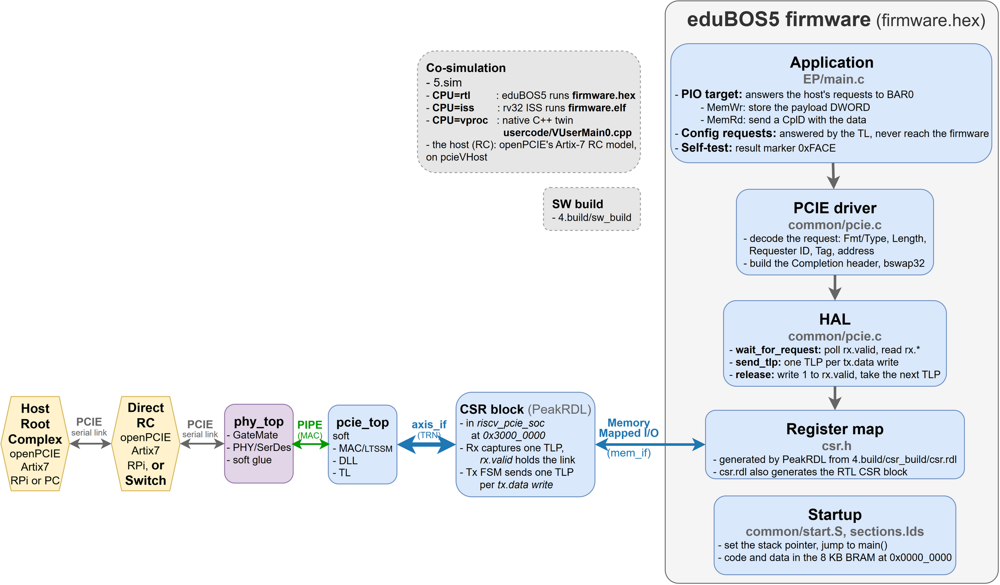

# SW Architecture

This is where the developers of **PIO TestApp** (the software part of) document their work.

<div align="center"></div>

### EP firmware

The EP firmware runs bare-metal on the eduBOS5 core of our GateMate SOC. It is the twin of the openPCIE RC firmware, with the roles swapped: there, the CPU sends requests and waits for Completions; here, it waits for the host's requests and sends the Completions.

| File | What it does |
|---|---|
| [`EP/main.c`](EP/main.c) | the PIO target, as large as BAR0 (4 KB): stores every DWORD of a MemWr, 3-DW or 4-DW header; answers a MemRd with CplDs, split at the 64-byte Read Completion Boundary; any other non-posted request with Unsupported Request |
| [`common/pcie.c`](common/pcie.c), [`pcie.h`](common/pcie.h) | the request layer: wait for a TLP in the CSR Rx window, decode its header, build and send the Completion (with up to 64 DWORDs of data), release the window |
| [`common/start.S`](common/start.S), [`sections.lds`](common/sections.lds) | set the stack, jump to `main()`; code and data in the 8 KB RAM at 0x0000_0000 |
| [`tests/soc_tx/main.c`](tests/soc_tx/main.c) | a test, not the EP: sends 3-DW and 4-DW MWr and MRd, for `tb_soc`'s Tx check ([`run-soc.sh tx`](../2.rtl/7.soc/sim/run-soc.sh)) |

What a reader should take from it:

- **The TL does the configuration, not the firmware.** The host's CfgRd0/CfgWr0 (IDs, Command register, BAR0 sizing) are answered by the soft TL, as AMD's `PCIE_2_1` hard macro answers them in silicon in EP mode. Only Memory requests reach the firmware, so enumeration works even before the firmware has started.
- **One TLP at a time, nothing lost.** The SOC captures each incoming TLP into the Rx window, the header in `rx.header0..2`, the DWORDs from DW3 on in `rx_payload`, and sets `rx.valid`. While it is set, the link is held off; the firmware clears it once it has answered.
- **A Completion routes back by the request's IDs.** Requester ID and Tag come from the request, TC and Attr are copied from it, and the Completer ID is our own Bus/Device/Function, read from `status.cfg_id`. That value comes from the host's configuration writes and differs between a direct link and a link behind a switch, so it is never hard-coded.
- **Byte enables matter.** A MemWr updates only the enabled bytes of its first and last DWORD; a MemRd's Byte Count and Lower Address follow from its First and Last DW Byte Enables (Base Specification 2.1, Tables 2-31 and 2-32), and each of its Completions carries the bytes left from its own first byte on. On the TRN interface, payload byte 0 travels in bits [31:24].
- **PASS means the host reached us.** `status.result` reads 0x0000_0001 while the firmware waits, and 0x0000_FACE (the `fw_pass` LED) once it has answered the host's first read.

Build (WSL, with the xPack RISC-V GCC on `PATH`):

```sh
cd 4.build/sw_build && make      # firmware.elf, .bin and .hex for the SOC RAM
```

We plan on creating not one, but three "Getting Started" examples, for the three representative compute platforms:
1) **Soft Embedded / BareMetal**: Artix-7 FPGA acting as a RootComplex with soft on-chip RISC-V CPU, on our openPCIE backplane
2) **General-purpose desktop/server class**: Linux PC
3) **Hard Embedded / Hosted**: RaspberryPi

## 1) Artix-7 FPGA as RootPort

## 2) PC as RootPort

## 3) RaspberryPi as RootPort


--------------------
#### End of Document
