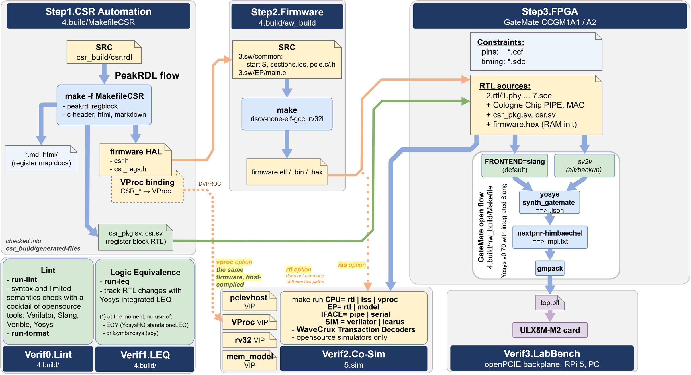

# _openCologne-PCIE_ Build

The build process for the _openCologne-PCIE_ project consists of three steps:
- Compilation of the control and status registers (CSR) from their RDL specification into RTL for the hardware design and a hardware abstraction layer (HAL) for the software application
- Compilation of the software application for the RISC-V hardware target
- Compilation of SystemVerilog designs into a bitstream for the hardware target

Each step has its own `Makefile` or scripts. Run them in order - the software can pick up the generated HAL, and the hardware build embeds the firmware image into the bitstream.

The flow is Yosys + nextpnr-himbaechel, the same as [openXC7](https://github.com/openXC7) on openPCIE: Yosys synthesizes (`read_slang` for SystemVerilog), nextpnr-himbaechel places and routes with the pins from a `.ccf` file and the timing from an `.sdc` file, and `gmpack` writes the bitstream. The build is simpler than on openPCIE: one CPU core (eduBOS5) and one tool flow, with no Vivado option.

## Build environment

We aim for Linux-native tools throughout, and accept WSL for convenience and inclusivity. Yet, as the GUI apps run worse on Linux and WSL (GPU drivers are not on par), we enjoy WaveCrux on Windows.

| Step | Makefile / Directory | Produces |
|---|---|---|
| 1. CSR | [`MakefileCSR`](./MakefileCSR) | `csr_build/generated-files/` - `csr.sv`, `csr_pkg.sv`, `csr.h`, `csr_top.h`, `opencologne_pcie.md`, `html/` |
| 2. SW | [`sw_build`](./sw_build) | `firmware.elf`, `firmware.bin`, `firmware.hex` |
| 3. HW | [`hw_build`](./hw_build): `run-lint.sh` `run-format.sh` `run-leq.sh` `run-synth.sh` `run-pnr.sh` | lint, format and equivalence reports, the GateMate netlist (`top.json`); the placed and routed design and the bitstream (`top.bit`), on mock pins for the GateMate A1 EVB (`GateMateA1-EVB.ccf`) until the board exists |

eduBOS5 is a copy of openPCIE's, in [`2.rtl/7.soc/CPU.eduBOS5`](../2.rtl/7.soc/CPU.eduBOS5).

### Build Structure

## Tool versions

The versions this repo has been run with so far. "Runs" means the step completes here.

| Tool | Version | Used for | Status |
|---|---|---|---|
| PeakRDL | 1.5.0 | CSR RTL, headers, docs (`MakefileCSR`) | generates |
| xPack RISC-V GCC | 15.2.0-1 | firmware (`sw_build`) | builds |
| GCC | 15.2 | co-sim C/C++: VProc, pcieVHost, the RC model; `-O0`/`-O2`, UBSan, ASan | builds |
| Yosys | 0.70, with `read_slang` | 8b/10b proofs, standalone SerDes test synthesis, `run-synth.sh`, `run-lint.sh`, `run-leq.sh` | runs |
| Verible | v0.0-4296-g0f262651 | `run-lint.sh`, `run-format.sh` | runs |
| Icarus Verilog | 14.0 (devel, master `7025c6613`, 2026-11-13) | PHY and DLL-over-PHY simulations, co-sim (`make SIM=icarus run`); 14 or later for the PIPE, MAC and DLL interface ports | runs |
| Verilator | 5.055 (devel, `v5.054-260-gb9f22851`) | co-sim (`make run`, default), SOC lint; its FST writer needs `liblz4-dev` | runs, checks |
| JanusHDL | 0.17.0 (preview) | co-sim (`make SIM=janushdl run`), EP model only: it has no assertions yet, which the EP RTL uses; free, closed source | runs |
| OSS CAD Suite | 2026-11-12 | Cologne Chip's toolchain package ([UG1002](../0.doc/4.build/ug1002-GateMate-toolchain.May2026.pdf)): nextpnr-himbaechel `nextpnr-0.11.1-91-gf934534a`, GateMate, for `run-pnr.sh` (`NEXTPNR=`); its Yosys is a development build, not used | places and routes; timing fails |
| gmpack | OSS CAD Suite, or Project Peppercorn v1.14 | bitstream (`run-pnr.sh`) | not yet run: P&R stops on timing |
| openFPGALoader | 1.1.1 | loading the bitstream over JTAG | not yet used on the board |
| WaveCrux Pro | 1.1.1 | waveforms; PIPE, DLL and serial-line decoding (wcx-pcie 0.3.0), TLP decoding (Pro, and [our plugin](https://github.com/Ferrite-Engineering/wavecrux-decoders/tree/main/decoders/pcie-tlp), pcie-tlp 0.1.1), RISC-V (Windows) | runs |
| Python | 3.12 | build scripts, `run-format.sh` | runs |

## Utilization

`run-synth.sh`, then `run-pnr.sh`, on the CCGM1A1 (EVB pins, PCLK 31.25 MHz). One row per change that moves the numbers.

| Date | Design | CPE_LT | CPE_FF | RAM_HALF | PCLK | Result |
|---|---|---|---|---|---|---|
| 2026-11-02 | retry buffer in flip-flops ([BA#33](https://github.com/chili-chips-ba/openCologne-PCIE/issues/33)) | 80,093 (195%) | 39,808 (97%) | 20 / 64 | – | does not place |
| 2026-11-02 | retry buffer in block RAM ([gatemate-pipe#20](https://github.com/colognechip/gatemate-pipe/pull/20)) | 22,076 (53%) | 7,261 (17%) | 22 / 64 | 12.2 MHz, 3 hold violations | routes; fails timing ([BA#46](https://github.com/chili-chips-ba/openCologne-PCIE/issues/46)) |
| 2026-11-02 | no latch in the MAC scrambler ([gatemate-pipe#21](https://github.com/colognechip/gatemate-pipe/pull/21)) | 22,181 (54%) | 7,147 (17%) | 22 / 64 | 12.75 MHz, no hold violation | routes; fails setup ([BA#46](https://github.com/chili-chips-ba/openCologne-PCIE/issues/46)) |
| 2026-11-13 | the same RTL (renames and formatting only), OSS CAD Suite 2026-11-12 | 21,536 (52%) | 7,076 (17%) | 22 / 64 | 13.07 MHz | routes; fails setup ([BA#46](https://github.com/chili-chips-ba/openCologne-PCIE/issues/46)) |

Out of 40,960 CPE_LT and CPE_FF, and 64 RAM_HALF.

**Per block** (2026-11-03):

| Block | CPE_LT | CPE_FF | RAM_HALF |
|---|---|---|---|
| SOC (`soc_top`: eduBOS5, RAM, CSR) | 5,999 (27%) | 2,091 (30%) | 12 |
| TL (`tl_top`) | 4,588 (20%) | 1,789 (26%) | 6 |
| DLL (`dll_top`) | 7,286 (32%) | 1,695 (24%) | 4 |
| Other (MAC, PHY, `trn_bridge`, clocks and resets) | 4,597 (20%) | 1,365 (20%) | 0 |
| Total | 22,470 | 6,940 | 22 |

Neither Yosys nor nextpnr reports a flat build per block. These numbers come from a second build that keeps the three blocks (`read_slang --best-effort-hierarchy`, `keep_hierarchy`), packed by nextpnr and counted by cell name. Nothing is optimised across the block boundaries there, so it is 1.2% larger in CPE_LT (9% in Yosys LUTs), and its routing did not converge; a second build per change is not sustainable, so this table is a snapshot.

#### References:
- [GateMate FPGA Toolchain Installation, UG1002](../0.doc/4.build/ug1002-GateMate-toolchain.May2026.pdf) by Cologne Chip, May 2026
- GateMate pin lists, from the DS1001 attachment, September 2026: [CCGM1A1](../0.doc/4.build/gatemate-ccgm1a1-pinlist.csv), [CCGM1A2](../0.doc/4.build/gatemate-ccgm1a2-pinlist.csv)
- nextpnr constraints: [general](https://github.com/YosysHQ/nextpnr/blob/master/docs/constraints.md), and the GateMate `.ccf` reader in nextpnr-himbaechel, [`ccf.cc`](https://github.com/YosysHQ/nextpnr/blob/master/himbaechel/uarch/gatemate/ccf.cc)
- [prjpeppercorn-test-cases](https://github.com/YosysHQ/prjpeppercorn-test-cases): open-flow GateMate test designs
- [Yosys](https://github.com/YosysHQ/yosys) with [slang](https://github.com/MikePopoloski/slang), and [nextpnr](https://github.com/YosysHQ/nextpnr) (himbaechel, GateMate): the tool flow; prebuilt in the [OSS CAD Suite](https://github.com/YosysHQ/oss-cad-suite-build/releases), as UG1002 recommends
- [PeakRDL](https://github.com/SystemRDL): `MakefileCSR`, CSR RTL, headers and docs from `csr_build/csr.rdl`
- [openFPGALoader](https://github.com/trabucayre/openFPGALoader): loads the bitstream over JTAG, GateMate included
- [fpgacapZero](https://github.com/lcapossio/fpgacapZero) (fcapz) -- open-source, vendor-agnostic FPGA debug cores: embedded logic analyzer, embedded I/O, JTAG-to-AXI and JTAG-to-UART bridges.

-----------
#### End of Document
