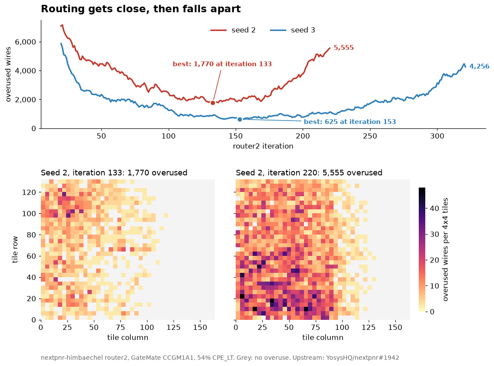

# _openCologne-PCIE_ Build

The build process for the _openCologne-PCIE_ project consists of three steps:
- Compilation of the control and status registers (CSR) from their RDL specification into RTL for the hardware design and a hardware abstraction layer (HAL) for the software application
- Compilation of the software application for the RISC-V hardware target
- Compilation of SystemVerilog designs into a bitstream for the hardware target

Each step has its own `Makefile` or scripts. Run them in order - the software can pick up the generated HAL, and the hardware build embeds the firmware image into the bitstream.

The flow is Yosys + nextpnr-himbaechel, the same as [openXC7](https://github.com/openXC7) on openPCIE: Yosys synthesizes (`read_slang` for SystemVerilog), nextpnr-himbaechel places and routes with the pins from a `.ccf` file and the timing from an `.sdc` file, and `gmpack` writes the bitstream. The build is simpler than on openPCIE: one CPU core (eduBOS5) and one tool flow, with no Vivado option.

## Build environment

We aim for Linux-native tools throughout, and accept WSL for convenience and inclusivity. Yet, as the GUI apps run worse on Linux and WSL (GPU drivers are not on par), we enjoy WaveCrux on Windows.

| Step | Makefile / Directory | Produces |
|---|---|---|
| 1. CSR | [`MakefileCSR`](./MakefileCSR) | `csr_build/generated-files/` - `csr.sv`, `csr_pkg.sv`, `csr.h`, `csr_top.h`, `opencologne_pcie.md`, `html/` |
| 2. SW | [`sw_build`](./sw_build) | `firmware.elf`, `firmware.bin`, `firmware.hex` |
| 3. HW | [`hw_build`](./hw_build): `run-lint.sh` `run-format.sh` `run-leq.sh` `run-synth.sh` `run-pnr.sh` | lint, format and equivalence reports, the GateMate netlist (`top.json`); the placed and routed design and the bitstream (`top.bit`), on mock pins for the GateMate A1 EVB (`GateMateA1-EVB.ccf`) until the board exists |

eduBOS5 is a copy of openPCIE's, in [`2.rtl/7.soc/CPU.eduBOS5`](../2.rtl/7.soc/CPU.eduBOS5).

### Build Structure

## Tool versions

The versions this repo has been run with so far. "Runs" means the step completes here.

| Tool | Version | Used for | Status |
|---|---|---|---|
| PeakRDL | 1.5.0 | CSR RTL, headers, docs (`MakefileCSR`) | generates |
| xPack RISC-V GCC | 15.2.0-1 | firmware (`sw_build`) | builds |
| GCC | 15.2 | co-sim C/C++: VProc, pcieVHost, the RC model; `-O0`/`-O2`, UBSan, ASan | builds |
| Yosys | 0.70, with `read_slang` | 8b/10b proofs, standalone SerDes test synthesis, `run-synth.sh`, `run-lint.sh`, `run-leq.sh` | runs |
| Verible | v0.0-4296-g0f262651 | `run-lint.sh`, `run-format.sh` | runs |
| Icarus Verilog | 14.0 (devel, master `addeab31d`, 2026-11-23) | PHY and DLL-over-PHY simulations, co-sim (`make SIM=icarus run`); 14 or later for the PIPE, MAC and DLL interface ports | runs |
| Verilator | 5.055 (devel, `v5.054-260-gb9f22851`) | co-sim (`make run`, default), SOC lint; its FST writer needs `liblz4-dev` | runs, checks |
| JanusHDL | 0.22.0 | co-sim (`make SIM=janushdl run`): `EP=model`; `EP=rtl` waits on [#24](https://github.com/chili-chips/openCologne-PCIE/issues/24); free, closed source | runs |
| OSS CAD Suite | 2026-11-12 | Cologne Chip's toolchain package ([UG1002](../0.doc/4.build/ug1002-GateMate-toolchain.May2026.pdf)): nextpnr-himbaechel `nextpnr-0.11.1-91-gf934534a`, GateMate, for `run-pnr.sh` (`NEXTPNR=`); its Yosys is a development build, not used | places and routes; timing fails |
| gmpack | OSS CAD Suite, or Project Peppercorn v1.14 | bitstream (`run-pnr.sh`) | not yet run: P&R stops on timing |
| openFPGALoader | 1.1.1 | loading the bitstream over JTAG | not yet used on the board |
| WaveCrux Pro | 1.1.1 | waveforms; PIPE, DLL and serial-line decoding (wcx-pcie 0.3.0), TLP decoding (Pro, and [our plugin](https://github.com/Ferrite-Engineering/wavecrux-decoders/tree/main/decoders/pcie-tlp), pcie-tlp 0.1.1), RISC-V (Windows) | runs |
| Python | 3.12 | build scripts, `run-format.sh` | runs |

## Utilization

`run-synth.sh`, then `run-pnr.sh`, on the CCGM1A1 (EVB pins, PCLK 31.25 MHz). One row per change that moves the numbers.

| Date | Design | CPE_LT | CPE_FF | RAM_HALF | PCLK | Result |
|---|---|---|---|---|---|---|
| 2026-11-02 | retry buffer in flip-flops | 80,093 (195%) | 39,808 (97%) | 20 / 64 | – | does not place |
| 2026-11-02 | retry buffer in block RAM | 22,076 (53%) | 7,261 (17%) | 22 / 64 | 12.2 MHz, 3 hold violations | routes; fails timing ([#15](https://github.com/chili-chips/openCologne-PCIE/issues/15)) |
| 2026-11-02 | no latch in the MAC scrambler | 22,181 (54%) | 7,147 (17%) | 22 / 64 | 12.75 MHz, no hold violation | routes; fails setup ([#15](https://github.com/chili-chips/openCologne-PCIE/issues/15)) |
| 2026-11-13 | the same RTL (renames and formatting only), OSS CAD Suite 2026-11-12 | 21,536 (52%) | 7,076 (17%) | 22 / 64 | 13.07 MHz | routes; fails setup ([#15](https://github.com/chili-chips/openCologne-PCIE/issues/15)) |
| 2026-11-25 | eduBOS5 register file in block RAM, `packet_handler` rewrite, default router with `--tmg-ripup` | 19,608 (47%) | 6,199 (15%) | 24 / 64 | 22.28 MHz | routes; fails setup ([Timing closure difficulties](#timing-closure-difficulties)) |

Out of 40,960 CPE_LT and CPE_FF, and 64 RAM_HALF.

**Per block** (2026-11-03):

| Block | CPE_LT | CPE_FF | RAM_HALF |
|---|---|---|---|
| SOC (`soc_top`: eduBOS5, RAM, CSR) | 5,999 (27%) | 2,091 (30%) | 12 |
| TL (`tl_top`) | 4,588 (20%) | 1,789 (26%) | 6 |
| DLL (`dll_top`) | 7,286 (32%) | 1,695 (24%) | 4 |
| Other (MAC, PHY, `trn_bridge`, clocks and resets) | 4,597 (20%) | 1,365 (20%) | 0 |
| Total | 22,470 | 6,940 | 22 |

Neither Yosys nor nextpnr reports a flat build per block. These numbers come from a second build that keeps the three blocks (`read_slang --best-effort-hierarchy`, `keep_hierarchy`), packed by nextpnr and counted by cell name. Nothing is optimised across the block boundaries there, so it is 1.2% larger in CPE_LT (9% in Yosys LUTs), and its routing did not converge; a second build per change is not sustainable, so this table is a snapshot.

## Timing closure difficulties

> **At a glance**
> - **Routing-bound at half full.** Both GateMate PCIe designs use about 50% of CPE_LT, yet routing takes most of each clock period.
> - **The routed ceiling is about 33 MHz.** The PCLK target is 31.25 MHz, so the margin is thin for anyone.
> - **We went from 12.2 to 22.28 MHz in November.** The next 9 MHz starts with the TL TX arbiter, then the router.
> - **A true Gen2 is hardly possible on the A1.** A "fake Gen2", with only the PIPE at 128 bits, can still test CC_SERDES training at 5 Gb/s ([details](#gen2-on-the-a1)).

### Ours and Goran's, side by side

[Goran's GateMate port of eerie](https://github.com/goran-mahovlic/pci_eerie/tree/gatemate-w16) hits the same limit as ours.

| | Ours (2026-11-25) | Goran's (EERIE_W8, 64-bit) |
|---|---|---|
| CPE_LT | 19,608 (47%) | 20,662 (51%) |
| Routed PCLK | **22.28 MHz** (default router, `--tmg-ripup`) 20.51 MHz (router2) | **31.35 to 34.65 MHz** |
| Placer estimate | 37.31 MHz | |
| Worst path | TL TX arbiter credit check: 44.9 ns, of which **31.4 ns (70%) is routing** | closed |

### Routing, not logic

**One net shows it.** In the router2 run, `u_tlp_rx_buffer.u_lcrc.crc_q[2]` takes **14.3 ns** to route from tile (40,118) to (41,113). Its ends are only **5 rows apart**, so the delay is a routing detour, not logic depth.

**One seed is not a measurement.** router2 gets close, then falls apart (the chart above), and the default router took **84 min** to converge. Check a timing change on 2 or 3 seeds before trusting it.

### Progress

| Date | Change | Routed PCLK |
|---|---|---|
| 2026-11-02 | retry buffer in block RAM | 12.2 MHz |
| 2026-11-02 | no latch in the MAC scrambler | 12.75 MHz |
| 2026-11-13 | OSS CAD Suite 2026-11-12 | 13.07 MHz |
| 2026-11-25 | register file in block RAM, `packet_handler` rewrite, `--tmg-ripup` | **22.28 MHz** |

### What helps

1. **The default router with `--tmg-ripup`**, as Goran uses. On the same netlist it gives 22.28 MHz against router2's 20.51 MHz, and it converges. `run-pnr.sh` uses it.
2. **No asynchronous-read memories.** GateMate has no LUT RAM, so such a memory becomes flip-flops and wide muxes, all of which must be routed. Moving eduBOS5's register file to block RAM cut DFF from 1,490 to 466 and MX from 1,101 to 405.
3. **Fewer logic levels and lower fan-out.** Goran duplicates high-fan-out registers, decodes K symbols a clock early, and uses prefix ANDs, popcount trees, flat matrices and a CRC precomputed from the RAM output. He measures each change on its own, in a shift-register harness.
4. **Register cuts on the worst paths.** The `packet_handler` rewrite took the DLL off the worst path. The TL TX arbiter is next.
5. **Aim at the big blocks.** The DLL is 33% of the logic. The LCRC is only about 8% of the design, and its form hardly matters: 1,113 cells flat, 1,197 chained.

### Gen2 on the A1

**A true Gen2 is hardly possible on the CCGM1A1.** Gen2 carries 4 Gb/s, which is 64 bits at 62.5 MHz or 128 bits at 31.25 MHz, end to end.

- **Routing is the main limit.** 62.5 MHz leaves about 6 to 8 logic levels per clock, at about 1.8 ns each, mostly wire. No PHY block reaches that even alone: Goran's best is 52.8 MHz.
- **Logic is the second limit.** A 128-bit datapath at 31.25 MHz does not fit. Goran's 128-bit PHY alone takes 81% of the CPEs, so a 128-bit DLL and TL would not fit beside it.

**A "fake Gen2" is possible.** Widen only the PIPE to 128 bits, and keep the DLL and TL at 64 bits behind a FIFO. That is Goran's `EERIE_W16`. The link trains at 5 GT/s but carries Gen1 throughput, 250 MB/s.

Its use is to test CC_SERDES training at 5 Gb/s. That is not proven in silicon yet: on the ULX5M, the PLL path 5 Gb/s needs measured far worse than the current one, already at 2.4 Gb/s.

### Router issues we filed

| Issue | What happens |
|---|---|
| [nextpnr#1732](https://github.com/YosysHQ/nextpnr/issues/1732) (our comment) | **Oscillation:** router2 never clears one overused wire, because two nets take it in turns |
| [nextpnr#1942](https://github.com/YosysHQ/nextpnr/issues/1942) | **Divergence:** overuse falls, then rises. Seed 2 bottoms at 1,770 (iteration 133) and climbs to 5,555 |
| [#28](https://github.com/chili-chips/openCologne-PCIE/issues/28) | our tracker for the divergence |

## Porting to other FPGAs

Everything above `pipe_if` is generic RTL: only `2.rtl/1.phy` and `2.rtl/2.pipe` are GateMate-specific. On another FPGA, put that vendor's SerDes behind a PIPE shim (receiver detection, PhyStatus, RxValid, electrical idle, reset sequencing) and feed the core 8 symbols per clock at 31.25 MHz (Gen1). A SerDes that gives 2 symbols at 125 MHz needs a 2-to-8 gearbox, with asynchronous FIFOs both ways, outside the core.

On Lattice ECP5 with the OSS CAD Suite (Yosys `read_slang`, nextpnr-ecp5), two netlist fixes go into the build script:

- memories without an initial value get `INITVAL = x`, which nextpnr-ecp5 cannot parse: `setundef -zero -params` on `TRELLIS_DPR16X4`;
- the DCU's default parameters come out as `"DONTCARE"`, which nextpnr cannot parse either: remove them from the netlist.

#### References:
- [GateMate FPGA Toolchain Installation, UG1002](../0.doc/4.build/ug1002-GateMate-toolchain.May2026.pdf) by Cologne Chip, May 2026
- GateMate pin lists, from the DS1001 attachment, September 2026: [CCGM1A1](../0.doc/4.build/gatemate-ccgm1a1-pinlist.csv), [CCGM1A2](../0.doc/4.build/gatemate-ccgm1a2-pinlist.csv)
- nextpnr constraints: [general](https://github.com/YosysHQ/nextpnr/blob/master/docs/constraints.md), and the GateMate `.ccf` reader in nextpnr-himbaechel, [`ccf.cc`](https://github.com/YosysHQ/nextpnr/blob/master/himbaechel/uarch/gatemate/ccf.cc)
- [prjpeppercorn-test-cases](https://github.com/YosysHQ/prjpeppercorn-test-cases): open-flow GateMate test designs
- [Yosys](https://github.com/YosysHQ/yosys) with [slang](https://github.com/MikePopoloski/slang), and [nextpnr](https://github.com/YosysHQ/nextpnr) (himbaechel, GateMate): the tool flow; prebuilt in the [OSS CAD Suite](https://github.com/YosysHQ/oss-cad-suite-build/releases), as UG1002 recommends
- [PeakRDL](https://github.com/SystemRDL): `MakefileCSR`, CSR RTL, headers and docs from `csr_build/csr.rdl`
- [openFPGALoader](https://github.com/trabucayre/openFPGALoader): loads the bitstream over JTAG, GateMate included
- [fpgacapZero](https://github.com/lcapossio/fpgacapZero) (fcapz) -- open-source, vendor-agnostic FPGA debug cores: embedded logic analyzer, embedded I/O, JTAG-to-AXI and JTAG-to-UART bridges.

-----------
#### End of Document
