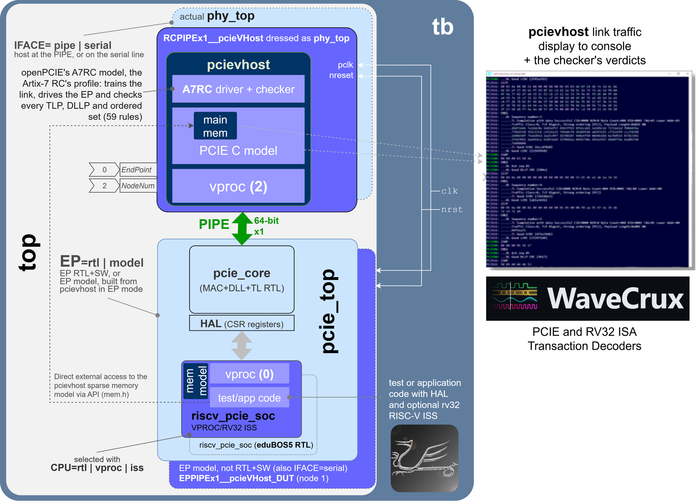
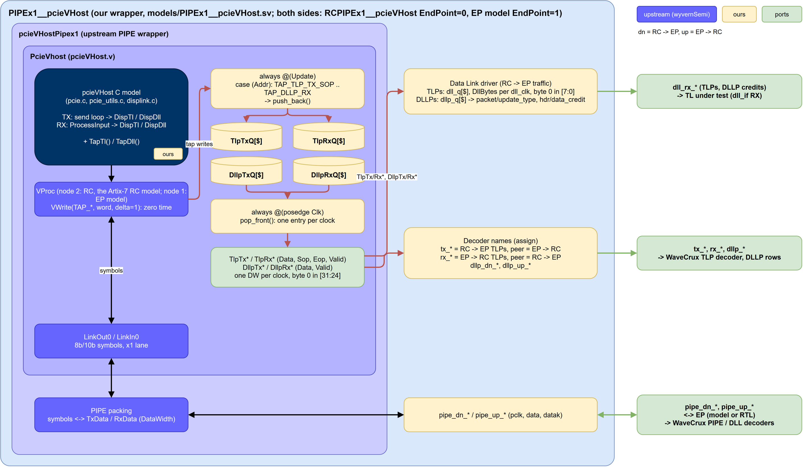

# openCologne-PCIE Simulation Top Level Test Bench

## Table of Contents

* [Introduction](#introduction)
* [Scope: unit debug, then top-level validation](#scope-unit-debug-then-top-level-validation)
  * [A host already proven against real silicon](#a-host-already-proven-against-real-silicon)
  * [An Artix-7 RC profile for the host](#an-artix-7-rc-profile-for-the-host)
* [Block-level flows](#block-level-flows)
* [Running the co-simulation](#running-the-co-simulation)
  * [The host: openPCIE's Artix-7 RC model](#the-host-openpcies-artix-7-rc-model)
  * [Make options](#make-options)
  * [Sanity and regression](#sanity-and-regression)
  * [WaveCrux decoders](#wavecrux-decoders)
  * [Transaction taps: a test platform at every layer](#transaction-taps-a-test-platform-at-every-layer)
  * [Viewing the EP in WaveCrux](#viewing-the-ep-in-wavecrux)
  * [Choosing the user code](#choosing-the-user-code)
  * [Verilator and Icarus, side by side](#verilator-and-icarus-side-by-side)
  * [Build defines](#build-defines)
  * [From XSIM to Verilator, via Icarus](#from-xsim-to-verilator-via-icarus)
  * [VIP versions and local changes](#vip-versions-and-local-changes)
* [VProc Software](#vproc-software)
  * [The CPU node: three ways to run the SOC's software](#the-cpu-node-three-ways-to-run-the-socs-software)
* [Debugging Code](#debugging-code)
* [The mem_model Co-Simulation Sparse Memory Model](#the-mem_model-co-simulation-sparse-memory-model)
* [Driving the PCIE Link](#driving-the-pcie-link)
* [HAL](#hal)
* [References](#references)


## Introduction

The top-level test bench drives the DUT's PCIE link with the [pcieVHost](https://github.com/wyvernSemi/pcievhost) VIP, a C model of a PCIE 1.1/2.0 link partner.

- **[VProc](https://github.com/wyvernSemi/vproc)** runs a natively compiled program "inside" an HDL component, in lock-step with the simulation. pcieVHost is such a program; its PCIE lanes appear as ports.
- **Roles:** designed as a root complex, the role it plays here. Its endpoint features, enabled by a parameter, are limited: a target for testing the root complex side.

<div align=center>

</div>

`CPU=rtl | vproc | iss` picks the SOC CPU ([below](#the-cpu-node-three-ways-to-run-the-socs-software)). Two switches set the rest:

- **`EP`:** the endpoint, our RTL or a model.
- **`IFACE`:** where the host meets it, the PIPE or the serial line. `IFACE=serial` adds the PHY: with `EP=rtl`, `tb.sv` puts all of `top` under the host instead of `pcie_top` in the `phy_top` socket; with `EP=model`, the EP model serialises itself.

Each VProc instance is a node with its own program, `VUserMain<n>` for node `n`:

| Node | Model | Program | Role |
|---|---|---|---|
| 2 | `RCPIPEx1__pcieVHost` | [`models/a7rc-model/VUserMain2.cpp`](models/a7rc-model) (openPCIE's) | the host, openPCIE's [Artix-7 RC model](#the-host-openpcies-artix-7-rc-model): trains the link, then sends the RC firmware's requests: IDs, BAR sizing and assignment, a write and a read in BAR0; then, as the tester, the stages [below](#the-host-openpcies-artix-7-rc-model) |
| 1 | `EPPIPEx1__pcieVHost_DUT` (`IFACE=serial`: `PcieVhostSerial`) | [`usercode/VUserMain1.cpp`](usercode/VUserMain1.cpp) | the EP model ([`stubs`](stubs/README.md)), an option next to the EP RTL + firmware: `EP=model` |
| 0 | `soc_cpu.VPROC` | native C/C++, or the rv32 ISS | the SOC's CPU, in place of eduBOS5, with `CPU=vproc` or `CPU=iss` (below) |

The model can print the traffic of both link directions to the console, layer by layer; [`hex/ContDisps.hex`](hex/ContDisps.hex) selects what is shown.

## Scope: unit debug, then top-level validation

Every layer is covered twice, on purpose: block-level test benches debug each unit alone; the top level validates them together, with an independent host. This matters most for the PHY: it comes from Cologne Chip, and only the top level checks it against our MAC, DLL, TL and firmware.

| Level | Where | Purpose | Link partner |
|---|---|---|---|
| Top | `5.sim` (here) | validates the units together: MAC + DLL + TL RTL and firmware (enumeration, configuration, PIO); with `IFACE=serial`, also Cologne Chip's PIPE and SerDes | openPCIE's Artix-7 RC model, in `RCPIPEx1__pcieVHost` |
| DLL over PIPE + PHY | [`2.rtl/4.dll/sim`](../2.rtl/4.dll/sim) | unit debug: DLL, MAC/LTSSM, PIPE and SerDes BFM on the serial line | a second copy of the same stack |
| PIPE + PHY | [`2.rtl/1.phy/3.sim`](../2.rtl/1.phy/3.sim) | unit debug: Cologne Chip's PIPE logic over the GateMate SerDes; the [SerDes BFM](../2.rtl/1.phy/2.serdes-model) against the vendor model | the vendor's PIPE test case; the BFM, looped back |

How to run each, and today's status: [Simulation, layer by layer](../2.rtl/README.md#simulation-layer-by-layer).

`IFACE` sets the top level's depth:

- **`pipe`**: the host sits at the PIPE. Fast (eight symbols per 31.25 MHz clock), and a failure points at MAC, DLL, TL or firmware.
- **`serial`**, `EP=rtl`: the real PHY is in; the host drives the serial line. Slower (2.5 Gb/s bit rate), but covers the whole stack, on the open-source [SerDes BFM](../2.rtl/1.phy/2.serdes-model), so anyone can run it.
- **`serial`**, `EP=model`: the serial line without the GateMate PHY; EP model and host are both upstream's `PcieVhostSerial`. Checks the host and its spec checker on the line (8b/10b, scrambling, the speed change), on Verilator and Icarus, while our EP RTL is not ready.

### A host already proven against real silicon

`RCPIPEx1__pcieVHost` is the pcieVHost model in our wrapper [`PIPEx1__pcieVHost`](models/PIPEx1__pcieVHost.sv), around upstream's `pcieVHostPipex1`, fixed to the RC role ([`models/RCPIPEx1__pcieVHost.sv`](models/RCPIPEx1__pcieVHost.sv)).

- On [openPCIE](https://github.com/chili-chips-ba/openPCIE/tree/main/5.sim), the same model and PIPE wrapper were validated against the AMD `PCIE_2_1` hard macro, roles swapped (model EP, hard macro RC): link training, flow control, TLPs and completions, end to end. So the model and the hard macro speak the same PCIE.
- An EP that passes against this model in simulation stands a better chance of working first time in hardware, when a physical Artix-7 running openPCIE as the RC drives our GateMate EP over the [openPCIE backplane](https://github.com/chili-chips-ba/openPCIE/tree/main/1.pcb).

### An Artix-7 RC profile for the host

Speaking the same PCIE is not behaving the same: as the RC, pcieVHost runs its own LTSSM, timers and credits. To test our EP against the RC it meets in the lab, the model gets an Artix-7 RC profile, the way the [rv32 ISS](#the-cpu-node-three-ways-to-run-the-socs-software) has timing models for PicoRV32 and eduBOS5:

1. **Measure.** On openPCIE, the `PCIE_2_1` RC drives the pcieVHost EP. Its PIPE, taps and LTSSM state show what the RC puts on the wire: training sequence counts and fields per LTSSM state, timeouts, speed change, InitFC credits, ACK and UpdateFC timing. Cases: direct, Gen1 x1 and Gen2 x1.
2. **Profile.** One table: behaviour, Artix-7 value, pcieVHost value.
3. **Model.** RC-only changes to pcieVHost (`ltssm.c` and the user code), picked by a profile switch. `ltssm.c` has one Configuration path for both roles, so an unguarded change moves the RC too.
4. **Check.** The same pcieVHost EP, against the profiled RC here and against the hard macro on openPCIE, must log the same link training and DLLP sequence.
5. **Use.** The profiled RC is the host of every run here, with full-length training ([below](#the-host-openpcies-artix-7-rc-model)).

Limits: the hard macro's simulation model is not silicon (analog effects, CDR lock time), and a profile covers only what the openPCIE runs exercise.

## Block-level flows

The layers below have their own Icarus Verilog flows, next to their RTL: the PHY (PIPE + SerDes, and the open-source SerDes BFM) in [2.rtl/1.phy/3.sim](../2.rtl/1.phy/3.sim/), the DLL over that PHY in [2.rtl/4.dll/sim](../2.rtl/4.dll/sim/).

## Running the co-simulation

Open-source simulators only: Verilator (default) or Icarus Verilog. From `5.sim`, on Linux or WSL:

```sh
make run                     # Verilator
make SIM=icarus run          # Icarus Verilog
make DUMP=1 run              # also write tb.fst
make IFACE=serial run        # the EP model and the host on the serial line
make EP=rtl run              # our EP RTL + firmware, the host at the PIPE
make EP=rtl IFACE=serial run # the same with the real PHY, the host on the serial line
make EP=rtl DUMP=1 run       # also write tb_rtl.fst: every layer of the EP, for WaveCrux
```

`DUMP=1` writes the FST natively (Verilator `--trace-fst`, Icarus `vvp -fst`):

- **`EP=model`: `tb.fst`.** The PIPE link both ways, its clock and reset, and one decoder page per pcieVHost (`tb.u_rc`, `tb.dut.bfm_pcie`): every decoder input (PIPE, DLL, TLPs), under the names WaveCrux auto-binds. `IFACE=serial`: `tb_serial.fst`, the serial line (`tb.ser_dn_line`, `tb.ser_up_line`); on Icarus also the ports of both models (Verilator: `tb.vlt` keeps the upstream models out).
- **`EP=rtl`: `tb_rtl.fst`** (`IFACE=serial`: `tb_rtl_serial.fst`). A decoder page at every layer boundary of our EP ([below](#viewing-the-ep-in-wavecrux)).
- **Session.** [`tb.DLL-PIPE.wavecrux`](tb.DLL-PIPE.wavecrux) opens the tracked [`tb.fst`](tb.fst) (Verilator run) with Ferrite's PIPE and DLL decoders on both directions. It binds signals by number: after a change to the dumped signals, run [`tools/wavecrux-rebind.py`](tools/wavecrux-rebind.py) on it.
- **lz4.** Verilator 5.052 has its own FST writer, which needs the lz4 headers (`liblz4-dev`).

**VIP.** VProc, the pcieVHost PCIE model and mem_model are copied from upstream into [`vip`](vip/README.md); our own wrappers are in `models/`. The first build compiles the VIP once into `~/.cache/opencologne-pcie/vip`, the Makefile's `$VIP_DIR` ([`tools/build-vip.sh`](tools/build-vip.sh)). VProc is built with openPCIE's `vproc-coroutine.patch`: the user code runs as a coroutine on the simulator's thread, not in a thread per node. That is about 22 times faster and deterministic, with no operating system scheduler in the handover (the prime suspect of the intermittent slow mode), so every run takes the same time: an `EP=model` run took 0.8 s instead of 17.7 s, same results (2026-10-31); with today's longer tester, about 1 s, and 100 seeds, 8 at a time, in about 19 s, all PASS ([details](https://github.com/chili-chips-ba/openPCIE/tree/main/5.sim#our-local-vip-improvements)).

**EP and host.**

- `EP=rtl`: the EP RTL + firmware ([`rtl.f`](rtl.f)), the host in the `phy_top` socket through [`models/phy_vproc_rc.sv`](models/phy_vproc_rc.sv).
- `EP=model` (default): the EP model `EPPIPEx1__pcieVHost_DUT`, a second pcieVHost in EP mode at node 1 ([`stubs`](stubs/README.md)).
- The host is `RCPIPEx1__pcieVHost` at node 2, running openPCIE's Artix-7 RC model ([below](#the-host-openpcies-artix-7-rc-model)).

**A passing run** trains the link to L0, then sends the RC firmware's requests: Vendor and Device ID, the six BARs sized, BAR0 assigned, Memory Space and Bus Master enabled, a write and a read in BAR0; in the default tester mode, then the tester's stages ([below](#the-host-openpcies-artix-7-rc-model)). It ends with `===> RC MODEL RESULT: PASS`; with `EP=rtl` our firmware serves the requests and sets `fw_pass`. The model ends the simulation itself; a FAIL, or no result by the [`tb.sv`](tb.sv) time limit `RUN_SIM_US`, ends it with `$fatal`, so `make run` exits non-zero.

**Serial line.**

- `EP=rtl IFACE=serial`: `tb.sv` puts `top` under the host: `phy_top` with Cologne Chip's PIPE logic and the open-source SerDes BFM ([`phy.f`](phy.f)), on a 2.5 Gb/s serial line. The host is then upstream's `PcieVhostSerial`, at node 2 with the same model, without our PIPE wrapper's transaction taps.
- It runs with `Gen2Clk = 1` and twice the Gen1 clocks (500 MHz, 5 GHz), divided by 2 at Gen1. With `Gen2Clk = 0` its `generate` block drives the bit clock twice, once straight and once halved (the `else` has no `begin`/`end`), and under Verilator the line ran at 1.25 Gb/s.
- `EP=model IFACE=serial`: the same host; the EP model is a second `PcieVhostSerial` (`EndPoint = 1`, node 1), as in openPCIE's `IFACE=serial` run.

### The host: openPCIE's Artix-7 RC model

The host is openPCIE's [Artix-7 RC model](https://github.com/chili-chips-ba/openPCIE/tree/main/5.sim#the-rc-model): what the lab RC sends, from link training to the RC firmware's requests and their pacing. It runs at the PIPE or, with `IFACE=serial`, on the serial line, with 8b/10b and scrambling on. At the PIPE it scrambles too against our EP RTL (`A7RC_PIPE_SCRAMBLE`, as the lab RC); against the EP model it sets Disable Scrambling. [`usercode/a7rc_ep.h`](usercode/a7rc_ep.h) says what it expects of our EP RTL; the EP model matches the RC model's own EP.

**Masters.** The host is a copy in [`models/a7rc-model`](models/a7rc-model); the masters are in openPCIE. To update: copy, `cmp`, `bash run-sanity.sh`.

| From openPCIE | Used for |
|---|---|
| `VUserMain2.cpp`, `a7rc_check.cpp` and `.h` (the checker), `ep_dma.h`, `ltssm.c` | the host |
| `pcievhost-speed.patch` | applied to pcieVHost before the VIP build; both pcieVHost models here (host and EP model) |
| `vproc-coroutine.patch` | applied to VProc; both models |

It replaced our own host: upstream's pcieVHost 1.9.3 in RC mode, unmodified, with host programs of ours. Against our EP RTL:

| | Upstream pcieVHost 1.9.3 RC | Artix-7 RC model |
|---|---|---|
| Link training | to L0, shortened (`LTSSM_ABBREVIATED`: 16 TS1 in Polling.Active) | to L0 as the lab RC: full length, its TS counts and timeouts; Gen2 if the EP offers it |
| FC init against our one InitFC1 and one InitFC2 set ([#25](https://github.com/chili-chips-ba/openCologne-PCIE/issues/25)) | hangs: after FC_INIT1 it waits for all three InitFC types again | completes on our first InitFC2 or UpdateFC, as the spec has it |
| Requests | as fast as the model can send them; a TLP right after another is dropped ([#26](https://github.com/chili-chips-ba/openCologne-PCIE/issues/26)) | the RC firmware's, with its think times, as on the lab RC; then, in the default tester mode, the tester's stages, below (`A7RC=1`: the lab RC's requests only) |
| Spec checks | none | every TLP and DLLP, against PCIe Base 2.1 rules ([drive and check](https://github.com/chili-chips-ba/openPCIE/tree/main/5.sim#drive-and-check)) |
| Result | stops in FC init, no TLP sent | `A7RC=1`: `RC MODEL RESULT: PASS`, `fw_pass` set, no violation. Tester (default): FAIL, below |

**Tester and literal.**

- **Tester** (default): the lab RC's sequence, then what its firmware never sends but the spec allows. The spec sets no gap between TLPs; only flow control limits the sender. The lab RC's firmware leaves microseconds between requests. Afterwards the tester runs, in order:
  - a config space sweep;
  - 8 writes and 8 reads to BAR0 back to back, the data checked;
  - a seeded random mix of reads and writes;
  - requests the EP must not support;
  - odd requests: ECRC, poisoned, traffic classes;
  - Data Link faults;
  - EP DMA under credit starvation ([`models/a7rc-model/ep_dma.h`](models/a7rc-model/ep_dma.h)), only with `DMA=1`: our EP has no DMA yet ([#41](https://github.com/chili-chips-ba/openCologne-PCIE/issues/41));
  - speed changes and retrains; speed changes only when both sides do Gen2 (the EP model and our RTL are Gen1).
- **Literal** (`A7RC=1`): only what the lab RC sends, with its timing.
- **Against our EP** (2026-11-02) the tester run fails. The checker flags Naks for back-to-back TLPs ([#26](https://github.com/chili-chips-ba/openCologne-PCIE/issues/26); on an error-free line any Nak is a violation, `DL.NAK`), no replay after held Acks or across a Recovery (`DL.REPLAY`, `TL.CPL-ALL`, [#24](https://github.com/chili-chips-ba/openCologne-PCIE/issues/24)) and the SKP interval (`PL.SKP`, [#38](https://github.com/chili-chips-ba/openCologne-PCIE/issues/38)). The InitFC after every Recovery (`FC.INIT-ORDER`, [#35](https://github.com/chili-chips-ba/openCologne-PCIE/issues/35)), Unsupported Request for reads longer than 1 DW (`TL.UR`, [#36](https://github.com/chili-chips-ba/openCologne-PCIE/issues/36)) and reads that return data older than an earlier write (`TL.ORDER`, [#37](https://github.com/chili-chips-ba/openCologne-PCIE/issues/37)) are fixed.

**Spec checker.** Every TLP and DLLP on the link is checked against PCIe Base Specification 2.1 rules, each with an ID and section number; a table of checks and violations prints at the end, and any violation fails the run.

- Today: 59 rules: Transaction Layer (`TL.`, 19), Data Link Layer (`DL.`, 12), flow control (`FC.`, 11), configuration space (`CFG.`, 11), Physical Layer (`PL.`, 6), listed in [drive and check](https://github.com/chili-chips-ba/openPCIE/tree/main/5.sim#drive-and-check).
- The tester's random mix is seeded (`make SEED=N`, `make regress`).
- The EP model passes all of them, at the PIPE and on the serial line, over 100 seeds. Our EP passes with `A7RC=1` and fails the tester, above.

The model also found [#22](https://github.com/chili-chips-ba/openCologne-PCIE/issues/22): our DLL's InitFC advertised P 32/1008 and NP 32/1, while the TL has 8/32 and 8/8, so its first UpdateFC-NP (9 after 32) looked to the host like a jump of 233 header credits. Fixed on our fork of gatemate-pipe (`send_dllp.sv` builds the InitFC DLLPs from `INIT_*`); `pcie_core.sv` gives the TL and DLL the same credits.

### Make options

`EP`, `IFACE` and `CPU` choose the models ([block diagram](#introduction)); the rest set the simulator, the host's mode and the output. `make help` lists the main ones.

| Switch | Values | Selects | Today |
|---|---|---|---|
| `SIM` | `verilator` (default), `icarus` | the simulator; the C/C++ models talk DPI-C to Verilator, VPI to Icarus | both, with `EP=model`; `EP=rtl` on Verilator only |
| `EP` | `model` (default), `rtl` | the EP: a second pcieVHost in EP mode (`EPPIPEx1__pcieVHost_DUT`, node 1), or our MAC + DLL + TL RTL with firmware | `model` passes; `rtl` passes with `A7RC=1`, fails the default tester mode, [above](#the-host-openpcies-artix-7-rc-model); `rtl` on Verilator only: Icarus does not parse the generated `csr_pkg.sv` (unpacked structs) |
| `IFACE` | `pipe` (default), `serial` | where the host meets the EP: the PIPE (`RCPIPEx1__pcieVHost`, node 2; with `EP=rtl` in the `phy_top` socket), or the serial line (`PcieVhostSerial`), which adds the PHY: the real one with `EP=rtl`, the EP model's own with `EP=model` | all four `EP` x `IFACE` work; `EP=rtl` gives the same results on both, [above](#running-the-co-simulation) |
| `CPU` | `rtl`, `vproc`, `iss` | the SOC CPU, with `EP=rtl`: eduBOS5 RTL, a native C/C++ program at node 0, or the rv32 ISS ([below](#the-cpu-node-three-ways-to-run-the-socs-software)) | all three, with `EP=rtl` |
| `A7RC` | `0` (default), `1` | the host's mode: the tester (the lab RC's sequence, then a config space sweep and back-to-back requests), or literal, only what the lab RC sends ([above](#the-host-openpcies-artix-7-rc-model)) | both pass with `EP=model` |
| `DMA` | `0` (default), `1` | the tester's EP DMA stage: off, or on | off until our EP has DMA ([#41](https://github.com/chili-chips-ba/openCologne-PCIE/issues/41)); the EP model passes it |
| `SEED` | `1` (default), any | the seed of the tester's random stimulus, read at run time (no rebuild) | |
| `SEEDS` | `10` (default) | `make regress`: seeds 1 to `SEEDS` | 100 seeds pass with `EP=model`; at about 1 s a seed, 1000 seeds per regression are practical (about 3 minutes with `REGRESS_JOBS=8`) |
| `REGRESS_JOBS` | `1` (default), any | seeds run side by side, each in `obj/regress/<seed>/` ([`tools/regress.sh`](tools/regress.sh)) | a seed takes about 1 s with the EP model (coroutine VProc, below) |
| `REGRESS_QUIET` | `1` (default), `0` | the packet display off in `regress` (`0`: as `hex/ContDisps.hex`) | |
| `REGRESS_S`, `REGRESS_TRIES` | `900`, `3` (default) | the wall-clock limit of a seed in seconds, and how often a seed runs again after hitting it or a crash (not after the test bench's own time limit) | |
| `REGRESS_DUMP` | `none` (default), `fail` | after `make regress`: every failing seed run again with its waveform, in `obj/wavecrux/<seed>/` | |
| `SIM_ARGS` | e.g. `+verilator+error+limit+100` | run-time arguments for the simulation: with that one, our EP's assertions report and the run goes on | |
| `WCX_OPEN` | `1` (default), `0` | `make wavecrux SEED=N`: that seed with its waveform, opened in WaveCrux at the checker's first violation ([`tools/wavecrux.py`](tools/wavecrux.py); WaveCrux started with `--wcp-port 54321`); `0`: the waveform only | cursor and view set over WCP |
| `OPTFLAG` | `-O2 -g` (default) | the C/C++ of the models and our user code; the VIP libraries are built `-O2 -g` too | `-O0` and `-O2` give the same result |
| `DUMP` | `0` (default), `1` | write the FST: `tb.fst`, `tb_serial.fst`, `tb_rtl.fst` or `tb_rtl_serial.fst`, by `EP` and `IFACE` | |
| `USRSIMFLAGS` | none (default) | extra Verilator or Icarus flags, such as defines | |

### Sanity and regression

Two lists, each a script in `5.sim`: [`run-sanity.sh`](run-sanity.sh) and [`run-regression.sh`](run-regression.sh). They print one line per run, keep the logs in `obj/sanity/` and `obj/regression/`, and exit non-zero on a failure. Make variables pass through (`bash run-sanity.sh SIM=icarus`). The EP DMA stage runs only in the regression's seeds (`DMA=1`, on the EP model): our EP has no DMA yet ([#41](https://github.com/chili-chips-ba/openCologne-PCIE/issues/41)).

**Sanity**, after every change: `bash run-sanity.sh`, six runs, about 2 minutes. Each must end `RC MODEL RESULT: PASS`, and Verilator and Icarus must print the same `===>` lines. Our EP drops an SKP ([#38](https://github.com/chili-chips-ba/openCologne-PCIE/issues/38)), so its three runs go on past the SVA and pass as "known #38" if PL.SKP holds every checker violation and the firmware still ends `0x0000face`.

```sh
make run                          # EP model at the PIPE, Verilator
make SIM=icarus run               # the same on Icarus
make IFACE=serial run             # EP model on the serial line
make EP=rtl A7RC=1 SIM_ARGS=+verilator+error+limit+100 run            # our EP RTL + firmware, the lab RC's requests
make EP=rtl CPU=vproc A7RC=1 SIM_ARGS=+verilator+error+limit+100 run  # the same, the firmware compiled for the host
make EP=rtl IFACE=serial A7RC=1 SIM_ARGS=+verilator+error+limit+100 run # our EP with the real PHY, through top
```

**Regression**, before a push: `bash run-regression.sh`, about 8 minutes. A run that fails on open issues is reported as known, with them (`KNOWN` in the script); the script fails only on an unexpected result. What it runs:

```sh
make regress SEEDS=100 REGRESS_JOBS=8                 # 100 random seeds, EP model
make run > v.log; make SIM=icarus run > i.log         # Verilator against Icarus:
diff <(grep -a '===>' v.log) <(grep -a '===>' i.log)  #   the same lines, PIPE and IFACE=serial
make EP=rtl run                                       # our EP against the tester
make EP=rtl IFACE=serial A7RC=1 run                   # our EP with the real PHY
(cd ../2.rtl/1.phy/3.sim && bash run-phy.sh pipe64 && bash run-phy.sh equiv)
(cd ../2.rtl/4.dll/sim && bash run-dll-phy.sh && bash run-dll-phy.sh --inject=stp && bash run-dll-phy.sh --inject=end)
(cd ../2.rtl/5.tlp/sim && bash run-tl.sh)
```

| Run | Time | Today (2026-11-02) |
|---|---|---|
| `make regress SEEDS=100 REGRESS_JOBS=8 DMA=1` | 20 s | 0 of 100 failed; every rule checked in some seed (the EP model answers CRS in one seed in four), but `PL.SPEED` and `PL.EIOS`: not applicable, our EP and the EP model are Gen1 |
| Verilator against Icarus | 3 min (Icarus serial) | the same `===>` lines, PIPE and serial |
| `make EP=rtl run` | 90 s | FAIL: [#24](https://github.com/chili-chips-ba/openCologne-PCIE/issues/24), [#26](https://github.com/chili-chips-ba/openCologne-PCIE/issues/26), [#38](https://github.com/chili-chips-ba/openCologne-PCIE/issues/38), [#40](https://github.com/chili-chips-ba/openCologne-PCIE/issues/40), [#42](https://github.com/chili-chips-ba/openCologne-PCIE/issues/42); `SVA #38` from 139 µs, a dropped SKP; `SVA #24` at 2.86 ms, a TLP neither Acked nor replayed; the regression lets it go on (`SIM_ARGS=+verilator+error+limit+100`), through the TL issues, until the first Recovery at 3.07 ms: the EP stays in L0 (#42) to the 10 ms limit |
| `make EP=rtl IFACE=serial A7RC=1 run` | 35 s | FAIL: [#38](https://github.com/chili-chips-ba/openCologne-PCIE/issues/38), stops at 216.0 µs on `SVA #38`: the MAC drops an SKP Ordered Set |
| `run-phy.sh pipe64`, `equiv` | 5 s | PASS |
| `run-dll-phy.sh` | 6 s | PASS: a corrupted sequence number, TLP byte or LCRC is Naked and replayed, a DLLP with a bad CRC dropped |
| `run-dll-phy.sh --inject=stp`, `--inject=end` | 10 s each | FAIL: [#24](https://github.com/chili-chips-ba/openCologne-PCIE/issues/24), a TLP with its STP or END hit is never replayed |
| `run-tl.sh` | 20 s | PASS |

`make DMA=1 run` adds the DMA stage: the EP model passes it.

**Assertions inside our EP** ([`models/ep_sva.sv`](models/ep_sva.sv), `EP=rtl`, Verilator `--assert`), bound into `pcie_core`, simulation only. Each stops the run at the clock an open issue happens, so it is reached whatever the timing; the host's checker sees the effect only later, if at all:

| Assertion | Fails when | Issue |
|---|---|---|
| `a_skp` | in L0, no SKP Ordered Set on the PIPE for 1538 + 128 + 28 Symbol Times (4.2.7.1) | [#38](https://github.com/chili-chips-ba/openCologne-PCIE/issues/38) |
| `a_skp_mux` | the MAC's SKP generator sends its SKP word in a cycle its output mux gives to data, an OS or IDLE: the SKP is lost | [#38](https://github.com/chili-chips-ba/openCologne-PCIE/issues/38) |
| `a_replay` | a TLP in the retry buffer is neither Acked nor replayed within the REPLAY_TIMER limit, 2 × 711 Symbol Times (3.5.2.1), in L0 | [#24](https://github.com/chili-chips-ba/openCologne-PCIE/issues/24) |
| `a_fc_init` | the DLL enters DL_Active, but the TL does not hold the InitFC credit limits of P, NP and Cpl (3.2.1) | none: fixed, the TL runs on `mac_rst_n` |

### WaveCrux decoders

Three complementary sets, one per layer:

| Decoders | Show | Where |
|---|---|---|
| Ferrite's PIPE, Data Link Layer and serial-line decoders (free) | ordered sets, DLLPs, Ack/Nak, flow control, LCRC, TLP framing | [wavecrux-decoders `decoders/pcie`](https://github.com/Ferrite-Engineering/wavecrux-decoders/tree/main/decoders/pcie) |
| Our TLP decoder (free) | every TLP named, each completion paired with its request | [wavecrux-decoders `decoders/pcie-tlp`](https://github.com/Ferrite-Engineering/wavecrux-decoders/tree/main/decoders/pcie-tlp) |
| WaveCrux Pro PCIe TLP analysis | latency, timeouts, Base Spec rule checks, bus statistics | [WaveCrux docs](https://github.com/Ferrite-Engineering/wavecrux/blob/main/docs-site/docs/protocol-decoders.md#pcie-tlp-analysis) |

- Ferrite's DLL decoder names each TLP from the PIPE bits (`TLP seq=5 MWr32 len=1`).
- Our TLP decoder reads the host's TLP stream from `tb.u_rc` (`tx_` RC -> EP, `rx_` EP -> RC), from transaction taps we added to pcieVHost ([details](models/pcievhost/README.md#transaction-taps-our-change)).
- With `EP=rtl`, all three sets decode our EP's own layers, from the PIPE to the firmware ([Viewing the EP in WaveCrux](#viewing-the-ep-in-wavecrux)).

### Transaction taps: a test platform at every layer

Each pcieVHost reports every TLP and DLLP it sends and receives on ports of its own: [transaction taps](models/pcievhost/README.md#transaction-taps-our-change) we added to the model.

- Our wrapper [`PIPEx1__pcieVHost`](models/PIPEx1__pcieVHost.sv) offers each packet at three layers, from one run, all always present.
- Both sides use it: the host `RCPIPEx1__pcieVHost` (`EndPoint=0`) and the EP model `EPPIPEx1__pcieVHost_DUT` (`EndPoint=1`).
- Each side has its decoder page, `tb.u_rc` and `tb.dut.bfm_pcie`, with the same names by link direction (dn = RC -> EP, up = EP -> RC). A packet shows on both, a link latency apart.

<div align="center">

</div>

| Layer | Ports of `tb.u_rc`, `tb.dut.bfm_pcie` | For |
|---|---|---|
| PIPE | `pipe_dn_*`, `pipe_up_*` (`pclk`, `data`, `datak`) | the link; PIPE and DLL decoders |
| Data Link | `dll_rx_*`, on `dll_clk`: TLPs (`data`, `tlp_valid`, `tlp_first`, `tlp_last`) and DLLPs (`hdr_credit`, `data_credit`, `update_type`, `packet_type`, `dllp_valid`) | RC -> EP traffic as an EP's DLL hands it to its TL (`dll_if` RX side): drives a TL under test |
| Data Link | `dllp_dn_*`, `dllp_up_*` | every DLLP, one word each |
| Transaction | `tx_*` (RC -> EP), `rx_*` (EP -> RC) | the TLP decoder |

The `dll_rx_*` fields follow the DLL ([DLL draft v2](../2.rtl/0.doc/260711-DLL_draft_v2.pdf), slides 7 and 9): TLP byte 0 in `data[7:0]`, the first byte on the wire; DLLP Type = {`packet_type`, `update_type`, 0, VC}, so `packet_type` 01 InitFC1, 11 InitFC2, 10 UpdateFC, and `update_type` 00 P, 01 NP, 10 Cpl. Like the DLL, every DLLP raises `dllp_valid`.

What it gives us:

- **RTL driven from the model.** `dll_rx_*` has the shape of `dll_if`'s RX side, so a TL can be tested without the MAC and DLL below it, on its own clock.
- **A reference for the DUT.** What the host sent and received, packet by packet, to compare against the DUT's own TL and DLL interfaces with `EP=rtl`.
- **Self-checking tests.** A checker reads the taps, not the console log.
- **Decoder fixtures from an open simulator.** Verilator and Icarus give the same TLPs at the same times (50 each way in the enumeration run), with expected values from the model, not from a decoder.
- **Any link partner.** The host's taps work with the EP model and the EP RTL alike; with the EP model, both ends of the link are tapped.

### Viewing the EP in WaveCrux

With `EP=rtl`, `DUMP=1` gives our EP a decoder page at every layer boundary:

- [`models/ep_wavecrux_view.sv`](models/ep_wavecrux_view.sv), bound into `pcie_core` as `wavecrux` (`tb.dut.u_core.wavecrux`; with `IFACE=serial` `tb.dut.u_pcie_top.u_core.wavecrux`);
- the CPU's retired instructions, `riscv_pcie_soc.cpu_view` (`DUMP=1` builds eduBOS5 with `RISCV_FORMAL`).

[`wavecrux.f`](wavecrux.f) lists the view files. Verilator does not limit the trace to the `$dumpvars` scopes, so the FST also holds all of `pcie_top`, six levels deep: the RTL behind every decoded packet is in the same file.

| Boundary | Names | Decoder | Sessions |
|---|---|---|---|
| PIPE, PHY ↔ MAC | `pipe_dn_*`, `pipe_up_*` | wcx-pcie: PCIe PIPE and PCIe Data Link Layer, 64-bit, `scrambling` auto | layers, free |
| MAC ↔ DLL | `mac_dn_*`, `mac_up_*` | wcx-pcie: PCIe Data Link Layer, `scrambling` off | layers, free |
| DLL ↔ TL, `dll_if` | `dll_*` | WaveCrux Pro: PCIe TLP, generic, Data Width 64 | layers, serial |
| TL ↔ `trn_bridge`, `trn_rx_if`, `trn_tx_if` | `trn_*` | the same | layers, serial |
| `trn_bridge` ↔ SOC, AXI-Stream | `m_axis_rx_*`, `s_axis_tx_*` | WaveCrux Pro: PCIe TLP, Xilinx 7 Series AXIS preset | layers, serial |
| | `tlp_view.tx_*`, `tlp_view.rx_*` | our [TLP decoder](https://github.com/Ferrite-Engineering/wavecrux-decoders/tree/main/decoders/pcie-tlp) (free), one DW per clock | free |
| SOC CPU | `tb.dut.u_soc.cpu_view.rvfi_*` | WaveCrux: RISC-V instruction trace | all |
| serial line, `IFACE=serial` | `tb.ser_dn_line`, `tb.ser_up_line` | wcx-pcie: PCIe serial line, symbols and Data Link Layer | serial |
| host taps, `IFACE=pipe` | `tb.u_rc` `tx_*`, `rx_*` | our TLP decoder | layers, free |

As on the host's page, dn is RC -> EP and up is EP -> RC. The Pro TLP decoder takes both directions in one instance, `tlp_*` RC -> EP and `peer_*` EP -> RC, and pairs every completion with its request. Its Data Width has to be 64: at its default, 32, it reads only the lower DW of each beat, and the completions come out wrong.

The sessions open the FST from this directory: [`tb_rtl.EP-layers.wavecrux`](tb_rtl.EP-layers.wavecrux) (all boundaries, Pro), [`tb_rtl.EP-free.wavecrux`](tb_rtl.EP-free.wavecrux) (the free decoders only) and, for `IFACE=serial`, [`tb_rtl_serial.EP-serial.wavecrux`](tb_rtl_serial.EP-serial.wavecrux). They need WaveCrux 1.1.0 or later, and:

- the [wcx-pcie](https://github.com/Ferrite-Engineering/wavecrux-decoders/releases/tag/pcie-v0.3.0) 0.3.0 and [pcie-tlp](https://github.com/Ferrite-Engineering/wavecrux-decoders/releases/tag/pcie-tlp-v0.1.1) 0.1.1 plugins (0.2.0 and 0.1.0 work too), added under **Settings -> Extensions -> Decoder Plugins**;
- the plugin notice accepted: until then the decoder rows stay empty, without a message;
- a Pro licence, for the Pro rows;
- after an RTL change, [`tools/wavecrux-rebind.py`](tools/wavecrux-rebind.py): a session binds its decoders by signal number (the FST handle), and the RTL can renumber them.

The pictures are WaveCrux Pro 1.1.0 with wcx-pcie 0.2.0. They predate the Artix-7 RC host: the host is upstream's, with its abbreviated LTSSM, and #25 shows as a hang.

- **Layer column.** The column on the far left, with the layer of every row, is ours, added to the screenshots: WaveCrux names a decoder row only by its decoder (`PCIe TLP #1`, in its own name column next to ours).
- **Which run.** Link training, flow-control init and the MAC findings: the repo as it is. The rest: a run with the three DLL issues [above](#the-host-openpcies-artix-7-rc-model) worked around locally, as without them no TLP gets through: InitFC repeated every 0.1 µs ([#25](https://github.com/chili-chips-ba/openCologne-PCIE/issues/25)), the TL given the DLL's fixed InitFC credits ([#22](https://github.com/chili-chips-ba/openCologne-PCIE/issues/22)) and a gap after every host write ([#26](https://github.com/chili-chips-ba/openCologne-PCIE/issues/26)).
- **Zoom.** A stretch too long for the decoders' labels is followed by a zoomed picture. WaveCrux rounds its time-ruler labels, so several ticks can carry the same label; the text gives exact times.

**The whole run.** Host on top, then the request path down to the CPU, then the answer path back up:


- 0 to 72 µs, link training. Most of it is Polling.Active: the EP sends the 1024 TS1 the specification asks for (65.5 µs), while the host, with its abbreviated LTSSM, already waits in Polling.Configuration sending TS2 (`TS2 ×1047`). L0 at 72.2 µs (a), DL_Active at 73.4 µs.
- 74 to 103 µs, enumeration (b): 22 configuration requests. `dll_if` is busy, TRN and the AXI-Stream stay quiet: the TL answers them itself.
- 103 µs, the first MWr32 and MRd32 to BAR0 (c) go on to the SOC. The SOC takes the MRd32 only at 345 µs (d): until then eduBOS5 clears its PIO memory (`pio_mem` in [`main.c`](../3.sw/EP/main.c), 256 words, 11 instructions each: the firmware is built without `-O`). The CPU leaves reset with the link; from then on its row is full.
- 345 to 499 µs, PIO, one request at a time, 24 µs each, almost all of it in the firmware; `fw_pass` at 370.7 µs (e).

Zoomed in on the CPU row, the loop that clears `pio_mem`. Top: a later turn (80 to 82 µs), the PC running through `0x58c` to `0x5b4` again and again. Bottom: the RISC-V decoder's table with its first turn, from 74.29 µs: 11 instructions per word, the loop counter read from the stack and written back every turn (`lw a4, -20(s0)`, `sw a5, -20(s0)`), as a build without `-O` makes it. One word takes 1 µs, the 256 about 250 µs. WaveCrux 1.1.0 draws this table's headings out of line with its columns; we moved them over their columns in the picture:


**Link training and flow-control init** (repo as it is). The PIPE decoder names every training sequence with its fields: the host's `TS2 link=PAD lane=PAD n_fts=4`, the EP's `TS1 link=PAD lane=PAD n_fts=0`, then `TS1 link=0 lane=PAD` (Config.Linkwidth), `TS1 link=0 lane=0` (Config.Lanenum), `TS2 link=0 lane=0` (Config.Complete) and L0, where the DLLPs start:


Zoomed in on 68.85 to 70.45 µs, through Configuration: the host's `TS1 link=0 lane=PAD` and `TS1 link=0 lane=0`, the EP's `TS1 link=PAD lane=PAD n_fts=0`, then `link=0 lane=PAD` and `link=0 lane=0`, under the LTSSM states of the EP; the red box on the EP's side is the cut TS2 of *Found with the decoders*, below:


The flow-control init is [#25](https://github.com/chili-chips-ba/openCologne-PCIE/issues/25) as it happens: the EP sends one InitFC1 set on entering DL_Init FC1, one InitFC2 set in FC2, and goes to DL_Active at 73.55 µs on the host's InitFC2 (0.2 µs later than in the run above, where #25 is worked around). The host repeats its InitFC2 set every 0.18 µs, waiting for one more EP set that never comes; for the rest of the run the EP sends only an UpdateFC every 30 µs, and no TLP crosses `dll_if`:


Zoomed in on the two sets of the EP, with the fixed credits of [#22](https://github.com/chili-chips-ba/openCologne-PCIE/issues/22) (H=32 for P and NP, Cpl infinite): `InitFC1-P`, `-NP`, `-Cpl` in DL_Init FC1 (top), `InitFC2-*` in FC2 (bottom), on DLL -> MAC and on the PIPE. The host is still sending InitFC1 then. On the PIPE TX row of the top half, the decoder's `Scrambling: on (detected)` notice is drawn over the first DLLP ([wavecrux#52](https://github.com/Ferrite-Engineering/wavecrux/issues/52)):


**Found with the decoders.** Red rows are the decoders' error flags. Two point at our MAC, transmit and receive side; the first also shows a gap in the decoder.

Every SKP the EP sends in Polling cuts a TS1 short ([#31](https://github.com/chili-chips-ba/openCologne-PCIE/issues/31)): its first 8 symbols, 16 data symbols (`f527f4ec622438c8`, `e2d32ce6a740be8d`), the SKP ordered set with 4 data symbols behind it (`14c017ff1c1c1cbc`, K `0f`), 8 zero symbols, then the next TS1. The same every 4.77 µs, 14 times before L0:


Once more with a TS2 ([#31](https://github.com/chili-chips-ba/openCologne-PCIE/issues/31)), on the step from Polling.Configuration to Config.Linkwidth.Start (68.88 µs): its first half (`4545000200f7f7bc`), then data (`fa28fbe36d2b37c7`) and 8 zero symbols instead of its second half, then TS1. Only ordered sets may be sent in Polling and Configuration. pcieVHost does not mind; a link partner that counts consecutive TS1 or TS2 may:


The MAC's receive side passes the SKP ordered sets the host sends on to the DLL, as data ([#32](https://github.com/chili-chips-ba/openCologne-PCIE/issues/32)): at 80.3 µs MAC -> DLL carries `f00308c05c1c1c1c` with K `08`, so `1c 1c 1c` as data before the SDP of the next DLLP (the COM is in the word before, which does not reach the DLL), and the decoder flags `Data outside a packet`. It happens every 80 µs, the host's SKP interval, at 160.3 µs with the COM too (`001c1c1cbcfdeda2`, K `04`); the DLL ignores them:


The gap in the decoder: it shows the cut TS1 above as whole, the 16 data symbols as its tail, with no error, as it does not check the TS1 identifiers in symbols 8 to 15 (same for the TS2). Only the data after the SKP is flagged.

**A configuration read, layer by layer.** The host's first request, CfgRd0 of the Vendor and Device ID. The TL answers it from its configuration space, so it goes no further than `dll_if`:


Zoomed in, from top to bottom: the CfgRd0 at the PIPE and after the MAC (74.08 to 74.46 µs), the TL at `dll_if` and the `Ack seq=0` going out (74.66 to 75.10 µs), the `UpdateFC-NP VC0 H=33 D=1` (75.15 to 75.26 µs) and the CplD going out (75.14 to 75.52 µs). The Pro decoder's labels at `dll_if` stay cut here; they are whole in the [TL's table](../2.rtl/5.tlp/README.md#viewing-the-tl-in-wavecrux), rows 1 and 2:


| Time | Where | Decoded | Step |
|---|---|---|---|
| 74.096 µs | PIPE RX | `TLP seq=0 CfgRd0 len=1` | STP on the link, scrambled |
| 74.320 µs | MAC -> DLL | `TLP seq=0 CfgRd0 len=1` | MAC receive, 7 PCLK |
| 74.704 µs | `dll_if` | `CfgRd0 Vendor ID/Device ID · 00:00.2 tag 0x00` | DLL receive with the LCRC check, 12 PCLK; `Ack seq=0` goes back at 74.74 µs |
| 75.056 µs | `dll_if` | `CplD [SC] Vendor ID/Device ID = 0x00011234` (CC00h:CC00h since 2026-11-03) | the TL, 11 PCLK; `UpdateFC-NP H=33` gives the credit back at 75.18 µs |
| 75.280 µs | DLL -> MAC | `TLP seq=0 CplD len=1` | DLL transmit, 7 PCLK |
| 75.408 µs | PIPE TX | `TLP seq=0 CplD len=1` | MAC transmit, 4 PCLK |

1.31 µs, 41 PCLK, from STP in to STP out. The times in this table and the next are the PCLK edge that samples the STP, or the first beat at `dll_if`, TRN and the AXI-Stream; the PCIe TLP decoders' rows start one PCLK, 32 ns, earlier, at the start of that clock (74.672 µs for the CfgRd0 at `dll_if`).

**A memory read, down to the firmware and back.** The last request, MRd32 of BAR0 + 0x010 (a: the host sends it, b: the SOC takes it, c: the SOC sends the CplD, d: the host has it):


Its two ends, zoomed in: on top a to b, the MRd32 from the link down to the SOC; below c to d, the CplD from the SOC back to the link:


Zoomed in on the PIPE and the MAC, `TLP seq=29 MRd32 len=1` coming in (472.98 to 473.32 µs) and `TLP seq=25 CplD len=1` going out (498.62 to 498.96 µs):


The Pro decoders' table, filtered on address 0x2A784010: the first MWr32 and MRd32 to it (tags 0x16, 0x17) and this MRd32 (tag 0x1D), at `dll_if` (`PCIe TLP #1`), TRN (`#2`) and the AXI-Stream (`Xilinx 7 Series AXIS`). Each CplD names the request it answers; requests at the AXI-Stream have `bar_hit` BAR0; latency is request to CplD at that boundary. The `bar_hit`, `latency` and `tag` columns are further right in the same table; we put them next to the label:


| Time | Where | Decoded | Step |
|---|---|---|---|
| 473.008 µs | PIPE RX | `TLP seq=29 MRd32 len=1` | STP on the link |
| 473.232 µs | MAC -> DLL | `TLP seq=29 MRd32 len=1` | MAC receive, 7 PCLK |
| 473.616 µs | `dll_if` | `MRd32 0x2A784010 · 00:00.2 tag 0x1D` | DLL receive, 12 PCLK |
| 473.808 µs | TRN | `MRd32 0x2A784010` | the TL: queue, ordering, BAR0 hit, 6 PCLK |
| 474.384 µs | AXI-Stream | `MRd32 0x2A784010`, `bar_hit` BAR0 | the SOC takes it once the firmware has released the previous request |
| 498.192 µs | AXI-Stream | `CplD [SC] 0x2A784010 = 0x0DF0FECA` | the firmware, 23.8 µs |
| 498.224 µs | TRN | `CplD [SC]` | `trn_bridge`, 1 PCLK |
| 498.448 µs | `dll_if` | `CplD [SC] 0x2A784010` | the TL's TX buffer, which takes a TLP whole before it sends it, 7 PCLK |
| 498.672 µs | DLL -> MAC | `TLP seq=25 CplD len=1` | DLL transmit, 7 PCLK |
| 498.800 µs | PIPE TX | `TLP seq=25 CplD len=1` | MAC transmit, 4 PCLK |

25.8 µs from STP in to STP out, 23.8 µs of it in the firmware: the latency of this MRd32 is 24.8 µs at `dll_if`, 24.4 µs at TRN and 23.8 µs at the AXI-Stream. The payload reads `0x0DF0FECA`, byte 0 first: the host wrote 0xcafef00d little-endian. Every layer shows the same tag, 0x1D, and the Pro decoders pair the CplD with this MRd32 at each of them. The first MRd32 to this address (tag 0x17) waited 264 µs; the [TL section](../2.rtl/5.tlp/README.md#viewing-the-tl-in-wavecrux) shows where.

**On the serial line** (`IFACE=serial`). The first CfgRd0 again, with Cologne Chip's PIPE logic and the SerDes BFM below the MAC: the serial-line decoders recover it from the 1-bit line. It is on the line at 80.47 µs and at the PIPE about 0.4 µs later (STP at 80.864 µs: bit lock, 8b/10b, word alignment, elastic buffer); its CplD leaves the PIPE at 82.176 µs and is on the line about 0.13 µs after:


Zoomed in on the line: the CfgRd0 coming in, `TLP frame seq=0 (18 symbols)` and `TLP seq=0 CfgRd0 len=1` (80.43 to 80.62 µs), and its CplD going out, `TLP seq=0 CplD len=1` at the PIPE and then on the line, `TLP frame seq=0 (22 symbols)` (82.14 to 82.40 µs):


### Choosing the user code

Each VProc node runs a C/C++ program with entry point `VUserMain<n>()`, `n` the node number. The make file compiles them into `obj/<sim>/libuser.a`, linked into the simulation. Four command-line variables choose what goes in:

| Variable | Default | What it does |
|---|---|---|
| `USER_C` | `VUserMain1.cpp` (`EP=model`), none (`EP=rtl`) | our programs: one `VUserMain<n>` per node (1 = EP model, 0 = native CPU), plus any helper files they need; the host, openPCIE's `VUserMain2.cpp`, `a7rc_check.cpp` and `ltssm.c`, is always added |
| `USRCODEDIR` | `5.sim/usercode` | the directory all of `USER_C` is read from; it is also on the include path |
| `OPTFLAG` | `-O2 -g` | compiler flags for the user code; `-O0` and `-O2` must give the same result |
| `USRSIMFLAGS` | empty | extra simulator flags, e.g. a define: `+define+X` for Verilator, `-DX` for Icarus |

```sh
make USER_C="VUserMain1.cpp my_checks.cpp" run   # add a helper file
make USRCODEDIR=$HOME/tests/ep run                # another EP model program, same file names
```

A different test is a different `USER_C` or `USRCODEDIR`, with no make file change. Run `make clean` after changing `OPTFLAG`: built object files are not recompiled.

### Verilator and Icarus, side by side

The same test bench on both simulators, `EP=model` (2026-10-31, WSL2, Verilator 5.052, Icarus Verilog 13.0):

| | Verilator | Icarus |
|---|---|---|
| Host results (`===>` lines), tester | 138, all rules pass | identical, line for line |
| Every TLP, DLLP and ordered set, with its time | | the same |
| `IFACE=serial` | 138, all rules pass | identical, line for line |
| Wall-clock time, `make run`, tester (PIPE, serial), 2026-11-01 | 1 s, 14 s | 10 s, about 4 min |
| C models reached via | DPI-C | VPI |
| Electrical idle on the line | `NOSIG` (the K flag and `0xFF`) per symbol on the PIPE; constant 0 on the serial line | the same |

Four fixes got there, all in openPCIE's `pcievhost-speed.patch`:

1. upstream's PIPE wrapper hid `Z` from the model (openPCIE issue 53);
2. electrical idle is now a driven value, `NOSIG`, with no `Z` and no Verilator side-band ([#34](https://github.com/chili-chips-ba/openCologne-PCIE/issues/34));
3. the wrapper put X and Z on the line at time 0 (issue 55);
4. its RX sample changed on the edge the model reads it on, so the read landed one symbol apart depending on each simulator's scheduling (issue 56).

### Build defines

| Define | Set in | Effect | Origin |
|---|---|---|---|
| `RC_GEN=2` | `Makefile` | the host advertises Gen2, and changes the link to Gen2 when the EP offers it | openPCIE |
| `A7RC_EP_EXPECT` | `Makefile` (`EP=rtl`) | the host's expectations of our EP: `usercode/a7rc_ep.h` | openPCIE |
| `SIM_SERIAL` | `Makefile` (`IFACE=serial`) | the host does 8b/10b and scrambling itself, on the serial line | openPCIE |
| `A7RC_LITERAL` | `Makefile` (`A7RC`) | `1`: the host sends only what the lab RC sends; `0`: the tester | openPCIE |
| `EXCLUDE_LTSSM` | `Makefile` | leaves the LTSSM out of the pcieVHost model; the user code links `ltssm.c` instead | VIP |
| `VPROC_SV` | `Makefile`, `tools/build-vip.sh` | VProc over SystemVerilog DPI-C (Verilator) | VIP |
| `ICARUS` | `Makefile`, `tools/build-vip.sh` | VProc over VPI (Icarus) | VIP |
| `VPROC_PLI_VPI` | `tools/build-vip.sh` (Icarus) | none in this VIP version | VIP |
| `EXTERN_VPI_TABLE` | `tools/build-vip.sh` (Icarus) | VProc takes its system-task table from pcieVHost's `veriuser.c` | VIP |
| `VPROC_BYTE_ENABLE` | `Makefile` | byte enables on the VProc bus, in VProc and pcieVHost | VIP |
| `_REENTRANT` | `tools/build-vip.sh` (Icarus) | thread-safe C library (the nodes now run as coroutines on the simulator's thread) | C library |
| `VPROC` | `Makefile` | the HAL's VProc back end (`csr_regs.h`, `pcie.c`), compiled with `CPU=vproc` | ours |
| `EP_RTL` | `Makefile` (`EP=rtl`) | `tb.sv` instantiates the EP RTL instead of the EP model | ours |
| `IFACE_SERIAL` | `Makefile` (`IFACE=serial`) | `tb.sv` connects the host on the serial line | ours |
| `CDR_MODEL=FAST` | `Makefile` (`EP=rtl IFACE=serial`) | the SerDes BFM's CDR model | ours |
| `SOC_CPU_VPROC` | `Makefile` (`CPU=vproc`, `iss`) | `riscv_pcie_soc.sv` puts `soc_cpu.VPROC.sv` in the CPU socket | ours |
| `RISCV_FORMAL` | `Makefile` (`EP=rtl DUMP=1`) | eduBOS5 drives its RVFI outputs, for the CPU's WaveCrux page | ours |
| `DUMP` | `Makefile` (`DUMP=1`) | `tb.sv` writes `tb.fst`, `tb_serial.fst`, `tb_rtl.fst` or `tb_rtl_serial.fst` | ours |

### From XSIM to Verilator, via Icarus

openPCIE runs its co-simulation on AMD's XSIM, as the encrypted Artix-7 hard macros left no other choice. **The pcieVHost setup we took from openPCIE did not run on Verilator.** Upstream has supported Verilator since `VERSION_1_0_0` (2024-08-27), with its own Verilator make flow since `VERSION_1_0_1` (2024-09-29); openPCIE and this repo both use `VESRSION_1_9_3` (sic, 2026-06-13). But the openPCIE integration (libraries, file list, wiring) was XSIM-only. Here all RTL is open, so the co-simulation moved to Verilator, the fast one, and Icarus. Lessons on the way:

1. **Libraries built from source, per simulator.** XSIM loaded prebuilt `libcosimlnx.a` / `libpcielnx.a`. Verilator reaches the C models through DPI-C, Icarus through VPI, each needing its own build of the same sources, so [`tools/build-vip.sh`](tools/build-vip.sh) builds both: `libcosimlnx.a` / `libpcielnx.a` for DPI-C, `libcosimica.a` / `libpcieica.a` for VPI. The VPI library also carries pcieVHost's `veriuser.c`, the table that registers the models' system tasks with Icarus.
2. **Every referenced module must exist.** The pcieVHost wrappers instantiate `clkmux` and `Serialiser` (from pcieVHost's `verilog/lib`), never compiled by the XSIM file list. Verilator wants every referenced module, so the VIP build now collects them.
3. **Electrical idle: `NOSIG`.** An electrically idle PCIE line carries no signal. Upstream models it as `Z` on a 4-state simulator, and under Verilator (2-state) as zeros plus a side-band, `ElecIdleOut` and `ElecIdleIn`. openPCIE's patch drops both: each idle symbol on the PIPE is `NOSIG`, the K flag and `0xFF` (no 8b/10b code), on Verilator and Icarus alike. Verilator can't be trusted with `Z` here: its `=== 'z` reads a driven 0 as `Z` ([#34](https://github.com/chili-chips-ba/openCologne-PCIE/issues/34)).
4. **One LTSSM on both sides.** On openPCIE the model plays the EP, an upstream port, against a real `PCIE_2_1` downstream port; the patch makes it spec-correct: an upstream port keeps sending Link/Lane = PAD in its TS1 until the downstream port assigns the numbers. Upstream's model takes a shortcut that only works against a copy of itself, so the patched EP would deadlock in Configuration.Start against pcieVHost's own RC, on both simulators. With upstream's RC as our host, we used upstream's `ltssm.c`. The host is now openPCIE's Artix-7 RC model, which assigns Link and Lane numbers as the hard macro does, so both sides use openPCIE's `ltssm.c`, patch included.
5. **Macros before models.** The pcieVHost models use macros (`WsTimeScale`, `RegDel`, the comma symbols, the register map) from its headers. Under Verilator the first file in the list happened to pull them in for all others; not under Icarus. [`tb.f`](tb.f) now names `allheaders.svh` first, for both.
6. **Portable delays.** Icarus rejected the test bench's `#(N * 1ps)` delays. The file's timescale is 1 ps, so plain numbers mean the same everywhere; the run limit is a 64-bit constant, as 10 ms in picoseconds overflows 32 bits.

### VIP versions and local changes

| Component | In use | Source |
|---|---|---|
| VProc | 1.13.4 | [wyvernSemi/vproc](https://github.com/wyvernSemi/vproc) |
| pcieVHost **(modified, see below)** | 1.9.3 | [wyvernSemi/pcievhost](https://github.com/wyvernSemi/pcievhost) |
| mem_model **(wrapped, see below)** | `main` c7b9c62 | [wyvernSemi/mem_model](https://github.com/wyvernSemi/mem_model) |
| rv32 ISS **(modified, see below)** | `main` 774d84fa | [wyvernSemi/rv32](https://github.com/wyvernSemi/rv32) |

The upstream files are copied in [`vip`](vip/README.md), with these changes made by [`tools/vip-import.sh`](tools/vip-import.sh):

| File | Change | Why |
|---|---|---|
| pcieVHost `verilog/pcieVHost/pcieVHost.sv` | VProc `BE` and `Burst` ports, left open | we build VProc with `VPROC_BYTE_ENABLE` |
| pcieVHost `verilog/test/test_defs.svh` | `` `fatal`` calls `tb.Fatal` | our test bench top is `tb` |
| pcieVHost `src/displink.c`, `src/pcie_vhost_map.h`, `pcieVHost.sv`, `pcieVHostPipex1.sv` | transaction taps: TLP and DLLP ports ([`pcievhost-taps.patch`](models/pcievhost/pcievhost-taps.patch)) | waveform decoders need the TLP stream; the model keeps it in C |
| pcieVHost `verilog/headers/pcie_vhost_map.svh` | added: generated from `src/pcie_vhost_map.h` | upstream's make files generate it |
| pcieVHost `src/ltssm.c` | not copied: the make file compiles openPCIE's, [`models/a7rc-model/ltssm.c`](models/a7rc-model), with its LTSSM patch and Artix-7 RC profile | the host is openPCIE's Artix-7 RC model (step 4 above) |
| pcieVHost `src/*.c`, `verilog/lib/Serialiser.sv`, `verilog/lib/clkmux.sv`, `verilog/pcieVHost/pcieVHost.sv`, `verilog/pcieVHost/pcieVHostPipex1.sv`, `verilog/headers/pciexpress_header.svh` | openPCIE's `pcievhost-speed.patch`, applied by `tools/build-vip.sh` before the build | Gen2 speed changes, the Artix-7 RC profile's flow control and Ack timing, lane polarity inversion, and one electrical-idle rule on every simulator (`NOSIG` on the PIPE, constant 0 on the serial line, no X or Z) |
| [`models/cosim/mem_model.sv`](models/cosim/mem_model.sv) | wraps upstream `mem_model.v` (as `f_mem_model.sv`) in Verilator `lint_off` pragmas | keeps third-party code out of our lint |
| VProc, pcieVHost, mem_model HDL | SystemVerilog names: modules `.sv`, `` `include`` headers `.svh`, the `` `include`` lines to match; after the patches, which keep upstream's `.v` names (`tools/build-vip.sh` maps `pcievhost-speed.patch`'s) | one rule for the whole repo: no `.v` files |
| rv32 `src/rv32csr_cpu.cpp` (in [`models/rv32/rv32-openpcie.patch`](models/rv32/rv32-openpcie.patch), from openPCIE) | the timer-compare check in `process_interrupts()` no longer charges cycles | it added 2 cycles to every instruction |
| rv32 `src/rv32i_cpu.cpp` (same patch) | `sw`, `sh` add the store extra cycles | upstream adds the load ones |
| [`models/rv32/usercode/rv32_timing_config.h`](models/rv32/usercode/rv32_timing_config.h) | PicoRV32, eduBOS5 2-/3-stage timing tables, measured on openPCIE's SOC RTL | see openPCIE's [Our Local VIP Improvements](https://github.com/chili-chips-ba/openPCIE/blob/main/5.sim/README.md#our-local-vip-improvements) |
| [`models/rv32/usercode/VUserMain0.cpp`](models/rv32/usercode/VUserMain0.cpp) | no fetch/load wait states; bus credit; waits for reset release, restarts on reset | the same |

The rv32 integration code in `models/rv32/usercode` is openPCIE's, without its `COUNTERS` (Zicntr) option.

## VProc Software

A VProc program is ordinary C or C++, except its entry point is `VUserMain<n>()`, with C linkage, instead of `main()`: the simulator already has a `main()`, and each node has its own program. VProc's scheduler talks to the simulator over DPI-C (Verilator) or VPI (Icarus), invisibly to the program. VProc offers a low-level C API and a C++ one, the `VProc` class in `VProcClass.h` (headers in `$VIP_DIR/include`, see [Running the co-simulation](#running-the-co-simulation)):

```c++
VProc (const uint32_t node);

int  write (const unsigned addr, const unsigned  data, const int delta=0);
int  read  (const unsigned addr,       unsigned *data, const int delta=0);
int  tick  (const unsigned ticks);
```

Addresses are byte addresses; `delta` stays at its default. `tick()` advances simulation time by a number of cycles of the node's clock, without a bus transaction. Finer accesses: `writeByte`, `writeHword`, `writeWord` and their `read` twins; the rest is in the [VProc manual](https://github.com/wyvernSemi/vproc/blob/master/doc/VProc.pdf).

A program can also reach the sparse memory model directly, through `mem.h` (C functions: `extern "C"` from C++):

```c++
void     WriteRamByte  (const uint64_t addr, const uint32_t data, const uint32_t node);
void     WriteRamHWord (const uint64_t addr, const uint32_t data, const int little_endian, const uint32_t node);
void     WriteRamWord  (const uint64_t addr, const uint32_t data, const int little_endian, const uint32_t node);
uint32_t ReadRamByte   (const uint64_t addr, const uint32_t node);
uint32_t ReadRamHWord  (const uint64_t addr, const int little_endian, const uint32_t node);
uint32_t ReadRamWord   (const uint64_t addr, const int little_endian, const uint32_t node);
```

No default arguments (C). `node` selects a memory space, not a VProc node; we use one, 0. Every `mem_model` instance in the HDL sees the same memory as this API, so programs and logic exchange data through it.

<div align="center">

</div>

### The CPU node: three ways to run the SOC's software

With `EP=rtl`, node 0 can stand in for eduBOS5 in the SOC's CPU socket ([`models/soc_cpu.VPROC.sv`](models/soc_cpu.VPROC.sv), on the same `mem_if` bus), in the same three ways as on openPCIE, chosen with `CPU`:

- **RTL** (`CPU=rtl`, default): eduBOS5 itself runs `firmware.hex`, as in the bitstream. The reference.
- **Native** (`CPU=vproc`): the firmware's own sources, compiled for the host, drive the bus ([HAL](#hal)); [`usercode/VUserMain0.cpp`](usercode/VUserMain0.cpp) calls them.
- **ISS** (`CPU=iss`): the [rv32](https://github.com/wyvernSemi/rv32) instruction set simulator runs the real RISC-V `firmware.elf`: real instructions, interpreted rather than executed by RTL. Its integration program ([`models/rv32/usercode`](models/rv32/usercode)) routes each load and store to the memory model, to a bus transaction on the SOC, or back to the ISS. The ISS sources, with openPCIE's fixes, are in [`vip/rv32`](vip/rv32).

The ISS reads its options from `vusermain.cfg`, as a command line for `vusermain0`. Timing models make it count cycles like a given core; `-V EDUBOS5STG2` (2-stage eduBOS5) or `-V EDUBOS5STG3` match ours.

**The ISS in WaveCrux.** The SOC's `rvfi` stays 0 under the ISS: it runs its instruction loop in C and calls back only for memory, unimplemented instructions and interrupts, so no retired instruction reaches the HDL. Its loads and stores to the SOC still show as bus transactions (`mem_if`). A subset (`rvfi_valid`, `rvfi_pc_rdata`, `rvfi_insn`) would need a per-instruction ISS hook and a VProc write per instruction, slowing it down. Not worth it: the ISS has better tools, `-r` (run-time disassembly in the log) and `-g` (gdb). WaveCrux matters for the RTL CPU, which has neither.

`-h` prints the help:
```
Usage:vusermain0 -t <test executable> [-hHebdrgxXRcI][-n <num instructions>]
      [-S <start addr>][-A <brk addr>][-D <debug o/p filename>][-p <port num>]
      [-l <line bytes>][-w <ways>][-s <sets>][-j <imem base addr>][-J <imem top addr>]
      [-P <cycles>][-x <base addr>][-X <top addr>][-V <core>]
   -t specify test executable/binary file (default test.exe)
   -B specify to load a raw binary file (default load ELF executable)
   -L specify address to load binary, if -B specified (default 0x00000000)
   -n specify number of instructions to run (default 0, i.e. run until unimp)
   -d Enable disassemble mode (default off)
   -r Enable run-time disassemble mode (default off. Overridden by -d)
   -C Use cycle count for internal mtime timer (default real-time)
   -a display ABI register names when disassembling (default x names)
   -T Use external memory mapped timer model (default internal)
   -H Halt on unimplemented instructions (default trap)
   -e Halt on ecall instruction (default trap)
   -E Halt on ebreak instruction (default trap)
   -b Halt at a specific address (default off)
   -A Specify halt address if -b active (default 0x00000040)
   -D Specify file for debug output (default stdout)
   -R Dump x0 to x31 on exit (default no dump)
   -c Dump CSR registers on exit (default no dump)
   -g Enable remote gdb mode (default disabled)
   -p Specify remote GDB port number (default 49152)
   -S Specify start address (default 0)
   -I Enable instruction cache timing model (default disabled)
   -l Specify number of bytes in icache line (default 8)
   -w Specify number of ways in icache (default 2)
   -s Specify number of sets in icache (default 256)
   -j Specify cached IMEM base address (default 0x00000000)
   -J Specify cached IMEM top address (default 0x7fffffff)
   -P Specify penalty, in cycles, of one slow mem access (default 4)
   -x Specify base address of external access region (default 0xFFFFFFFF)
   -X Specify top address of external access region (default 0xFFFFFFFF)
   -V Specify RISC-V core timing model to use (default "DEFAULT")
   -h display this help message
```

## Debugging Code

The simulation is a native process including the user programs, so the host `gdb` debugs them directly; build with `-g` (the default `OPTFLAG`):

```sh
gdb --args obj/verilator/Vtb                                          # Verilator
gdb --args vvp -n -M obj/icarus -m VProc obj/icarus/sim               # Icarus
(gdb) break VUserMain2
(gdb) run
```

No simulator kernel to attach to, unlike XSIM: the breakpoint stops the whole simulation, and the host program's C++ state (a TLP it built, the BAR values it read) is inspected as in any program.

Code on the rv32 ISS uses the RISC-V `gdb`: with `-g` in `vusermain.cfg`, the ISS opens a TCP port and prints its number (e.g. `RV32GDB: Using TCP port number: 49152`); `(gdb) target remote :49152` connects. Details: [ISS manual](https://github.com/wyvernSemi/rv32/blob/main/iss/doc/iss_manual.pdf).

## The mem_model Co-Simulation Sparse Memory Model

[mem_model](https://github.com/wyvernSemi/mem_model) is a sparse memory in C, part of the pcieVHost software: a 64-bit address space, pages allocated only when touched. Programs reach it through the API above; logic reaches the same memory through the `mem_model` HDL component, instantiable any number of times. That shared space is how VProc programs and simulated logic hand data to each other. Details: [`models/cosim/README.md`](models/cosim/README.md).

## Driving the PCIE Link

The EP has a single x1 PIPE port, 64 bits wide, as Cologne Chip's PIPE. `pcieVHostPipex1`, the PIPE wrapper of the pcieVHost model, drives it at Gen1 (Gen2 only when the EP offers it; ours is Gen1):

<div align=center>

</div>

On a 64-bit PIPE, eight symbols travel per PIPE clock, so `pclk` runs at `pcieclk`/8: 31.25 MHz against the 250 MHz symbol clock of Gen1. Configuring and driving the model: [`models/pcievhost/README.md`](models/pcievhost/README.md).

## HAL

One HAL, [`csr_regs.h`](../4.build/csr_build/csr_regs.h), serves the firmware on eduBOS5 and compiled for the host in co-simulation. Only its back end changes: the lines under `#ifdef VPROC` turn each access into a _VProc_ bus cycle. The design is openPCIE's ([HAL](https://github.com/chili-chips-ba/openPCIE/blob/main/5.sim/README.md#hal)).

- **Generation:** `make -f MakefileCSR` in `4.build` generates the CSR RTL and the C header `csr.h` from the single register map `csr_build/csr.rdl`.
- **Accessors** take register offsets and the CSR base address from `csr.h`: `CSR_REG32()` for a whole register, `CSR_GET()`, `CSR_SET()` and `CSR_RMW()` for one field.
- **On eduBOS5:** loads and stores (`lw`, and `sb`, `sh` or `sw` as wide as the field's bytes).
- **On the host** (C++ with `VPROC` defined): _VProc_ bus cycles: `VRead`, `VWrite`, or `VWriteBE` with the byte enables of the core's store, each followed by `CSR_VP_GAP` (8) idle SOC cycles.

Two more host differences:

- **Entry point:** every _VProc_ node starts at `VUserMain<n>`, and the simulator has its own `main()`, so the firmware is compiled with `-Dmain=fw_main`, called by a `VUserMain0` shim.
- **Halt:** `halt()` in [`3.sw/common/pcie.c`](../3.sw/common/pcie.c) ends in an endless loop. Under `VPROC` the loop ticks the _VProc_ node, so the simulation runs on to its end.

`make EP=rtl CPU=vproc run` runs it on node 0 ([above](#the-cpu-node-three-ways-to-run-the-socs-software)).

## References
- [Logic sim using pcieVHost and 3rd Party PCIe](https://www.linkedin.com/pulse/case-study-logic-simulation-environment-using-third-party-southwell-tyere)
- [VProc](https://github.com/wyvernSemi/vproc)
- [mem_model](https://github.com/wyvernSemi/mem_model)
- [PCIe VHost Model](https://github.com/wyvernSemi/pcievhost)
- [rv32 RISC-V ISS](https://github.com/wyvernSemi/rv32/tree/main/iss)
- [cocotbext-pcie](https://github.com/alexforencich/cocotbext-pcie): Alex Forencich's PCIE models for cocotb (Python)
- [WaveCrux PCIE decoders](https://github.com/Ferrite-Engineering/wavecrux-decoders/tree/main/decoders/pcie): PIPE and DLL traffic as transactions in the waveform
- [WaveCrux TLP decoder](https://github.com/Ferrite-Engineering/wavecrux-decoders/tree/main/decoders/pcie-tlp): our TLP plugin, every TLP named, each completion paired with its request
- [WaveCrux RV32 ISA decoder](https://github.com/Ferrite-Engineering/wavecrux/tree/main/assets/decoders/isa/riscv): RISC-V instructions in the waveform
- [SystemRDL](https://www.accellera.org/downloads/standards/systemrdl)
- [PeakRDL and SystemRDLcompiler](https://github.com/SystemRDL)

--------------------
#### End of Document
