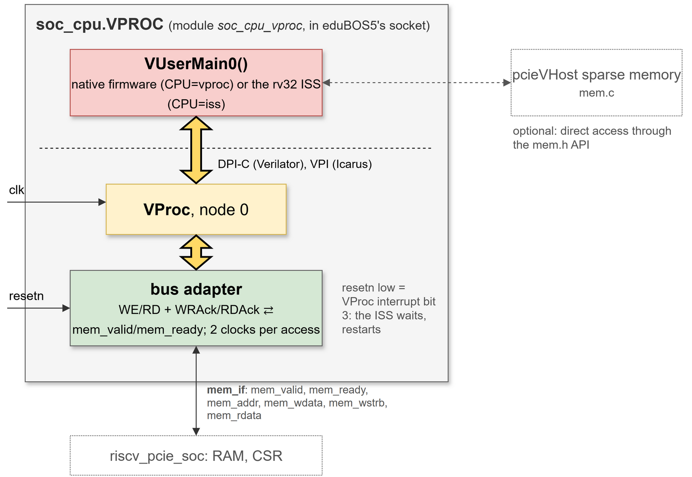

# Simulation Models

This directory contains the following models

* `soc_cpu.VPROC.sv` : _VProc_ based `soc_cpu` compatible virtual processor.
* `phy_vproc_rc.sv` : the `phy_top` socket with `IFACE=pipe`, the host at the PIPE: a wrapper of openPCIE_BFM's `pipe_phy_core.sv`.
* `ep_model_phy.sv` : `IFACE=phy`, the EP model behind our PHY: `phy_top` with the EP model on its PIPE through openPCIE_BFM's `pipe_mac_adapter.sv`.
* `tl_shadow.sv` : `TL=1`, our Transaction Layer beside the EP model, bound into `tb`: `dll_if` driven from the EP model's Data Link taps, its completions checked against the EP model's.
* `ep_wavecrux_view.sv` : our EP's layer boundaries, for the WaveCrux decoders (`EP=rtl DUMP=1`).
* `tlp_dw_if.sv`, `tlp_dw_monitor.sv`, `tlp_wavecrux_view.sv` : the SOC's AXI-Stream TLPs, one DW per clock, for the TLP decoder.
* `gatemate_cells_sim.sv` : simulation models of the GateMate primitives `clk_rst_gen` uses: `CC_USR_RSTN`, `CC_BUFG`.
* `bfm_uart.sv` : a minimal UART BFM, 115.2 kb/s, 8N1.

In addition, sub-directories contain the following models

* [`cosim`](cosim/README.md) : notes on the _VProc_ and _mem_model_ co-simulation VIP, as this test bench uses them.
* [`rv32`](rv32/README.md) : Contains the _rv32_ RISC-V RV32GCC_Zbb instruction set simulator C++ model

The PCIE models (the pcieVHost wrappers, the PIPE adapters, the Artix-7 RC host) are [openPCIE_BFM](https://github.com/chili-chips/openPCIE_BFM#layout)'s, in the submodule [`../vip/openPCIE_BFM`](../vip/README.md).

## soc_cpu.VPROC

The `soc_cpu.VPROC` module is pin compatible with the other `soc_cpu` components with RTL softcore implementations of 32-bit RISC-V processors, such as eduBOS5. In place of the softcore is a [_VProc_](https://github.com/wyvernSemi/vproc) virtual processor which can run natively compiled code and drive its memory mapped bus in the logic simulation (see [here](../README.md#vproc-software)). The module, `soc_cpu_vproc`, has only a clock (`clk`), an active-low reset (`resetn`) and the SOC's CPU bus, `mem_if` (`mem_valid`, `mem_ready`, `mem_addr`, `mem_wdata`, `mem_wstrb`, `mem_rdata`), the external bus to the rest of the logic, just as for the softcores.

--------------------
#### End of Document
