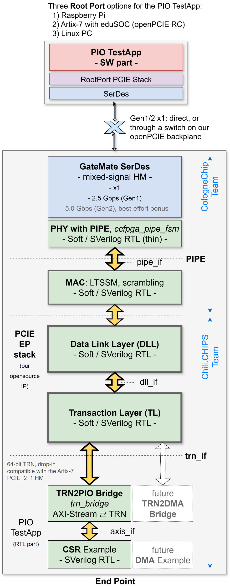
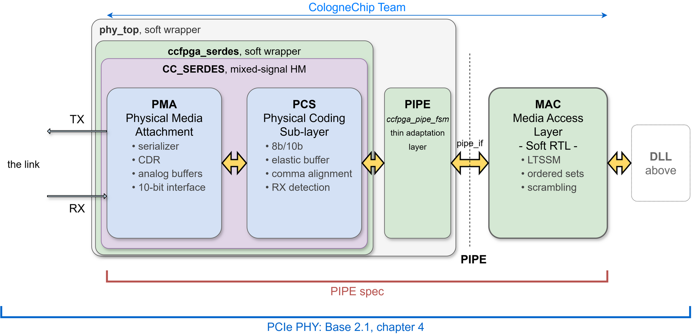
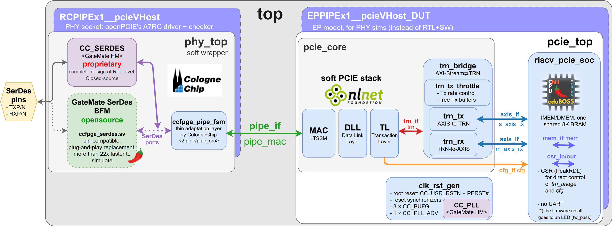
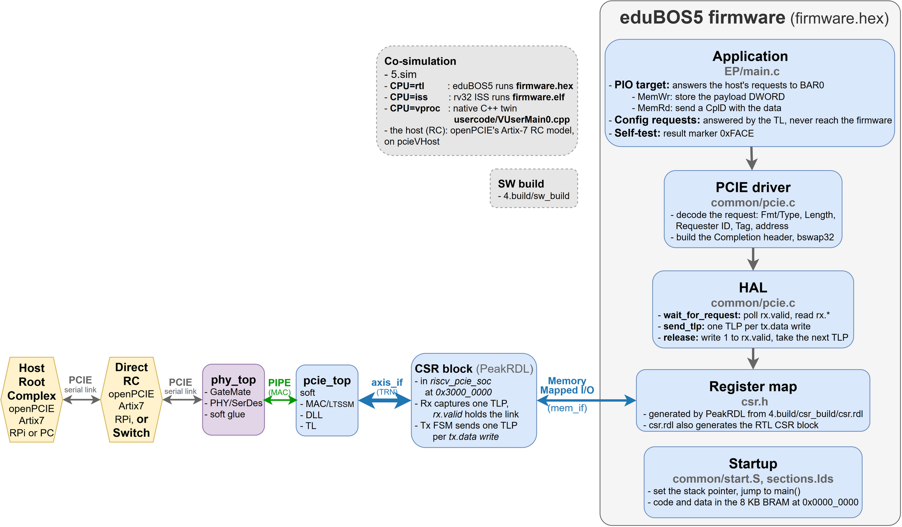
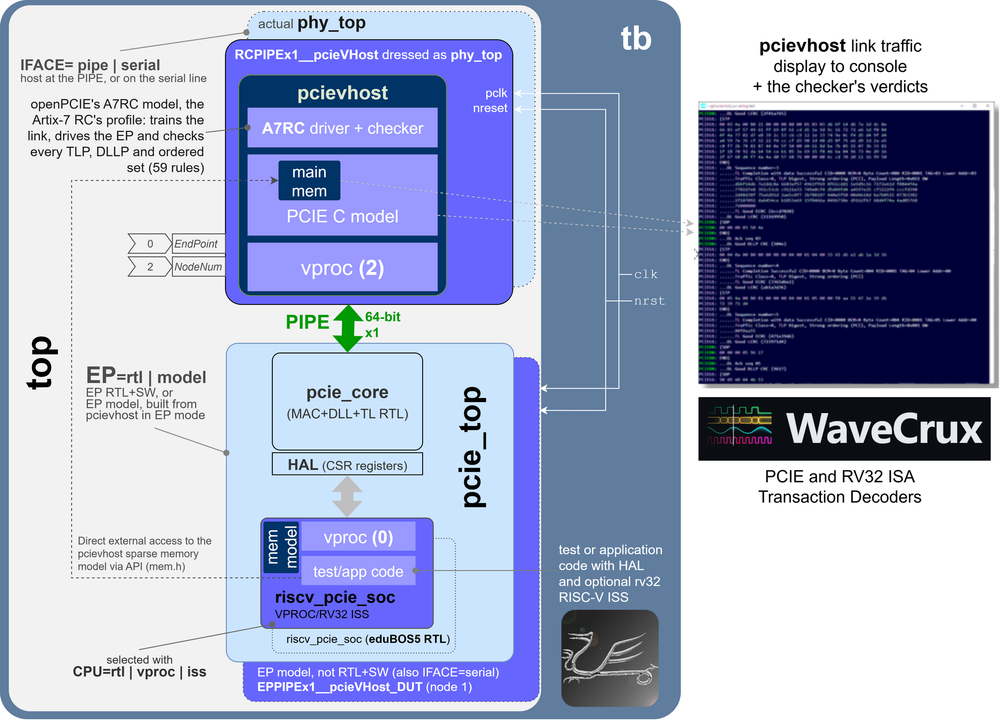
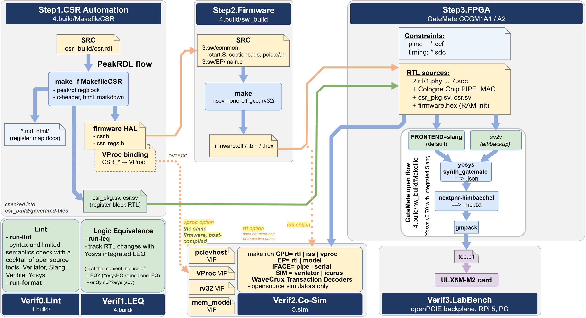

**openCologne-PCIE** is a **soft PCIE EndPoint core** for the Cologne Chip GateMate FPGA, built with the fully opensource [nextPNR-himbaechel](https://github.com/YosysHQ/prjpeppercorn) _"PrjPeppercorn"_ tools. It continues [openCologne](https://github.com/chili-chips/openCologne) and complements the [openPCIE](https://github.com/chili-chips/openpcie) RootComplex.

  

- **Clearly layered and portable:**
  - SerDes PHY is the only Hard Macro (HM)
    - project RTL stack can move to other FPGA families and [OpenROAD](https://github.com/The-OpenROAD-Project) ASICs
  - Transaction layer interface compatible with Artix7 PCIE_2_1 HM
  - **`This is the only soft PCIE protocol stack in opensource at the moment`**
    
- **End-to-End simulated:**
  - comes with unique opensource **Verification IP (VIP)**
  - three simulators: _Verilator, Icarus, JanusHDL_
  - best-in-class waveform viewers and protocol decoders: _WaveCrux_ suite
    
- **Hardware PCBs:**
  - two PCIE cards for GateMate: M.2 and "Slot"
  - capable of hosting (BOM variant) all three GateMate die packaging options (A1, A2, A4)
  - Plug-and-Play with 3rd-party carriers, including our opensource [PCIE Backplane](https://github.com/chili-chips/openPCIE/tree/main/1.pcb/openpci2-backplane).

- **LiteX integration:**
  - planned through [LitePCIE](https://github.com/enjoy-digital/litepcie), contributing to an end-to-end, community-maintained _openCompute_ PCIE ecosystem.

- **Fully lab-tested for interoperability with:**
  - AMD/Xilinx Artix7 Root Complex
    - with and without PCIE Gen2.1 Switch in the path (ASM1184e)
  - Linux PC, as a plug-in card into standard desktop motherboard
  - RaspberryPi
    
| Go to | For |
|---|---|
| [1.pcb](1.pcb/README.md) | EP card and test setup |
| [2.rtl](2.rtl/README.md) | RTL: PHY, PIPE, MAC, DLL, TL, TRN, SOC |
| [3.sw](3.sw/README.md) | EP firmware |
| [4.build](4.build/README.md) | Build flow |
| [5.sim](5.sim/README.md) | Test bench and VIP |
| [6.litex](6.litex/README.md) | LiteX integration |

  

### Design Blueprint: Minimal, yet functional PCIE EP core

PCIE is complex, and most real-life users need little of it. We build a barebones EP that still interoperates with real PCIE HW/SW systems.

| Area | Scope |
|---|---|
| Application | **PIO writes and reads** only. DMA and other applications can later be added on top of the core. |
| Speed | **`Gen1`**. Gen2 (5 Gbps) is future work: the GateMate SerDes has trouble running at 5 Gbps ([1.pcb](1.pcb/README.md)), and Gen2 needs the rate change in Recovery.Speed, as every link trains at Gen1 first. |
| Width | **`x1 (single-lane)`** only. Link width training is reduced to waking the link from its down state. |
| Functions | **`One Physical Function (PF0)`**. No _Virtual Functions_ (VF), _Traffic Classes_ (TC) or _Virtual Channels_ (VC). |
| Configuration Space | Bare minimum, mostly hard-coded. **BAR0** only, 32-bit, programmable from the Root Port. No 64-bit BARs. |
| Power states | Least extent possible, mainly for the SerDes, the largest consumer. See [PHY](2.rtl/1.phy/README.md). |

> The GateMate A1 die has one SerDes. A 2-lane link on the two-die A2 would need the protocol stack split across two dice, a major project of its own. The PCIE stack is expected to fill most of the A1, so the A2 and A4 serve as logic banks for the user app.

### References:

- **[PCIE Primer](http://www.anita-simulators.org.uk/wyvernsemi/articles/pci_express.pdf) by Simon Southwell**

--------------------

# HW Architecture

### EP card: Intergalaktik ULX5M-M2

  

The GateMate EP card is the [ULX5M-M2](1.pcb/README.md) by [Intergalaktik](https://intergalaktik.eu) and [Radiona](https://radiona.org), in M.2 form factor. Sources: [intergalaktik/ulx5m-m2](https://github.com/intergalaktik/ulx5m-m2).

### Test setup

  

The card plugs into the [openPCIE backplane](https://github.com/chili-chips/openPCIE/tree/main/1.pcb) ([more info](https://www.chili-chips.xyz/openpcie-backplane-put-your-fpga-in-control)), where the [openPCIE](https://github.com/chili-chips/openPCIE) Artix-7 is the RC. Two topologies:

1. **Direct:** our EP on the RC link.
2. **Behind Switch:** through the backplane's PCIE switch.

> Why test both: the EP takes its bus and device number from the Type 0 configuration writes it receives, and must return it in the Completer ID of every Completion. Direct, the bus number is often 1; behind the switch it is higher. A TL that hard-codes the bus number passes Direct and fails Behind Switch.

We then also test with a PC and a Raspberry Pi as the host. Details: [1.pcb/README.md](1.pcb/README.md).

--------------------

# PIPE is not a dream!

  

The GateMate SerDes has not been used for PCIE before, so expect PHY issues (signal integrity, jitter). Cologne Chip developers own the PHY and the **P**hysical **I**nterface for **P**CI **E**xpress (PIPE): **`2.rtl/1.phy`** and **`2.rtl/2.pipe`**.

> PIPE keeps the generic logic apart from FPGA-specific RTL. Not all our RTL is portable to other vendors, but a port only needs to revisit the thin layer behind PIPE.

--------------------

# RTL Architecture

Two major elements:
- **PCIE-capable SerDes:** Cologne Chip (CC) **proprietary** mixed-signal hard IP, wrapped in a thin soft adaptation layer (_phy_top_) with an industry-standard PIPE interface. An opensource SerDes BFM, [openSERDES_BFM](https://github.com/chili-chips/openSERDES_BFM), stands in for it in faster, public-domain simulations.
- **PCIE protocol stack:** soft RTL: MAC/LTSSM by Cologne Chip; DLL, TL, app, test, validation, system, infrastructure and process by Chili.CHIPS (MAC from Cologne Chip's [gatemate-pipe](https://github.com/colognechip/gatemate-pipe)), topped by an eduBOS5-based RISC-V SOC as the application layer.

> **TRN-compatible:** the TL's user interface, `trn_tx_if` / `trn_rx_if`, is derived from the TRN interface of the AMD Artix-7 `PCIE_2_1` hard macro in EndPoint mode, cut to the signals this core uses. `trn_compat` maps it back to TRN for user logic written for that HM, and lists what is not supported ([details](2.rtl/README.md#compatibility-goal-an-artix-7-endpoint-in-open-source)).

  

Details: [2.rtl/README.md](2.rtl/README.md)

--------------------

# SW Architecture

 

The EP firmware runs bare-metal on the eduBOS5 RISC-V core of our GateMate SOC. It answers the host's Memory requests (PIO); the soft TL answers the configuration requests. Hosts: see [Bringup](#bringup-debug-and-lab-validation); the openPCIE Artix-7 RC firmware enumerates our EP and runs the PIO write-read-validate test.

## HAL

The control and status register (CSR) HAL is [auto-generated](5.sim/README.md#hal) with [`peakrdl`](https://peakrdl-cheader.readthedocs.io/en/latest/), as is the CSR RTL, from one SystemRDL file, [`4.build/csr_build/csr.rdl`](4.build/csr_build/csr.rdl). The firmware reaches every register through one accessor, `CSR_REG32()`: a load or store on eduBOS5, a *VProc* bus cycle when the same firmware is compiled for the host in co-simulation.

Details: [3.sw/README.md](3.sw/README.md)

--------------------

# Simulation Architecture

    

The [test bench](5.sim/README.md) uses open-source simulators only: Verilator or Icarus Verilog. The host is openPCIE's A7RC driver + checker (59 PCIe 2.1 rules) on [openPCIE_BFM](https://github.com/chili-chips/openPCIE_BFM), our model on Simon Southwell's [_pcieVHost VIP_](https://github.com/wyvernSemi/pcievhost), in the RC role, `RCPIPEx1__pcieVHost`: it drives our DUT at its PIPE interface, trains the link and enumerates the EP. The same model already ran against the AMD `PCIE_2_1` hard macro on openPCIE, which raises the odds that our EP works first time against a physical Artix-7 RC.

### Coverage plan: every layer, against a known-good partner

Either half of the design can be swapped for pcieVHost:

1. **`phy_top` → `RCPIPEx1__pcieVHost`** (pcieVHost as the RC): our MAC, DLL, TL and firmware get a full link partner at PIPE. This is the top-level run.
2. **`pcie_top` → `EPPIPEx1__pcieVHost_DUT`** (pcieVHost as the EP, `EP=model`): the test bench and host program run before our EP RTL exists. This is today's default.
3. **`phy_top` alone**, in its own [block-level test benches](2.rtl/README.md#simulation-layer-by-layer) ([scope](5.sim/README.md#scope-unit-debug-then-top-level-validation)), on our opensource SerDes BFM.

Waveforms decode as transactions in the [WaveCrux PCIE decoders](https://github.com/Ferrite-Engineering/wavecrux-decoders/tree/main/decoders/pcie) and the [RV32 ISA decoder](https://github.com/Ferrite-Engineering/wavecrux/tree/main/assets/decoders/isa/riscv):

| View | Where |
|---|---|
| PIPE and DLL, block level | [DLL in WaveCrux](2.rtl/4.dll/README.md#viewing-the-dll-in-wavecrux) |
| Cologne Chip's MAC + DLL bench with pcieVHost (in gatemate-pipe) | [pictures](2.rtl/4.dll/README.md#simulation-with-pcievhost) |
| Top level, every layer from PIPE to firmware | [EP in WaveCrux](5.sim/README.md#viewing-the-ep-in-wavecrux), [TL in WaveCrux](2.rtl/5.tlp/README.md#viewing-the-tl-in-wavecrux) |

* A [_VProc_](https://github.com/wyvernSemi/vproc) virtual processor based [`soc_cpu.VPROC`](5.sim/models/README.md#soc_cpuvproc) component, in place of the RTL CPU, runs:
  * natively compiled test code;
  * the firmware itself, compiled natively through the same [HAL](5.sim/README.md#hal);
  * RISC-V code on the [rv32 RISC-V ISS model](5.sim/models/rv32/README.md).
* A C [sparse memory model](https://github.com/wyvernSemi/mem_model), shared by logic and _VProc_ code ([notes](5.sim/models/cosim/README.md)).

Both simulation models are submodules: clone with `git clone --recurse-submodules`, or run `git submodule update --init` in a clone.

Details: [5.sim/README.md](5.sim/README.md)

  

One run in [WaveCrux](https://wavecrux.app), every layer from the PIPE to the firmware: link training, enumeration, PIO, firmware PASS. The [walkthrough](5.sim/README.md#viewing-the-ep-in-wavecrux) zooms in, layer by layer.

--------------------

# Implementation Workflow

 

See [4.build/README.md](4.build/README.md)

--------------------

# Bringup, Debug and Lab Validation

1) **openPCIE backplane:** the ULX5M-M2 card in an M.2 slot, the openPCIE Artix-7 as the RC: link up, enumeration, PIO write-read-validate, (a) Direct and (b) Behind Switch
2) **PC:** enumeration and PIO from a Linux PC as the host
3) **Raspberry Pi:** the same with a Raspberry Pi as the host

#### References:
- [PCIE Utils](https://mj.ucw.cz/sw/pciutils)
- [Debug PCIE issues using 'lspci' and 'setpci'](https://adaptivesupport.amd.com/s/article/1148199?language=en_US)
- [fpgas.online: PCIE enumeration test](https://github.com/fpgas-online/fpgas.online-test-designs/blob/main/docs/tests/pcie-enumeration.md)

#### PCIE Protocol Analyzers:
- [PCIE Sniffing](https://ctf.re/pcie/experiment/linux/keysight/protocol-analyzer/2024/03/26/pcie-experiment-1)
- [Stark 75T Card](https://www.ebay.com/itm/396313189094?var=664969332633)
- [ngscopeclient](http://www.ngscopeclient.org/protocol-analysis)
- [PCI Leech](https://github.com/ufrisk/pcileech)
- [PCI Leech/ZDMA](https://github.com/ufrisk/pcileech-fpga/tree/master/ZDMA)
- [LiteX PCIE Screamer](https://github.com/enjoy-digital/pcie_screamer)
- [LiteX PCIE Analyzer](https://github.com/enjoy-digital/pcie_analyzer)
- [Wireshark PCIe Dissector](https://github.com/antmicro/wireshark-pcie-dissector)
- [PCIe Tool Hunt](https://scolton.blogspot.com/2023/05/pcie-deep-dive-part-1-tool-hunt.html)
- [An interesting PCIE tidbit: Peer-to-Peer communication](https://github.com/Xilinx/XRT/blob/master/src/runtime_src/doc/toc/p2p.rst). Also see [this](https://xillybus.com/tutorials/pci-express-tlp-pcie-primer-tutorial-guide-1)
- [NetTLP - An invasive method for intercepting PCIE TLPs](https://haeena.dev/nettlp)

--------------------

# LiteX integration

  

See [6.litex/README.md](6.litex/README.md)

--------------------

# Project Status

- ✅ Procure Test equipment, test fixtures, dev boards and accessories

- ✅ Create docs and diagrams that are easy to follow and comprehend
>- ✅ PIPE
>- ✅ RTL DLL and TL
>- ✅ SW
>- ✅ TB, Sim, VIP

- 🟠 Design, debug and manufacture two flavors of EP cards
> Given the high-speed nature of our design, we plan for two iterations:
>- ✅ M.2  **RevA**
>- 🟠 "Slot" RevA

>- 🟠 M.2  **RevB**
>- ⬜ "Slot" RevB

- 🟠 Develop opensource PHY with PIPE interface for GateMate SerDes
>- ✅ x1, **Gen1**
>- ⬜ x1, Gen2: future work, the SerDes has trouble running at 5 Gbps

- 🟠 Develop opensource RTL for PCIE EP **DLL function**, with PIPE interface
- 🟠 Develop opensource RTL for PCIE EP **TL function**

- 🟠 Create comprehensive co-sim testbench

- ⬜ Develop opensource PCIE EP Demo/Example for PIO access
> - ⬜ Software driver and TestApp
> - ⬜ Debug and bringup

- 🟠 Implement it all in GateMate, pushing through PNR and timing closure
> - 🟠 Work with nextpnr/ProjectPeppercorn developers to identify and resolve issues

- ⬜ Port to LiteX

- ⬜ Present project challenges and achievements at (minimum) two trade fairs or conferences (see [Community Outreach](#community-outreach))

--------------------

### Acknowledgements

We are thankful to **NLnet Foundation** for unreserved sponsorship of this development activity.

   
   

This project was funded through the NGI0 Commons Fund, a fund established by NLnet with financial support from the European Commission's Next Generation Internet programme, under the aegis of DG Communications Networks, Content and Technology under grant agreement No 101135429. Additional funding is made available by the Swiss State Secretariat for Education, Research and Innovation (SERI).

### Partners and Contributors

  
  

  
  

**wyvernSemi**'s wisdom and contribution meant a world of difference -- Thank you, we are honored to have had you on the project!

  

  
  

**KiCad** turns electrical idea into a manufacturable board. **PrjPeppercorn**, with **Yosys** at its core, turns RTL into a loadable FPGA bitfile. **PeakRDL** turns our SystemRDL file into CSR RTL+headers+RegMap docs. **WaveCrux** greatly facilitates waveform decoding and viewing. But, that's not all -- Thank you all for these wonderful opensource tools.

   
   
   

  
  
  
  
  
  

  
  
  
  
  
  
  
  
  
  

--------------------

### Community Outreach

A project the community does not know about is not finished work. We spread the word through posts, presentations and conferences.

Our posts so far:
- [2026-11-04, LinkedIn (JanusHDL)](https://lnkd.in/p/geXDYbsq)
- [2026-10-20, LinkedIn (Ferrite)](https://lnkd.in/p/g-yGBEU8)
- [2026-10-17, LinkedIn (WaveCrux)](https://www.linkedin.com/posts/chili-chips_having-too-much-fun-cracking-ones-and-zeros-activity-7517129808020074496-Rmev?utm_source=share&utm_medium=member_desktop&rcm=ACoAAAJv-TcBSi_5ff0VNMrInrT-xg44YF3jnyU)
- [2026-09-17, LinkedIn (Tiny Tapeout)](https://www.linkedin.com/feed/update/urn:li:activity:7505843991876370432?commentUrn=urn%3Ali%3Acomment%3A%28activity%3A7505843991876370432%2C7505869378253578240%29&replyUrn=urn%3Ali%3Acomment%3A%28activity%3A7505843991876370432%2C7505896426162274304%29&dashCommentUrn=urn%3Ali%3Afsd_comment%3A%287505869378253578240%2Curn%3Ali%3Aactivity%3A7505843991876370432%29&dashReplyUrn=urn%3Ali%3Afsd_comment%3A%287505896426162274304%2Curn%3Ali%3Aactivity%3A7505843991876370432%29)
- [2026-06-23, LinkedIn (FPGA vendors)](https://www.linkedin.com/posts/andrew-e-wilson_its-fun-bringing-all-the-fpga-vendors-together-share-7475267075234607104-j50-)
- [2026-06-12, LinkedIn (FDF26)](https://www.linkedin.com/feed/update/urn:li:activity:7471157152074694656?commentUrn=urn%3Ali%3Acomment%3A%28activity%3A7471157152074694656%2C7471308573994557441%29&dashCommentUrn=urn%3Ali%3Afsd_comment%3A%287471308573994557441%2Curn%3Ali%3Aactivity%3A7471157152074694656%29)
- [2025-11-20, LinkedIn (Namaste FPGA)](https://www.linkedin.com/feed/update/urn:li:activity:7394569666557366272?commentUrn=urn%3Ali%3Acomment%3A%28activity%3A7394569666557366272%2C7397466385519448064%29&dashCommentUrn=urn%3Ali%3Afsd_comment%3A%287397466385519448064%2Curn%3Ali%3Aactivity%3A7394569666557366272%29)
- [2025-10-02, LinkedIn (announcement)](https://www.linkedin.com/feed/update/urn:li:activity:7379769413421559808)
- [2025-08-25, LinkedIn (pcievhost)](https://www.linkedin.com/feed/update/urn:li:ugcPost:7362742908170473473?commentUrn=urn%3Ali%3Acomment%3A%28ugcPost%3A7362742908170473473%2C7363111076936232962%29&dashCommentUrn=urn%3Ali%3Afsd_comment%3A%287363111076936232962%2Curn%3Ali%3AugcPost%3A7362742908170473473%29)

**Issues filed upstream.** JanusHDL has no public tracker (it is closed source, so it can read encrypted IP), so its issues are here, under the [`JanusHDL` label](https://github.com/issues?q=org%3Achili-chips+label%3AJanusHDL):

| Tool / project | Issue | What | State |
|---|---|---|---|
| prjpeppercorn-test-cases | [#12](https://github.com/YosysHQ/prjpeppercorn-test-cases/issues/12) | offer: this design as a test case for their regression and QA runs | open |
| JanusHDL | [#1](https://github.com/chili-chips/openCologne-PCIE/issues/1) | 0.17.0: what simulates and what does not | open |
| JanusHDL | [#2](https://github.com/chili-chips/openCologne-PCIE/issues/2) | performance against Verilator and Icarus | open |

Planned fairs and conferences:

| Venue | Cologne Chip presence |
|---|---|
| **[Electronica 2026, Munich](https://electronica.de/en)** | Booth very likely; conference track |
| **[Embedded World 2027, Nuremberg](https://www.embedded-world.de/en)** | Booth; conference track |
| **[FPGA Developer Forum 2027, CERN, Geneva](https://indico.cern.ch/category/17799)** | Sponsor; maybe a few presentation slots |
| **[FPGA Conference 2027, Munich](https://www.fpga-conference.eu)** | Sponsor; at least 2 presentation slots |

More venues welcome: please send your ideas!

--------------------

### Community Involvement

Want to help the opensource PCIE community grow? See [Contributions](CONTRIBUTING.md).

Need help? Ask ===> .

--------------------

### Future outlook

Next, in this order: burst PIO, then DMA Requester capability. Gen2 comes later, once the SerDes runs at 5 Gbps ([Future Development](2.rtl/README.md#future-development)).

Beyond that and ports to other FPGA families + ASICs, we are considering:

- hardware acceleration for AI, video, and general DSP compute workloads
- bolting our PCIE EP to [ztachip](https://github.com/ztachip/ztachip), to accelerate PC host Python
> This borrows from Xilinx PYNQ and Alveo, where programmable [DPUs](https://www.amd.com/en/products/adaptive-socs-and-fpgas/intellectual-property/dpu.html) map algorithms into acceleration hardware without RTL design and validation. The result would be the first opensource "DPU" co-processor, working hand-in-hand with our two new cards. After all, NiteFury and SQRL Acorn CLE 215+ M.2 cards were made for acceleration of crypto mining
- possibly also the SerDes HM building brick. Two opensource SerDes are in the works, in two process technologies, and more are likely to follow:
  - **180 nm CMOS**, GlobalFoundries [GF180MCU](https://github.com/google/gf180mcu-pdk). [wafer.space](https://wafer.space), who run shuttles on it, track that work and expect it in 6 to 9 months (as of October 2026);
  - **130 nm SiGe BiCMOS**, the EU-based [IHP](https://www.ihp-microelectronics.com) [SG13G2](https://github.com/IHP-GmbH/IHP-Open-PDK): [BRICD](https://www.thebricd.org)'s Open-SERDES, with an open channel-to-GDS flow.

--------------------

### GenAI

Our repo may contain elements of work facilitated by the modern GenAI tools , used under strict guidance and tight supervision of the blood-and-flesh developers, solely for reviews, as a second pair of eyes for QA and suggestions. That is read-only use, in line with [NLnet's GenAI policy v2.0](https://nlnet.nl/foundation/policies/generativeAI/2.0/). Work before October 20, 2026 followed the then-valid [v1.1](https://nlnet.nl/foundation/policies/generativeAI/1.1/). Rules for contributors: [GenAI](CONTRIBUTING.md#genai).

In the end, it is us, the human devs, who are fully responsible for any shortfalls you may uncover while tapping into repo resources.

--------------------
#### End of Document
